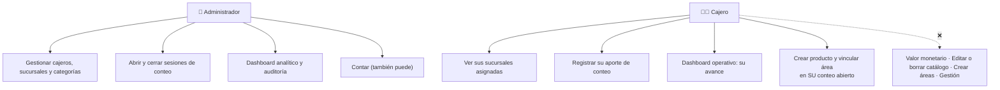

# 01 · Requisitos y alcance

[← Índice](README.md) · [Siguiente: Estimaciones →](02-estimaciones-y-restricciones.md)

---

## 1. Problema

En negocios con varias sucursales, el conteo de inventario producto por producto es
lento y propenso a errores. La observación de negocio es que **el precio de venta ya
agrupa el inventario de forma suficientemente útil**: al dueño le importa cuántas
unidades hay de cada valor y cuánto dinero representan, no el SKU exacto.

El sistema reemplaza el conteo por producto por un **conteo por categoría de valor**,
bajo un único flujo de trabajo para cualquier valor (`$1.000` y `$150.000` se cuentan
igual).

---

## 2. Actores

El sistema tiene exactamente **dos roles**.

> **El cajero toca el catálogo, pero sólo hacia adelante.** Puede crear una categoría y
> vincularle un área existente mientras cuenta, porque es quien tiene el producto en la
> mano; no puede editar, desactivar ni borrar nada, ni crear áreas, ni fijar precios
> ([ADR-21](13-decisiones-adr.md#adr-21)).

> **Nota de terminología.** En la v1 este rol se llamaba "trabajador". En la v2 se
> unifica bajo **cajero**, que es quien realiza el conteo. No existe un tercer rol.

### Matriz de permisos

| Capacidad                                                     | Cajero | Administrador |
| ------------------------------------------------------------- | :----: | :-----------: |
| Iniciar sesión                                                |   ✅   |      ✅       |
| Ver sucursales asignadas                                      |   ✅   |  ✅ (todas)   |
| Registrar aporte de conteo                                    |   ✅   |      ✅       |
| Ver total de unidades del equipo                              |   ✅   |      ✅       |
| **Dashboard operativo** (avance, pendientes, sincronización)  |   ✅   |      ✅       |
| **Ver valor monetario del inventario**                        |   ❌   |      ✅       |
| **Dashboard analítico** (subtotales, participación, gráficas) |   ❌   |      ✅       |
| Comparativo entre sucursales                                  |   ❌   |      ✅       |
| Abrir / cerrar sesión de conteo                               |   ❌   |      ✅       |
| Gestionar cajeros y sucursales                                |   ❌   |      ✅       |
| **Crear una categoría/producto durante su conteo abierto**    |   ✅   |      ✅       |
| **Vincular un área existente a una categoría _sin área_, durante su conteo** |   ✅   |      ✅       |
| Editar, desactivar o borrar categorías                        |   ❌   |      ✅       |
| Crear o gestionar áreas                                       |   ❌   |      ✅       |
| Fijar el precio (`valor`) de una categoría                    |   ❌   |      ✅       |
| Ver auditoría (acotada a sus sucursales asignadas, #45)       |   ✅   |  ✅ (todas)   |
| Editar o borrar auditoría                                     |   ❌   |  ❌ (nadie)   |

> **Por qué el cajero no ve dinero.** En muchos negocios el valor total del inventario
> es información sensible que no corresponde al personal de mostrador. El cajero ve
> **unidades**, que es lo que necesita para contar; el administrador ve **dinero**, que
> es lo que necesita para decidir. La separación se aplica en las Security Rules, no
> sólo en la interfaz ([09](09-seguridad-y-auditoria.md)).

---

## 3. Requisitos funcionales

### 3.1 Obligatorios (v1 del producto)

| ID    | Requisito                                                                                                  |
| ----- | ---------------------------------------------------------------------------------------------------------- |
| RF-01 | Un cajero inicia sesión con correo y contraseña                                                            |
| RF-02 | El administrador crea, edita y desactiva cajeros                                                           |
| RF-03 | El administrador gestiona sucursales                                                                       |
| RF-04 | El administrador gestiona el catálogo de categorías de valor                                               |
| RF-05 | Se abre una **sesión de conteo** por sucursal; sólo una abierta a la vez                                   |
| RF-06 | Un cajero registra la cantidad contada para cualquier categoría de valor                                   |
| RF-07 | El sistema calcula subtotal por categoría y total general                                                  |
| RF-08 | Los cambios se reflejan en los demás dispositivos de la misma sesión                                       |
| RF-09 | **Ningún conteo se pierde** cuando dos cajeros registran la misma categoría                                |
| RF-10 | La app funciona **sin conexión** y sincroniza al recuperar señal                                           |
| RF-11 | Toda modificación queda en un historial de auditoría **inmutable durante 12 meses en caliente**¹           |
| RF-12 | El administrador cierra la sesión, congelando el resultado                                                 |
| RF-13 | Dashboard analítico para el administrador, con comparativo entre sucursales                                |
| RF-14 | Dashboard operativo para el cajero, sin información monetaria                                              |
| RF-15 | El sistema funciona como **aplicación web (PWA)**, instalable en escritorio y en cualquier navegador móvil |
| RF-16 | **El cierre de sesión verifica que todos los participantes hayan sincronizado**                            |

> **RF-16 es nuevo en la v2** y no es un detalle: es la salvaguarda que compensa la
> menor durabilidad del almacenamiento local en la PWA. Ver [06](06-plataforma-web.md).

> ¹ **"Inmutable" significa que ningún actor humano puede editarlo ni borrarlo mientras
> existe** (`infra/firestore.rules`, `allow write: if false` sin excepción por rol),
> no que se conserve para siempre. Un cron mensual purga eventos de más de 12 meses
> (decisión de costo, ver [02 §7](02-estimaciones-y-restricciones.md)) — piso de
> negocio: mínimo 6 meses de historial garantizado una vez en producción, con margen
> de 2×. Ver [66](https://github.com/jab16jy/inventory-tally/issues/66).

### 3.2 Deseables (fuera del alcance actual)

- Exportación a Excel/PDF del conteo cerrado.
- Comparativo contra el inventario teórico del POS del negocio.
- Escaneo de código de barras para asistir la selección de categoría.
- Apps nativas (Android/iOS) vía tiendas de aplicaciones (sólo si la PWA resulta insuficiente en la práctica).

### 3.3 Fuera de alcance (explícito)

- Gestión de productos individuales o SKUs.
- Facturación, ventas o movimientos de inventario.
- Multi-empresa con aislamiento por organización. El sistema asume **una empresa con N sucursales**.

---

## 4. Requisitos no funcionales

| ID     | Requisito                     | Objetivo medible                                                      |
| ------ | ----------------------------- | --------------------------------------------------------------------- |
| RNF-01 | Latencia de sincronización    | Cambio visible en otro dispositivo en < 3 s con red estable           |
| RNF-02 | Disponibilidad offline        | 100 % de las operaciones de conteo funcionan sin red                  |
| RNF-03 | Integridad del conteo         | 0 % de pérdida de aportes bajo escritura concurrente                  |
| RNF-04 | Trazabilidad                  | 100 % de las modificaciones generan evento no editable, retenido 12 meses¹ |
| RNF-05 | Rendimiento de UI             | ≥ 55 fps con hasta 200 categorías                                     |
| RNF-06 | Costo operativo               | Dentro del plan gratuito de Firebase para el volumen estimado         |
| RNF-07 | Arranque                      | < 5 s en 4G tras la primera carga · < 3 s con service worker caliente |
| RNF-08 | Seguridad                     | Un cajero no accede a sucursales no asignadas ni a datos monetarios   |
| RNF-09 | Mantenibilidad                | Lógica de negocio testeable sin Firebase                              |
| RNF-10 | **Consumo de datos**          | < 1,5 MB por sesión de conteo tras la carga inicial                   |
| RNF-11 | **Latencia tras inactividad** | La app debe funcionar correctamente tras 30 días sin abrirse          |
| RNF-12 | **Durabilidad de aportes**    | Ningún aporte registrado puede perderse entre sesiones de conteo      |

> **RNF-10 a RNF-12 son nuevos en la v2.** Responden a las tres condiciones reales del
> despliegue: datos móviles en algunas sucursales, ciclo de conteo quincenal o mensual,
> y almacenamiento local menos duradero en la PWA.

---

## 5. Supuestos de diseño

1. Un cajero cuenta **una sucursal a la vez**; puede tener varias asignadas.
2. Una sucursal tiene **como máximo una sesión abierta**. Invariante garantizada por el backend.
3. Las categorías de valor son **globales al negocio**, para permitir comparar sucursales.
4. El conteo es **acumulativo por cajero**: cada uno declara cuánto contó _él_, no el total del anaquel.
5. La corrección de un error se hace **editando el propio aporte**, nunca el de otro.
6. **El conteo es quincenal o mensual.** Cada sesión es un evento de alto valor: si se
   pierde, no se repite al día siguiente. Esto eleva el costo de cualquier fallo de
   sincronización y justifica RF-16.
7. **Existe conectividad al inicio de la sesión** (el cajero llega, inicia sesión y
   carga el catálogo). La falta de señal se asume _durante_ el recorrido, no al empezar.

---

## 6. Criterios de aceptación de la fase

- [x] Modelo de datos concreto con colecciones e índices.
- [x] Estrategia de concurrencia y offline resuelta y documentada.
- [x] **Garantías de la PWA declaradas explícitamente (offline, instalación, límites).**
- [x] Contratos de Cloud Functions definidos con su esquema.
- [x] Security Rules escritas para cada colección, incluyendo separación por rol.
- [x] Estrategia de agregación y dos dashboards diferenciados.
- [x] **Estructura de monorepo definida con su pipeline.**
- [x] Cada decisión relevante con su ADR y alternativas evaluadas.

---

[← Índice](README.md) · [Siguiente: Estimaciones →](02-estimaciones-y-restricciones.md)
