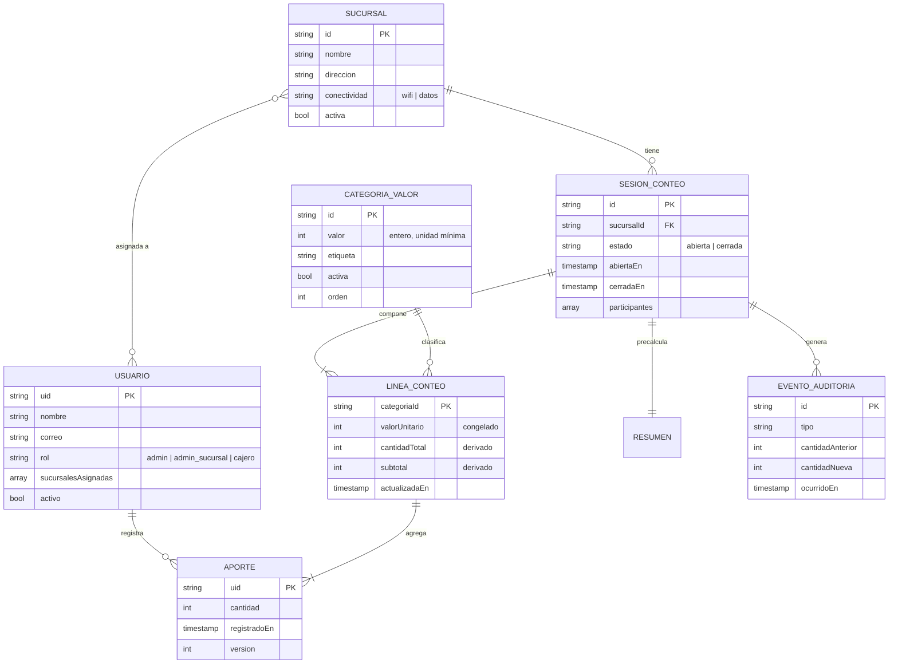
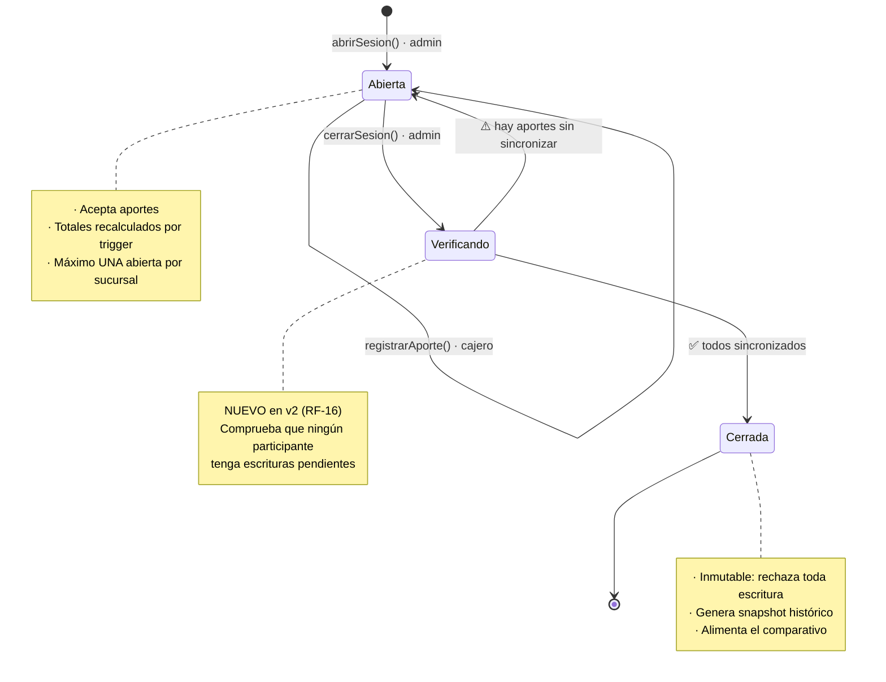

# 03 · Modelo de dominio

[← Estimaciones](02-estimaciones-y-restricciones.md) · [Índice](README.md) · [Siguiente: Modelo de datos →](04-modelo-de-datos-firestore.md)

---

## 1. El conteo es un evento, no un estado

La fase de exploración modelaba el inventario como estado mutable permanente. Eso hacía
imposible responder _"¿cómo veníamos el mes pasado?"_, dejaba la auditoría sin contexto
y nunca producía un dato definitivo.

En el diseño el conteo es un **evento con inicio y cierre**: la `SesionDeConteo`. El
inventario deja de ser un número flotante y pasa a ser el resultado congelado de una
sesión cerrada.

> Con conteo **quincenal o mensual**, esta decisión es todavía más importante que en la
> v1: cada sesión es el único registro de inventario de ese período. No hay un conteo de
> mañana que corrija el de hoy.

---

## 2. Entidades



Un campo nuevo en la v2:

- `SUCURSAL.conectividad` — permite que la UI avise al cajero que precargue el catálogo
  con WiFi antes de entrar a una sucursal que sólo tiene datos móviles.

---

## 3. Glosario

| Término                 | Definición                                                                                         |
| ----------------------- | -------------------------------------------------------------------------------------------------- |
| **Cajero**              | Persona que realiza el conteo. Único rol operativo del sistema                                     |
| **Categoría de valor**  | Un precio de venta definido por el negocio. Unidad de clasificación, global a todas las sucursales |
| **Área**                | Agrupación de categorías gestionada por el administrador. El cajero nunca la crea             |
| **Sesión de conteo**    | Ejercicio de inventario completo sobre una sucursal, con apertura y cierre. Unidad de trabajo      |
| **Línea de conteo**     | Intersección (sesión × categoría). Contiene el total agregado. Dato **derivado**                   |
| **Aporte**              | Lo que **un** cajero declara haber contado. **Único dato que el cliente escribe**                  |
| **Resumen**             | Documento precalculado con las métricas de la sesión                                               |
| **Evento de auditoría** | Registro inmutable de un cambio, escrito exclusivamente por el backend                             |

---

## 4. La regla que sostiene todo el sistema

> **El cliente escribe aportes. El backend deriva totales.**

```
cantidadTotal(sesión, categoría) = Σ cantidad(aporte) ∀ cajero
subtotal(sesión, categoría)      = cantidadTotal × valorUnitario
```

| Propiedad                        | Por qué se obtiene                                                       |
| -------------------------------- | ------------------------------------------------------------------------ |
| **Sin pérdida por concurrencia** | Dos cajeros escriben documentos distintos; no hay colisión               |
| **Offline seguro**               | El aporte propio se escribe local; el orden de llegada no altera la suma |
| **Auditoría natural**            | Cada aporte ya tiene autor                                               |
| **Corrección sin conflicto**     | Un cajero corrige _su_ aporte sin pisar el de nadie                      |
| **Resistente a manipulación**    | El total no es escribible desde el cliente                               |
| **Reconstruible**                | Los totales siempre pueden recalcularse desde los aportes                |

### Contraste con el diseño de exploración

| Escenario                                      | Diseño de exploración                          | Diseño actual               |
| ---------------------------------------------- | ---------------------------------------------- | --------------------------- |
| Ana cuenta 30, Luis cuenta 25, misma categoría | Total = 25 o 30 → **se pierden unidades**      | Total = 55 ✅               |
| Ana trabaja offline 20 min y luego sincroniza  | Su escritura pisa todo lo hecho mientras tanto | Su aporte se suma ✅        |
| Ana quería poner 3, no 30                      | Edita el total y borra el trabajo de Luis      | Edita su aporte: 55 → 28 ✅ |

---

## 5. Ciclo de vida de una sesión de conteo



### El estado `Verificando` y por qué existe

Con conteo mensual y todo el personal usando la PWA, el peor escenario no es la
concurrencia: es que un cajero termine de contar con aportes en cola, cierre el
navegador y no lo vuelva a abrir en treinta días. Esos aportes viven en el
almacenamiento local del navegador, que **no está garantizado a esa escala de tiempo**
([06](06-plataforma-web.md)).

El paso de verificación convierte ese riesgo silencioso en una alerta explícita antes
de que el conteo se dé por terminado.

### Reapertura

No se permite. Si aparece un error tras el cierre, se abre una **sesión de corrección**
con referencia a la anterior (`sesionCorregidaId`). Una sesión cerrada es evidencia
contable; mutarla destruye el valor de la auditoría.

---

## 6. Invariantes del sistema

| #    | Invariante                                               | Garantizada por                                    |
| ---- | -------------------------------------------------------- | -------------------------------------------------- |
| I-1  | Una sucursal tiene como máximo una sesión `abierta`      | Function `abrirSesion` (transacción)               |
| I-2  | `cantidadTotal` es exactamente la suma de sus aportes    | Trigger `onAporteEscrito` (transacción)            |
| I-3  | Ningún aporte puede ser negativo                         | Validación en cliente + Security Rules             |
| I-4  | No se escriben aportes en sesiones `cerradas`            | Security Rules                                     |
| I-5  | La auditoría no puede editarse ni borrarse por nadie     | Security Rules (`write: if false`)                 |
| I-6  | Un cajero sólo accede a sus sucursales asignadas         | Security Rules + custom claims                     |
| I-7  | `valorUnitario` se congela al crearse la línea; el área deja de ser un campo de la línea cuando la unidad que introduce `porArea` reemplaza su desglose por aporte | Trigger de siembra + `onAporteEscrito` ([ADR-23](13-decisiones-adr.md#adr-23)) |
| I-8  | Un usuario desactivado no puede autenticarse ni escribir | Function + `revokeRefreshTokens`                   |
| I-9  | **Un cajero nunca lee valores monetarios**               | Security Rules sobre `resumen` y campos derivados  |
| I-10 | **Una sesión no se cierra con aportes sin sincronizar**  | Function `cerrarSesion` + confirmación del cliente |

> **I-7 en detalle:** si el negocio sube un precio de $5.000 a $5.500, los conteos
> históricos deben conservar el valor vigente al momento del conteo. Por eso la línea
> guarda una copia del valor, no una referencia viva al catálogo.
>
> El área **sigue este modelo** ([ADR-23](13-decisiones-adr.md#adr-23), que
> supersede a ADR-21 y ADR-22): ya no es un dato congelado al sembrar ni un campo que
> se corrige después, sino una división de trabajo. La línea
> (`sesiones/{sesionId}/lineas/{categoriaId}`, que sigue siendo una fila por categoría)
> tiene `porArea: Readonly<Record<areaId, number>>`, el desglose de `cantidadTotal` construido a
> partir del `areaId` que cada `Aporte` trae consigo (con clave compuesta `{uid}__{areaId}`).
> Se retiraron el campo `area`, el sentinel `"Sin área"` y la callable de reetiquetado:
> corregir una clasificación errónea es aportar desde otra área, no reescribir la línea.
>
> **El cajero sigue sin crear áreas al vuelo** — una entrada creada a mitad de conteo sólo
> aplicaría a la próxima sesión, y ésa es la parte del razonamiento original que se
> mantiene intacta. Tampoco edita ni borra categorías: eso sigue siendo del admin.

---

## 7. Reglas de negocio del cálculo

- Valores monetarios como **enteros en la unidad mínima**. Nunca `double`: los flotantes
  introducen errores de redondeo inaceptables en dinero.
- `subtotal = cantidadTotal × valorUnitario`, ambos enteros → resultado exacto.
- Los porcentajes se calculan **al presentar**, nunca se almacenan, para evitar
  inconsistencias por redondeo acumulado.
- El cajero opera exclusivamente sobre **unidades**; el cálculo monetario ocurre en la
  capa a la que sólo accede el administrador.

---

[← Estimaciones](02-estimaciones-y-restricciones.md) · [Índice](README.md) · [Siguiente: Modelo de datos →](04-modelo-de-datos-firestore.md)
