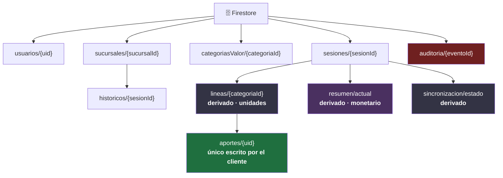

# 04 · Modelo de datos en Firestore

[← Modelo de dominio](03-modelo-de-dominio.md) · [Índice](README.md) · [Siguiente: Concurrencia y offline →](05-concurrencia-offline-tiempo-real.md)

---

## 1. Mapa de colecciones

```
usuarios/{uid}
sucursales/{sucursalId}
categoriasValor/{categoriaId}

sesiones/{sesionId}
    lineas/{categoriaId}              ← unidades (visible al cajero)
        aportes/{uid}
    resumen/actual                    ← monetario (sólo admin)
    sincronizacion/estado             ← control de cierre (RF-16)

sucursales/{sucursalId}/historicos/{sesionId}
auditoria/{eventoId}
```



**Leyenda:** verde = escrito por el cliente · gris = derivado, legible por ambos roles ·
morado = derivado, **sólo administrador** · rojo = sólo backend, lectura de admin.

---

## 2. La separación por rol es estructural, no cosmética

El requisito "el cajero no ve dinero" (I-9) se resuelve **en la forma de los datos**, no
filtrando campos en la interfaz. Firestore autoriza por documento, no por campo: si el
`subtotal` viviera en un documento que el cajero puede leer, podría leerlo con el SDK
aunque la app no lo muestre.

| Dato                                 | Documento               | Quién puede leerlo |
| ------------------------------------ | ----------------------- | ------------------ |
| Cantidad de unidades por categoría   | `lineas/{categoriaId}`  | Cajero y admin     |
| Valor unitario de la categoría       | `categoriasValor/{id}`  | Cajero y admin     |
| **Subtotal monetario por categoría** | `resumen/actual`        | **Sólo admin**     |
| **Total monetario de la sesión**     | `resumen/actual`        | **Sólo admin**     |
| **Comparativo entre sucursales**     | `historicos/{sesionId}` | **Sólo admin**     |

> **Detalle honesto:** el cajero conoce el valor de cada categoría (lo necesita para
> identificarla: "el estante de los $5.000") y ve las unidades. Con eso podría multiplicar
> mentalmente. La separación **no oculta lo deducible**; impide que el sistema entregue
> el total consolidado del inventario del negocio, que es la información sensible de verdad.

---

## 3. Esquemas de documento

### `usuarios/{uid}`

El ID del documento es el UID de Firebase Auth. Nunca se guarda contraseña.

```json
{
  "nombre": "Ana Ramírez",
  "correo": "ana@negocio.com",
  "rol": "cajero",
  "sucursalesAsignadas": ["suc_norte", "suc_centro"],
  "activo": true,
  "creadoEn": "2026-08-02T14:03:00Z",
  "creadoPor": "uid_admin",
  "pwaInstalada": true,
  "ultimoAccesoEn": "2026-08-02T15:40:00Z"
}
```

> `rol` y `sucursalesAsignadas` se duplican como **custom claims**. El documento es la
> fuente de verdad para la UI; los claims lo son para las Security Rules ([09](09-seguridad-y-auditoria.md)).

### `sucursales/{sucursalId}`

```json
{
  "nombre": "Sucursal Norte",
  "direccion": "Cra 43 #75-120",
  "conectividad": "datos",
  "activa": true,
  "sesionAbiertaId": "ses_20260802_norte_01",
  "creadaEn": "2026-01-15T10:00:00Z"
}
```

> `sesionAbiertaId` implementa la invariante I-1: al ser un campo del documento de
> sucursal, una transacción garantiza atómicamente que no se abran dos sesiones.
> `conectividad` alimenta el aviso de precarga en la UI.

### `categoriasValor/{categoriaId}`

```json
{
  "valor": 5000,
  "etiqueta": "$5.000",
  "activa": true,
  "orden": 12,
  "creadaEn": "2026-01-15T10:05:00Z",
  "areaId": "area_aseo"
}
```

Enteros en la unidad mínima. Las categorías nunca se borran, sólo se desactivan:
borrarlas rompería los históricos. `areaId` es opcional: ausente = sin área
(comportamiento válido, no roto).

### `areas/{areaId}`

```json
{
  "nombre": "Aseo",
  "activa": true,
  "creadaEn": "2026-01-15T10:00:00Z"
}
```

Gestionada exclusivamente por el administrador (crear/desactivar, sin editar). Igual
que `categoriasValor`, nunca se borra, sólo se desactiva.

### `sesiones/{sesionId}`

ID legible y ordenable: `ses_{YYYYMMDD}_{sucursalId}_{corr}`.

```json
{
  "sucursalId": "suc_norte",
  "sucursalNombre": "Sucursal Norte",
  "estado": "abierta",
  "abiertaEn": "2026-08-02T08:00:00Z",
  "abiertaPor": "uid_admin",
  "cerradaEn": null,
  "cerradaPor": null,
  "participantes": ["uid_ana", "uid_luis"],
  "totalUnidades": 1840,
  "sesionCorregidaId": null
}
```

> `totalUnidades` vive aquí (no en `resumen`) porque el cajero necesita verlo. El total
> **monetario** vive en `resumen`, que él no puede leer.

### `sesiones/{sesionId}/lineas/{categoriaId}`

ID del documento = ID de la categoría: direccionable sin consulta previa e imposible de
duplicar.

```json
{
  "categoriaId": "cat_5000",
  "valorUnitario": 5000,
  "etiqueta": "$5.000",
  "area": "Aseo",
  "cantidadTotal": 55,
  "numAportantes": 2,
  "versiones": { "uid_ana": 3, "uid_luis": 1 },
  "actualizadaEn": "2026-08-02T09:14:33Z",
  "actualizadaPor": "uid_luis"
}
```

> **El `subtotal` ya no vive aquí** (cambio respecto a la v1). Se movió a `resumen` para
> que el cajero, que necesita leer las líneas, no reciba importes consolidados.
> `versiones` da idempotencia al trigger ([05](05-concurrencia-offline-tiempo-real.md)).
> `area` sigue el mismo patrón que `valorUnitario` (invariante I-7, [03](03-modelo-de-dominio.md)):
> copiado y congelado desde `categoriasValor.areaId` al sembrar la línea, `"Sin área"` si
> la categoría no tenía una asignada.

### `sesiones/{sesionId}/lineas/{categoriaId}/aportes/{uid}`

ID del documento = UID del cajero. **Esta decisión es la que elimina los conflictos de
escritura.**

```json
{
  "uid": "uid_ana",
  "nombre": "Ana Ramírez",
  "cantidad": 30,
  "registradoEn": "2026-08-02T09:12:10Z",
  "dispositivoId": "safari-ios-a91f",
  "version": 3
}
```

### `sesiones/{sesionId}/resumen/actual` — sólo administrador

```json
{
  "totalUnidades": 1840,
  "totalMonetario": 12450000,
  "numCategoriasConConteo": 47,
  "categoriaMayor": { "categoriaId": "cat_2000", "etiqueta": "$2.000", "cantidad": 310 },
  "categoriaMenor": { "categoriaId": "cat_150000", "etiqueta": "$150.000", "cantidad": 2 },
  "porCategoria": {
    "cat_2000": { "cantidad": 310, "subtotal": 620000, "actualizadaEn": "2026-08-02T09:20:00Z" },
    "cat_5000": { "cantidad": 55, "subtotal": 275000, "actualizadaEn": "2026-08-02T09:14:33Z" }
  },
  "recalculadoEn": "2026-08-02T09:20:04Z",
  "dirty": false,
  "marcaAportes": 12
}
```

`marcaAportes` (invariante I-M, [05 · Concurrencia](05-concurrencia-offline-tiempo-real.md#5-el-punto-caliente-del-documento-resumen)):
contador monotónico que sube en la misma transacción que cualquier escritor de `lineas`
(el trigger `onAporteEscrito`; también `reconciliarLineas`). `recalcularResumenes` lo usa
para demostrar, sin bloquear `lineas` con una transacción de lectura, que ningún aporte
se coló entre que leyó las líneas y escribió el resumen — si el marcador cambió, no
limpia `dirty`. Ausente en documentos creados antes de este campo; se trata como `0`.

### `sesiones/{sesionId}/sincronizacion/estado` — nuevo en v2

Soporta RF-16 y la invariante I-10.

```json
{
  "participantes": {
    "uid_ana": {
      "ultimoAporteServidor": "2026-08-02T11:02:00Z",
      "confirmadoEn": "2026-08-02T11:05:00Z"
    },
    "uid_luis": { "ultimoAporteServidor": "2026-08-02T10:58:00Z", "confirmadoEn": null }
  },
  "actualizadoEn": "2026-08-02T11:05:00Z"
}
```

`confirmadoEn` lo escribe el propio cliente cuando detecta que **no le quedan escrituras
pendientes** (`!hasPendingWrites`). El administrador ve quién ha confirmado y quién no
antes de cerrar. Es el único caso en que el cliente escribe fuera de `aportes`, y por
eso su regla es estrecha: sólo puede escribir su propia entrada.

El predicado de sincronización (RF-16, D-3) es
`confirmadoEn != null && confirmadoEn >= (ultimoAporteServidor ?? 0)`: un aporte posterior
a la confirmación la vuelve obsoleta aunque `confirmadoEn` siga siendo verdadero.

### `sucursales/{sucursalId}/historicos/{sesionId}` — sólo administrador

```json
{
  "sesionId": "ses_20260802_norte_01",
  "cerradaEn": "2026-08-02T11:30:00Z",
  "totalUnidades": 1840,
  "totalMonetario": 12450000,
  "porCategoria": { "cat_2000": { "cantidad": 310, "subtotal": 620000 } }
}
```

### `auditoria/{eventoId}` — sólo administrador

```json
{
  "tipo": "APORTE_MODIFICADO",
  "sesionId": "ses_20260802_norte_01",
  "sucursalId": "suc_norte",
  "sucursalNombre": "Sucursal Norte",
  "categoriaId": "cat_5000",
  "categoriaEtiqueta": "$5.000",
  "usuarioId": "uid_ana",
  "usuarioNombre": "Ana Ramírez",
  "cantidadAnterior": 30,
  "cantidadNueva": 28,
  "totalAnterior": 55,
  "totalNuevo": 53,
  "ocurridoEn": "2026-08-02T09:18:00Z",
  "origen": "trigger"
}
```

**Tipos de evento:** `APORTE_CREADO`, `APORTE_MODIFICADO`, `SESION_ABIERTA`,
`SESION_CERRADA`, `CIERRE_BLOQUEADO`, `USUARIO_CREADO`, `USUARIO_ACTUALIZADO`,
`USUARIO_DESACTIVADO`, `CATEGORIA_CREADA`, `CATEGORIA_DESACTIVADA`, `RECONCILIACION`,
`AUDITORIA_PURGADA`.

> **Denormalización deliberada:** el evento guarda nombres porque Firestore no tiene
> joins y porque la auditoría debe reflejar el estado **del momento del hecho**. Si Ana
> cambia de nombre, los eventos pasados no deben cambiar.

---

## 4. Índices compuestos

| Colección   | Campos                                           | Consulta que habilita          |
| ----------- | ------------------------------------------------ | ------------------------------ |
| `auditoria` | `sucursalId` ASC, `ocurridoEn` DESC              | Historial de una sucursal      |
| `auditoria` | `usuarioId` ASC, `ocurridoEn` DESC               | "Qué hizo este cajero"         |
| `auditoria` | `sesionId` ASC, `ocurridoEn` DESC                | Historial de un conteo         |
| `sesiones`  | `sucursalId` ASC, `estado` ASC, `abiertaEn` DESC | Sesión abierta / histórico     |
| `sesiones`  | `estado` ASC, `abiertaEn` DESC                   | Panel admin: sesiones abiertas |

```json
{
  "indexes": [
    {
      "collectionGroup": "auditoria",
      "queryScope": "COLLECTION",
      "fields": [
        { "fieldPath": "sucursalId", "order": "ASCENDING" },
        { "fieldPath": "ocurridoEn", "order": "DESCENDING" }
      ]
    },
    {
      "collectionGroup": "sesiones",
      "queryScope": "COLLECTION",
      "fields": [
        { "fieldPath": "sucursalId", "order": "ASCENDING" },
        { "fieldPath": "estado", "order": "ASCENDING" },
        { "fieldPath": "abiertaEn", "order": "DESCENDING" }
      ]
    }
  ]
}
```

---

## 5. Decisiones de modelado

| Decisión                                          | Alternativa descartada             | Razón                                                                                      |
| ------------------------------------------------- | ---------------------------------- | ------------------------------------------------------------------------------------------ |
| Aporte como documento por cajero                  | Campo `cantidad` único por línea   | Elimina la pérdida de conteos concurrentes                                                 |
| ID de línea = ID de categoría                     | ID autogenerado                    | Acceso directo; imposibilita duplicados                                                    |
| ID de aporte = UID                                | ID autogenerado                    | Un cajero, un aporte por línea; corregir es `update`                                       |
| **`subtotal` fuera de `lineas`**                  | Subtotal junto a la cantidad       | Firestore autoriza por documento: separar es la única forma de ocultar el dinero al cajero |
| `auditoria` como colección raíz                   | Subcolección de la sesión          | Consultas transversales y retención independiente                                          |
| `resumen` como documento único                    | Cálculo en cliente                 | 240× menos lecturas                                                                        |
| `sesionAbiertaId` en la sucursal                  | Consulta `where estado == abierta` | Unicidad garantizada transaccionalmente                                                    |
| **`sincronizacion/estado` como documento aparte** | Campo dentro de la sesión          | Permite escritura acotada del cliente sin abrir el documento de sesión                     |
| Valores monetarios como `int`                     | `double`                           | Exactitud en dinero                                                                        |

---

## 6. Ejemplo completo poblado

```
sesiones/ses_20260802_norte_01
  ├── estado: "abierta" · totalUnidades: 365
  ├── lineas/cat_5000
  │     ├── cantidadTotal: 55           ← derivado (30 + 25)
  │     └── aportes/
  │           ├── uid_ana   → cantidad: 30
  │           └── uid_luis  → cantidad: 25
  ├── lineas/cat_2000
  │     ├── cantidadTotal: 310
  │     └── aportes/uid_ana → cantidad: 310
  ├── resumen/actual                     🔒 sólo admin
  │     └── totalMonetario: 895000
  └── sincronizacion/estado
        ├── uid_ana:  confirmadoEn: "11:05"
        └── uid_luis: confirmadoEn: null   ⚠️ bloquea el cierre
```

---

[← Modelo de dominio](03-modelo-de-dominio.md) · [Índice](README.md) · [Siguiente: Concurrencia y offline →](05-concurrencia-offline-tiempo-real.md)
