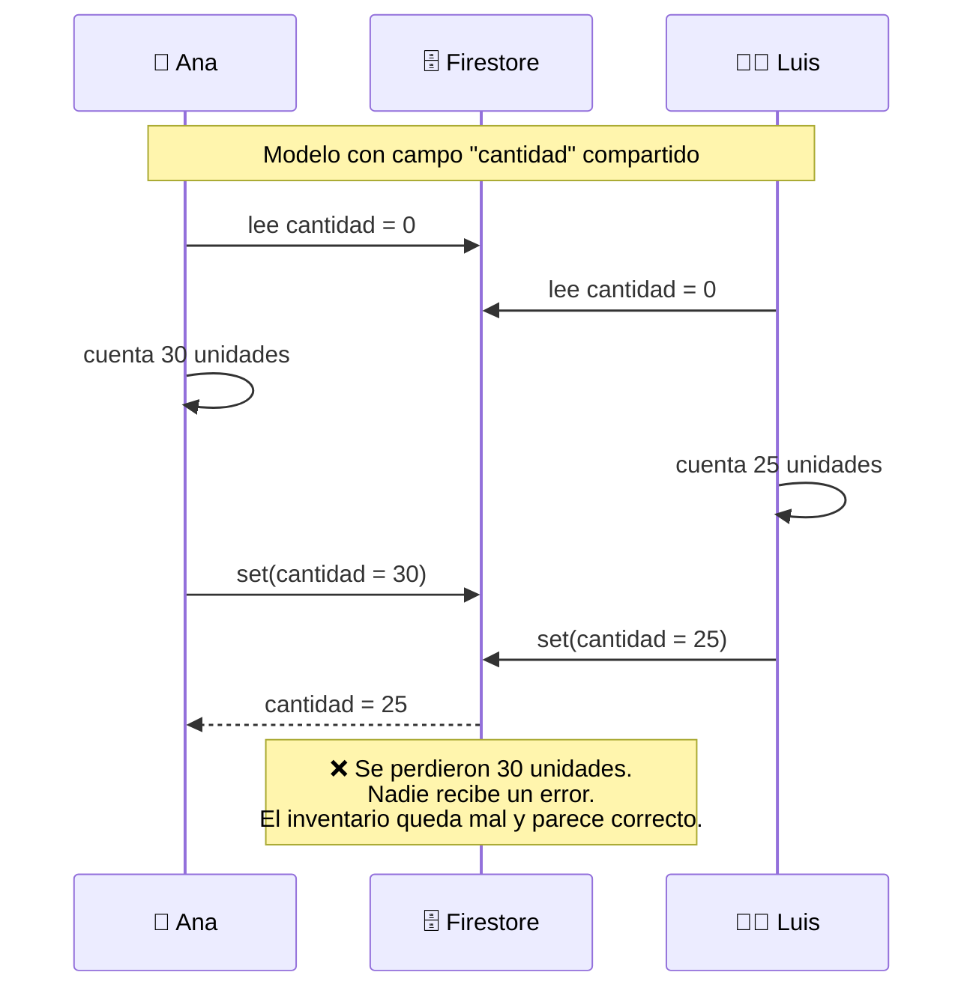
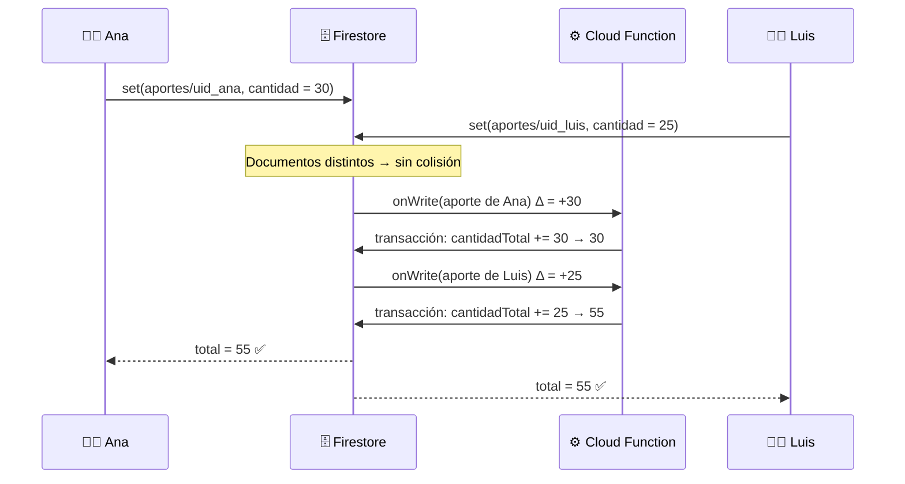
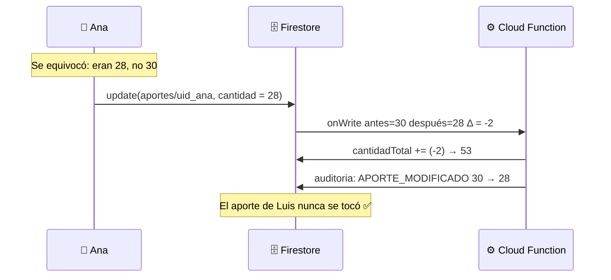
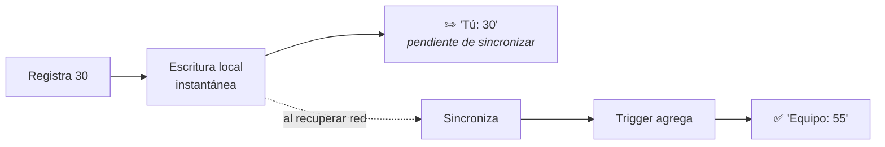
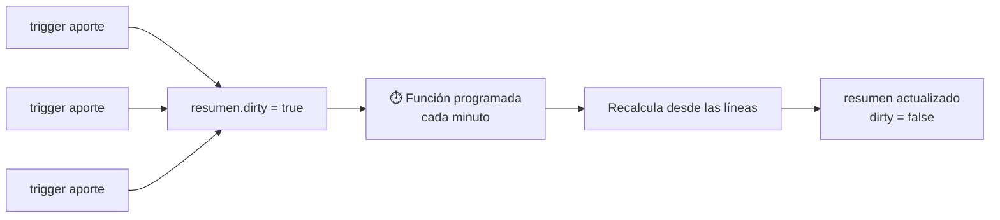

# 05 · Concurrencia, offline y tiempo real

[← Modelo de datos](04-modelo-de-datos-firestore.md) · [Índice](README.md) · [Siguiente: Plataforma web →](06-plataforma-web.md)

---

Este documento resuelve el defecto que habría hecho fallar el sistema en su propósito
central: **contar bien cuando varias personas cuentan a la vez.**

## 1. El fallo del diseño original



Lo grave no es el error: es que es **silencioso**. El sistema reporta un inventario
plausible pero falso, y la auditoría —al registrar sólo el último valor— tampoco lo
delata. Con conteo mensual, ese inventario falso rige durante treinta días.

---

## 2. La solución: aportes por cajero

Cada cajero escribe en **su propio documento**. El total es una suma, no una asignación:
el resultado no depende del orden de llegada de las escrituras.



### Corrección de un error propio



### Por qué el delta y no un recálculo

El trigger recibe el estado anterior y el posterior, así que calcula
`Δ = cantidadNueva − cantidadAnterior` y aplica `FieldValue.increment(Δ)` en una
transacción. Es **O(1)** (no lee los N aportes) e **idempotente** gracias al campo
`version`, necesario porque Firestore garantiza entrega _at-least-once_: un trigger
puede ejecutarse más de una vez para el mismo cambio.

---

## 3. Implementación del trigger

```typescript
// packages/functions/src/triggers/onAporteEscrito.ts
import { onDocumentWritten } from "firebase-functions/v2/firestore";
import { FieldValue, getFirestore } from "firebase-admin/firestore";

export const onAporteEscrito = onDocumentWritten(
  {
    document: "sesiones/{sesionId}/lineas/{categoriaId}/aportes/{uid}",
    // En Functions v2 el reintento de funciones de fondo es opt-in. Sin él, una
    // transacción que agote sus reintentos por contención pierde la agregación
    // en silencio. Sólo es seguro porque el delta de abajo es idempotente.
    retry: true,
  },
  async (event) => {
    const { sesionId, categoriaId, uid } = event.params;
    const antes = event.data?.before.data();
    const despues = event.data?.after.data();

    const cantidadAnterior = antes?.cantidad ?? 0;
    const cantidadNueva = despues?.cantidad ?? 0;

    const db = getFirestore();
    const sesionRef = db.doc(`sesiones/${sesionId}`);
    const lineaRef = db.doc(`sesiones/${sesionId}/lineas/${categoriaId}`);
    const resumenRef = db.doc(`sesiones/${sesionId}/resumen/actual`);
    const syncRef = db.doc(`sesiones/${sesionId}/sincronizacion/estado`);

    await db.runTransaction(async (tx) => {
      const [linea, sesion] = await Promise.all([tx.get(lineaRef), tx.get(sesionRef)]);

      // I-4: nunca agregar sobre una sesión cerrada
      if (sesion.data()?.estado !== "abierta") return;

      // Idempotencia ante reejecución del trigger
      const versiones = linea.get("versiones") ?? {};
      const versionAplicada = versiones[uid] ?? 0;
      const versionEntrante = despues?.version ?? 0;
      if (versionEntrante <= versionAplicada) return;

      // El delta se calcula contra el ÚLTIMO ESTADO APLICADO, no contra el
      // `before` del evento. Firestore entrega at-least-once y además puede
      // reordenar: si el evento v2 (5→12) se procesa antes que el v1 (0→5),
      // calcular `cantidadNueva - cantidadAnterior` haría que v1 se descartara
      // por versión y su aporte desapareciera del total. Con el mapa
      // `aplicados`, v2 primero da 12−0 = 12 y v1 posterior se descarta sin
      // restar nada: el orden deja de importar.
      const aplicados = linea.get("aplicados") ?? {};
      const delta = cantidadNueva - (aplicados[uid] ?? 0);
      if (delta === 0) return;

      // Los campos anidados van como objetos reales, NO como claves con punto.
      // `set(..., { merge: true })` no interpreta `"versiones.uid_ana"` como un
      // FieldPath —crea un campo literal con el punto en el nombre—, a
      // diferencia de `update()`. Y `update()` no sirve aquí porque el
      // documento puede no existir todavía.
      tx.set(
        lineaRef,
        {
          cantidadTotal: FieldValue.increment(delta),
          versiones: { [uid]: versionEntrante },
          aplicados: { [uid]: cantidadNueva },
          actualizadaEn: FieldValue.serverTimestamp(),
          actualizadaPor: uid,
        },
        { merge: true },
      );

      // Total de unidades visible al cajero
      tx.update(sesionRef, {
        totalUnidades: FieldValue.increment(delta),
        participantes: FieldValue.arrayUnion(uid),
      });

      // El resumen monetario se recalcula agrupado (§5). `marcaAportes` sube
      // en la MISMA transacción que muta `lineas` (invariante I-M, nuevo en
      // slice 1 de `complete-cloud-functions`): es lo que le permite al cron
      // (`recalcularResumenes`, §5) demostrar con un compare-and-clear que
      // ningún aporte se coló entre su lectura de `lineas` y su escritura de
      // `resumen`, sin bloquear `lineas` con una transacción de lectura.
      // Cualquier otro escritor de `lineas` (hoy sólo `reconciliarLineas`)
      // debe respetar la misma invariante.
      tx.set(resumenRef, { dirty: true, marcaAportes: FieldValue.increment(1) }, { merge: true });

      // Rastro de sincronización para el cierre (RF-16)
      tx.set(
        syncRef,
        {
          participantes: {
            [uid]: { ultimoAporteServidor: FieldValue.serverTimestamp() },
          },
        },
        { merge: true },
      );

      // Auditoría inmutable, en la misma transacción
      tx.create(db.collection("auditoria").doc(), {
        tipo: antes ? "APORTE_MODIFICADO" : "APORTE_CREADO",
        sesionId,
        categoriaId,
        usuarioId: uid,
        usuarioNombre: despues?.nombre ?? antes?.nombre,
        cantidadAnterior,
        cantidadNueva,
        ocurridoEn: FieldValue.serverTimestamp(),
        origen: "trigger",
      });
    });
  },
);
```

> **La auditoría va dentro de la misma transacción a propósito.** Si falla el registro
> de auditoría, falla el cambio. No existe un estado en que el conteo cambió pero nadie
> lo registró.

---

## 4. Offline: lo que garantiza el modelo y lo que depende del navegador

El modelo de aportes es **libre de conflictos por construcción**. Lo que sí depende del
navegador es la **durabilidad de la cola local**, y eso se trata en detalle en
[06 · Plataforma web](06-plataforma-web.md).

### Comportamiento garantizado

| Situación                             | Comportamiento                                                             |
| ------------------------------------- | -------------------------------------------------------------------------- |
| Cajero sin red registra un aporte     | Se escribe en caché local; la UI lo muestra al instante                    |
| Otro cajero contaba mientras tanto    | Al reconectar, el aporte se **suma**; nada se pisa                         |
| Dos cajeros offline simultáneamente   | Ambos aportes se suman al reconectar                                       |
| Mismo cajero desde dos dispositivos   | Última escritura gana **sobre su propio aporte**; queda en auditoría       |
| App cerrada con escrituras pendientes | Se persisten y se envían al reabrir _(con la salvedad de la PWA — ver 06)_ |

### Los dos números que la UI nunca mezcla



_Tu aporte_ es local, instantáneo y siempre confiable. _El total del equipo_ es remoto y
puede estar desactualizado sin red. Separarlos es lo que hace que el cajero confíe en la
app cuando no hay señal.

```typescript
const esLocal = snapshot.metadata.hasPendingWrites;
const desdeCache = snapshot.metadata.isFromCache;
```

---

## 5. El punto caliente del documento `resumen`

Firestore sostiene aproximadamente **1 escritura/segundo por documento**. Si diez cajeros
registran aportes rápidamente, actualizar `resumen/actual` en cada trigger provocaría
contención y reintentos.

**Solución: marca `dirty` + recálculo agrupado.**



- Los triggers sólo escriben un booleano (y suben `marcaAportes`, I-M).
- Una función programada recalcula el resumen leyendo las **líneas** (60 lecturas), sólo
  si `dirty == true` — y sólo limpia `dirty` si `marcaAportes` no cambió mientras leía
  (compare-and-clear, doc 08 §4): la cadencia decide **cuándo** corre, nunca si el
  resultado escrito es correcto.
- **OQ-1 (resuelto):** Cloud Scheduler no acepta un gránulo menor a un minuto (ni cron
  Unix ni sintaxis App Engine bajan de minutos), así que la cadencia es `every 1 minutes`,
  no los 30 s originalmente propuestos.
- El dashboard del administrador admite hasta ~1 min de desfase; **la pantalla de conteo
  no depende del resumen** —lee las líneas directamente— y sigue siendo tiempo real.

**Camino de crecimiento:** si el volumen creciera un orden de magnitud, migrar a
contadores fragmentados (10 shards, suma al leer). Innecesario hoy.

---

## 6. Estrategia de suscripciones

| Pantalla          | Suscripción                           |          Documentos |
| ----------------- | ------------------------------------- | ------------------: |
| Conteo (cajero)   | `sesiones/{id}/lineas`                |                  60 |
| Aporte propio     | `.../aportes/{miUid}`                 | 1 por línea abierta |
| Total de unidades | `sesiones/{id}`                       |                   1 |
| Dashboard admin   | `sesiones/{id}/resumen/actual`        |                   1 |
| Estado de cierre  | `sesiones/{id}/sincronizacion/estado` |                   1 |
| Auditoría         | consulta paginada, **sin listener**   |           25/página |
| Comparativo       | `historicos` por sucursal             |                   5 |

Reglas de higiene:

1. Nunca escuchar la colección `aportes` completa: es N× más costosa y no aporta nada
   que la línea no tenga.
2. Cerrar listeners al salir de la pantalla (`autoDispose`).
3. Un solo listener por sesión, compartido entre widgets vía provider.

---

## 7. Verificación

| #   | Escenario                                                                 | Resultado esperado                              |
| --- | ------------------------------------------------------------------------- | ----------------------------------------------- |
| T-1 | Dos clientes escriben la misma categoría a la vez                         | Total = suma de ambos                           |
| T-2 | Cliente offline 10 min, otro cuenta mientras tanto                        | Al reconectar, total correcto                   |
| T-3 | Trigger reejecutado dos veces                                             | Total no se duplica (idempotencia)              |
| T-4 | Aporte enviado a sesión cerrada                                           | Rechazado por Security Rules                    |
| T-5 | 200 categorías × 10 cajeros en 60 s                                       | Resumen converge en < 90 s _(OQ-1: cron cada 1 min no garantiza < 60 s)_ |
| T-6 | Cliente manipulado intenta escribir `cantidadTotal`                       | Rechazado                                       |
| T-7 | Cajero intenta leer `resumen/actual`                                      | Rechazado (I-9)                                 |
| T-8 | **Aporte desde dos navegadores/dispositivos distintos en la misma línea** | Total = suma; ambos aportes quedan en auditoría |
| T-9 | **Cierre con un participante sin confirmar**                              | Bloqueado, con evento `CIERRE_BLOQUEADO`        |

T-1 a T-9 se automatizan con el **Firebase Emulator Suite**, que permite probar triggers
y reglas sin tocar producción. Corren en CI ([12](12-despliegue-y-entornos.md)).

---

[← Modelo de datos](04-modelo-de-datos-firestore.md) · [Índice](README.md) · [Siguiente: Plataforma web →](06-plataforma-web.md)
