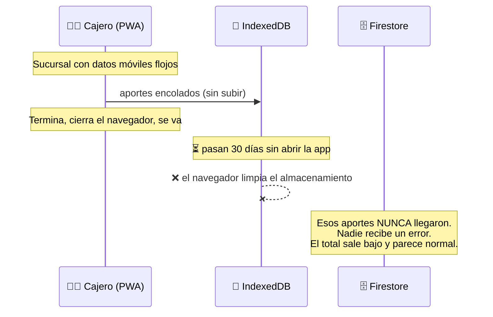
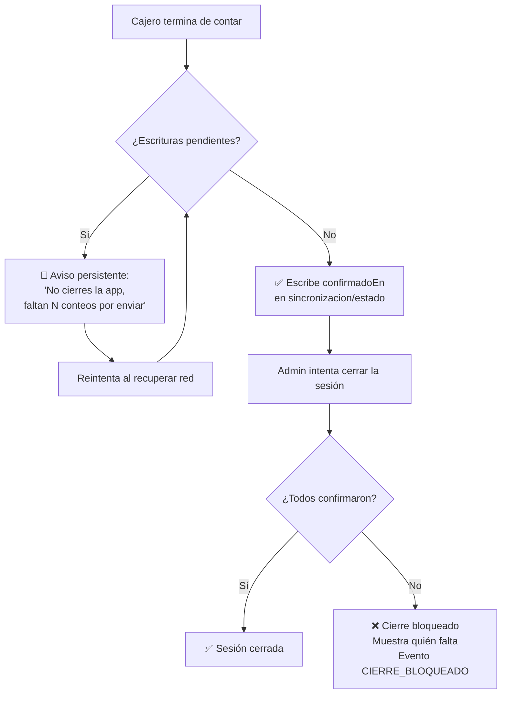

# 06 · Plataforma web

[← Concurrencia](05-concurrencia-offline-tiempo-real.md) · [Índice](README.md) · [Siguiente: Monorepo y arquitectura →](07-monorepo-y-arquitectura.md)

---

Documento revisado. El diseño original de la v2 cubría dos plataformas — Android nativo
para la mitad del equipo, PWA para la otra mitad que usa iPhone. El dueño del producto
decidió ir un paso más allá: **no hay app nativa para nadie**. Todo el personal, cajeros
y administrador, cuenta con **una sola aplicación web instalable**, servida desde
Firebase Hosting. Esto no cambia el backend ni el modelo de datos — sólo simplifica el
cliente a una base de código y elimina toda la maquinaria de distribución nativa.

## 1. La decisión

|                           | Todo el personal                                      |
| ------------------------- | ----------------------------------------------------- |
| **Entrega**               | PWA vía Firebase Hosting                              |
| **Base de código**        | React + Vite + TypeScript                             |
| **Renderizado**           | DOM real, sin motor de canvas                         |
| **Costo de distribución** | USD 0                                                 |
| **Instalación**           | "Instalar app" / "Añadir a pantalla de inicio"        |
| **Actualización**         | Automática al recargar, con control de versión mínima |

Una sola base de código produce el único cliente del sistema. El backend, el modelo de
datos, los triggers y las reglas son **idénticos a los de cualquier diseño anterior**: la
plataforma nunca apareció en ninguna decisión de servidor, y sigue sin aparecer.

---

## 2. Garantías de la plataforma — declaradas, no asumidas

Fingir que una PWA tiene las garantías de una app nativa instalada desde una tienda sería
el error más caro de este documento. No las tiene, y el diseño lo dice explícitamente en
vez de fingir una paridad que no existe.

| Garantía                                             |          Web (PWA)          | Comentario                                   |
| ---------------------------------------------------- | :-------------------------: | -------------------------------------------- |
| Conteo concurrente sin pérdida                       |             ✅              | Depende del modelo de datos, no del cliente  |
| Registrar aportes sin red                            |             ✅              | Caché local vía IndexedDB (SDK de Firestore) |
| Ver totales cacheados sin red                        |             ✅              |                                              |
| Cola de escrituras sobrevive al cierre de la pestaña |             ⚠️              | Depende de IndexedDB                         |
| **Cola sobrevive 30 días de inactividad**            |             ❌              | **Riesgo central de este documento**         |
| Rendimiento de scroll y entrada                      |             ⚠️              | A validar con prototipo (§5)                 |
| Arranque en frío                                     | < 5 s en 4G (primera carga) | < 3 s con service worker caliente            |
| Descarga inicial                                     |     ~400 KB comprimidos     | Bundle de Vite                               |

> La fila marcada en rojo es la única que exige una contramedida de diseño. Todo lo demás
> es aceptable para el uso previsto: sesiones de conteo de 2 a 4 horas, una o dos veces al
> mes.

---

## 3. El riesgo real de la PWA (y por qué no es el que parece)

El riesgo **no** está al abrir la app. Si el navegador borró el almacenamiento local, el
cajero vuelve a iniciar sesión y descarga el catálogo otra vez: entre 30 y 60 segundos,
una vez cada quince o treinta días. Molesto, no grave.

El riesgo está **al cerrarla con trabajo sin subir**.



Con conteo diario esto casi no ocurre: al día siguiente se abre la app y sincroniza. Con
conteo **quincenal o mensual**, la ventana de inactividad excede con holgura los plazos
de limpieza de almacenamiento del navegador.

Y el modo de fallo es exactamente el que este diseño existe para eliminar: **pérdida
silenciosa de conteos**.

### La contramedida: verificación de sincronización antes del cierre (RF-16 · I-10)

No se resuelve con más tecnología, sino con una regla operativa que el sistema hace
cumplir.



Tres piezas, ninguna compleja:

1. **En el cliente:** banner persistente y no descartable mientras `hasPendingWrites` sea
   verdadero. Al llegar a cero, escribe su `confirmadoEn`.
2. **En el administrador:** la pantalla de cierre lista los participantes con su estado.
   El botón de cerrar está deshabilitado si alguno falta.
3. **En el backend:** `cerrarSesion` revalida el estado del lado del servidor. La UI puede
   ser evadida; la Function no.

> **Anulación deliberada.** El administrador puede forzar el cierre si un cajero se fue
> con el teléfono. Requiere confirmación explícita y genera un evento de auditoría
> `SESION_CERRADA` con `forzadoPor` y la lista de quienes no confirmaron. Bloquear sin
> salida convertiría una protección en un obstáculo operativo.

---

## 4. Configuración técnica de la PWA

### Build

```bash
vite build
```

`vite-plugin-pwa` genera el service worker, el manifest y el precacheo de assets a partir
de la configuración del proyecto (`vite.config.ts`). No requiere pasos manuales de
empaquetado adicionales.

```typescript
// vite.config.ts (fragmento)
import { VitePWA } from "vite-plugin-pwa";

export default defineConfig({
  plugins: [
    react(),
    VitePWA({
      registerType: "autoUpdate",
      workbox: {
        // El bootstrap (index.html) nunca se cachea agresivamente;
        // los assets con hash sí, porque son inmutables por versión.
        navigateFallback: "/index.html",
        runtimeCaching: [],
      },
      manifest: {
        name: "Conteo de Inventario",
        short_name: "Conteo",
        display: "standalone",
        orientation: "portrait",
        background_color: "#0F1115",
        theme_color: "#0F1115",
        start_url: "/",
        icons: [
          { src: "icons/icon-192.png", sizes: "192x192", type: "image/png" },
          { src: "icons/icon-512.png", sizes: "512x512", type: "image/png" },
          {
            src: "icons/icon-maskable-512.png",
            sizes: "512x512",
            type: "image/png",
            purpose: "maskable",
          },
        ],
      },
    }),
  ],
});
```

### Persistencia de Firestore en web

La persistencia local **hay que pedirla explícitamente** con el SDK de JavaScript, y el
fallo es silencioso si no se maneja.

```typescript
// apps/web/src/lib/firestore.ts
import {
  initializeFirestore,
  persistentLocalCache,
  persistentMultipleTabManager,
} from "firebase/firestore";

export const db = initializeFirestore(app, {
  localCache: persistentLocalCache({
    tabManager: persistentMultipleTabManager(),
    // Multi-pestaña: sin esto sólo la primera pestaña tiene persistencia
    // y el resto queda en memoria sin avisar.
  }),
});
```

Y solicitar almacenamiento persistente al arrancar, para reducir la probabilidad de
limpieza automática:

```typescript
async function solicitarAlmacenamientoPersistente(): Promise<boolean> {
  const persistido = (await navigator.storage?.persist()) ?? false;
  // No es garantía; se registra para diagnóstico
  logEvent(analytics, "storage_persist", { ok: persistido ? 1 : 0 });
  return persistido;
}
```

### Service worker: cachear el motor, nunca los datos

| Recurso                           | Estrategia                         | Motivo                                     |
| --------------------------------- | ---------------------------------- | ------------------------------------------ |
| JS, CSS, fuentes, iconos con hash | _Cache first_, versionado por hash | No cambia entre releases                   |
| `index.html`                      | _Network first_, sin caché         | Evita quedar atrapado en una versión vieja |
| Datos de Firestore                | **Nunca por service worker**       | Los gestiona el SDK en IndexedDB           |

> **La trampa clásica del service worker** es cachear agresivamente y dejar a los usuarios
> atrapados en una versión antigua sin forma de actualizar. Con conteo mensual el riesgo
> se multiplica: un cajero podría abrir una versión de hace tres releases. Por eso
> `index.html` nunca se cachea y la app verifica su versión mínima contra el servidor al
> arrancar ([12](12-despliegue-y-entornos.md)).

### Manifest

Ver el bloque `manifest` dentro de la configuración de `vite-plugin-pwa` arriba —
`vite-plugin-pwa` lo genera; no se mantiene un `manifest.json` de mano.

`display: standalone` importa más de lo que parece en iOS: una PWA abierta desde la
pantalla de inicio no se ejecuta dentro de Safari y su almacenamiento se rige por su
propio contador de uso, no por el del navegador. **Instalar no es opcional; es parte del
procedimiento de alta de cualquier cajero** ([11 · UX](11-ux-y-navegacion.md)).

---

## 5. Criterio de validación con prototipo

La decisión de ir con web puro ([ADR-15](13-decisiones-adr.md)) se valida con evidencia,
no con expectativa, igual que la decisión original de cubrir iOS con PWA.

**Prototipo:** sólo la pantalla de conteo (lista de 60 categorías, teclado numérico,
escritura de aporte), servida desde Hosting, probada en un iPhone real con Safari, dentro
de una sucursal con datos móviles.

| Métrica                                              | Umbral de aceptación           | Si falla                                         |
| ---------------------------------------------------- | ------------------------------ | ------------------------------------------------ |
| Tiempo hasta primera interacción (4G, primera carga) | < 8 s                          | Reducir bundle; revisar code-splitting           |
| Tiempo de arranque con service worker caliente       | < 3 s                          | Revisar estrategia de caché                      |
| Fluidez del scroll con 60 filas                      | sin saltos perceptibles        | Virtualizar la lista; memoizar filas             |
| Teclado numérico: apertura y foco                    | sin retrasos ni saltos de foco | Ajustar el tipo de `<input>` y el manejo de foco |
| Consumo de datos en 1 h de conteo                    | < 1 MB                         | Revisar suscripciones                            |

Con React sobre DOM real, el riesgo de entrada de texto en Safari que motivaba este
prototipo en el diseño anterior (basado en un motor de canvas) desaparece de raíz: los
campos de formulario son elementos HTML nativos. El prototipo se mantiene igual como
verificación empírica, no porque se espere que falle.

---

## 6. Qué se perdería si en el futuro se paga por una app nativa

Registro honesto de lo que la PWA no da, por si el negocio cambia de opinión:

| Capacidad                                   |    Disponible sin tienda de aplicaciones    |
| ------------------------------------------- | :-----------------------------------------: |
| Conteo offline                              |         ✅ (con menor durabilidad)          |
| Notificaciones push                         | ⚠️ requiere PWA instalada, soporte limitado |
| Presencia en Play Store / App Store         |                     ❌                      |
| Distribución gestionada por MDM             |                     ❌                      |
| Durabilidad de almacenamiento a largo plazo |                     ❌                      |
| Rendimiento nativo de scroll y entrada      |  ❌ (aceptable con DOM real, no idéntico)   |

Migrar a una app nativa más adelante implica reescribir el cliente: React no comparte
código con Android/iOS nativo de la forma en que Flutter sí lo hacía con Flutter Web. Es
el costo aceptado a cambio de un cliente único, más liviano, y de un equipo que ya no
mantiene dos rutas de renderizado ([ADR-15](13-decisiones-adr.md)).

---

[← Concurrencia](05-concurrencia-offline-tiempo-real.md) · [Índice](README.md) · [Siguiente: Monorepo y arquitectura →](07-monorepo-y-arquitectura.md)
