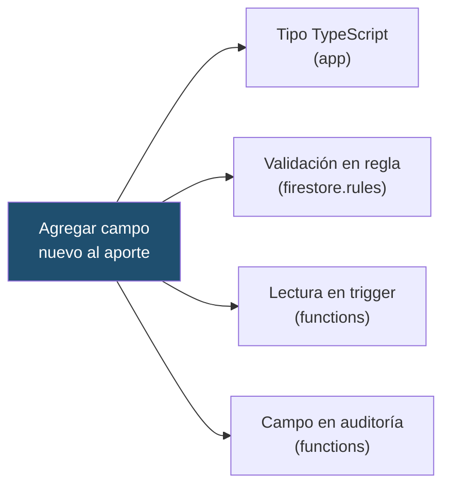
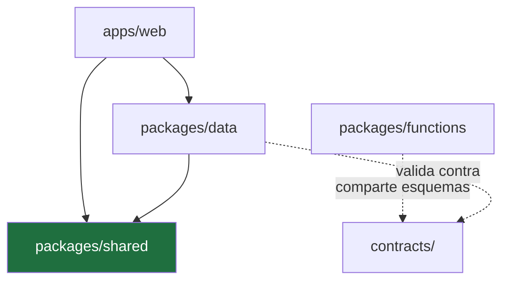
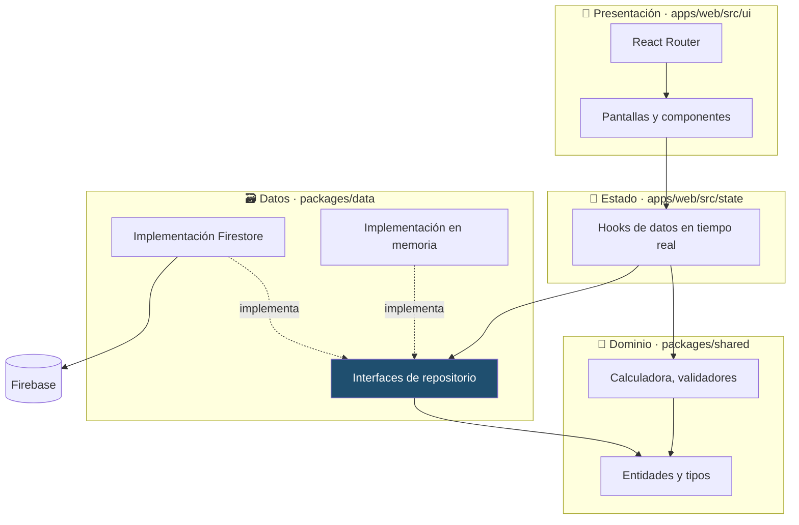

# 07 · Monorepo y arquitectura

[← Plataforma web](06-plataforma-web.md) · [Índice](README.md) · [Siguiente: Contratos →](08-contratos-y-cloud-functions.md)

---

## 1. Por qué monorepo

El sistema tiene cuatro artefactos que **cambian juntos**: la app web, las Cloud
Functions, las Security Rules y los índices de Firestore. Agregar un campo al aporte toca
los cuatro.



En repositorios separados eso son cuatro _pull requests_ que pueden desplegarse en
distinto orden, y un despliegue parcial deja el sistema en un estado que nadie probó. En
un monorepo es **un commit, una revisión, un pipeline**.

| Beneficio                    | Concreto en este proyecto                                         |
| ---------------------------- | ----------------------------------------------------------------- |
| Cambios atómicos de contrato | Tipo, regla y trigger se modifican y revisan juntos               |
| Un solo CI                   | Los tests de reglas corren contra el código de la app que las usa |
| Despliegue ordenado          | Índices → reglas → funciones → hosting, en un solo flujo          |
| Código compartido real       | `packages/shared` lo usan app, funciones y herramientas           |
| Historia unificada           | Un `git log` explica por qué cambió el sistema, no una parte      |

**Costo aceptado:** el CI es más largo que el de un repo pequeño. Se mitiga con ejecución
condicional por rutas ([12](12-despliegue-y-entornos.md)).

---

## 2. Estructura del repositorio

```
conteo-eficiente/
├── apps/
│   └── web/                         # React + Vite + TypeScript (PWA única)
│       ├── src/
│       │   ├── ui/                  # pantallas y componentes
│       │   ├── state/               # hooks de datos en tiempo real
│       │   └── lib/                 # firebase, router, utilidades
│       ├── public/                  # iconos, assets estáticos
│       ├── index.html
│       └── vite.config.ts
│
├── packages/
│   ├── functions/                   # Cloud Functions (TypeScript)
│   │   ├── src/
│   │   │   ├── callables/
│   │   │   ├── triggers/
│   │   │   ├── scheduled/
│   │   │   └── lib/                 # validación, auditoría, helpers
│   │   ├── test/
│   │   └── package.json
│   ├── shared/                      # dominio puro: sin React, sin Firebase
│   │   └── src/
│   │       ├── models/              # entidades y tipos
│   │       └── services/            # calculadora, validadores
│   └── data/                        # repositorios: interfaces + Firestore
│       └── src/
│           ├── repositories/        # interfaces
│           ├── firebase/            # implementaciones
│           └── fakes/               # implementaciones en memoria
│
├── contracts/                       # fuente única de los contratos
│   └── schemas/                     # esquemas zod por callable, compartidos
│                                     # entre validación de cliente y de servidor
│
├── infra/
│   ├── firestore.rules
│   ├── firestore.indexes.json
│   ├── storage.rules                # denegación total
│   └── firebase.json
│
├── docs/
│   └── diseno/                      # estos documentos
│
├── tools/                           # scripts de generación y siembra
├── package.json                     # workspaces npm (raíz)
└── .github/workflows/
    ├── ci.yml
    └── deploy.yml
```

### Reglas de dependencia entre paquetes



| Paquete              | Puede importar        | Nunca importa        |
| -------------------- | --------------------- | -------------------- |
| `shared`             | nada del proyecto     | React, Firebase      |
| `data`               | `shared`, `contracts` | Componentes de React |
| `apps/web`           | todos                 | —                    |
| `packages/functions` | `contracts`, `shared` | código de UI         |

> **`shared` sin React ni Firebase** es lo que permite probar los cálculos de conteo en
> milisegundos, con `vitest` puro, sin navegador ni emulador.

---

## 3. Contratos compartidos

Con un monorepo de un solo lenguaje, el problema que motivaba una capa aparte de
contratos —el modelo del aporte existiendo dos veces, en Dart y en TypeScript, y
pudiendo divergir sin que nadie lo note— desaparece: `packages/shared` define el tipo una
sola vez y tanto `apps/web` como `packages/functions` lo importan directamente.

Lo que sí sigue haciendo falta es **validación en tiempo de ejecución** en el límite de
cada callable: nunca se confía en `req.data`, venga de donde venga.

```
contracts/
└── schemas/
    ├── crear-cajero.schema.ts
    ├── abrir-sesion.schema.ts
    └── cerrar-sesion.schema.ts
```

```typescript
// contracts/schemas/crear-cajero.schema.ts
import { z } from "zod";

export const crearCajeroSchema = z.object({
  nombre: z.string().min(1),
  correo: z.string().email(),
  passwordTemporal: z.string().min(8),
  rol: z.enum(["admin", "cajero"]),
  sucursalesAsignadas: z.array(z.string()).max(10),
});

export type CrearCajeroInput = z.infer<typeof crearCajeroSchema>;
```

El mismo esquema valida el formulario en `apps/web` (mensajes de error inmediatos, antes
de llamar a la Function) y la entrada de la callable en `packages/functions` (la
autoridad real: la UI puede evadirse, la Function no). Un solo archivo, sin _fixtures_
dorados ni generación de código cruzada — esa complejidad era el precio de un repositorio
bilingüe, y ya no aplica.

---

## 4. Arquitectura por capas dentro de la app

Se mantiene **capas dentro de una sola aplicación**, sin Clean Architecture completa,
porque el número de reglas de negocio es reducido. La capa de datos expone
**interfaces**, igual que en el diseño anterior.



**Regla de dependencia:** las flechas apuntan hacia abajo. La presentación no conoce
Firestore; el dominio no conoce componentes. Sólo `packages/data/firebase` importa el SDK
de Firebase.

### Gestión de estado: decisión deliberadamente mínima

No se introduce una librería de estado global (Redux, Zustand, Jotai). El estado real de
este sistema **ya vive en Firestore**; el cliente sólo necesita suscribirse a él. Un hook
con `onSnapshot` + `useState`/`useSyncExternalStore` cubre eso sin dependencias nuevas, y
el Contexto de React alcanza para lo poco que es estado puramente de UI (sesión de
autenticación, rol activo). Si la complejidad de composición de estado creciera, la ruta
de escalamiento natural es TanStack Query como capa de caché sobre los mismos hooks — no
hace falta hoy.

---

## 5. Modelos

```typescript
// packages/shared/src/models/linea-conteo.ts
export interface LineaConteo {
  readonly categoriaId: string;
  readonly etiqueta: string;
  readonly valorUnitario: number;
  readonly cantidadTotal: number;
  readonly numAportantes: number;
  readonly actualizadaEn: Date;
}

/** Subtotal calculado localmente. El cajero NO lo ve;
 *  se usa sólo en las vistas de administrador. */
export function subtotal(linea: LineaConteo): number {
  return linea.cantidadTotal * linea.valorUnitario;
}

export function lineaConteoFromDoc(data: Record<string, unknown>, id: string): LineaConteo {
  return {
    categoriaId: id,
    etiqueta: String(data.etiqueta),
    valorUnitario: Number(data.valorUnitario),
    cantidadTotal: Number(data.cantidadTotal),
    numAportantes: Number(data.numAportantes),
    actualizadaEn: (data.actualizadaEn as Timestamp).toDate(),
  };
}
```

Tipos `readonly` más funciones puras cubren lo que `freezed` daba en Dart —inmutabilidad
e igualdad estructural razonable— sin generación de código: TypeScript ya impide mutar un
campo `readonly` en tiempo de compilación.

---

## 6. Interfaces de repositorio

```typescript
// packages/data/src/repositories/conteo-repository.ts
export interface ConteoRepository {
  observarLineas(sesionId: string, onChange: (lineas: LineaConteo[]) => void): Unsubscribe;
  observarMiAporte(
    sesionId: string,
    categoriaId: string,
    onChange: (aporte: Aporte | null) => void,
  ): Unsubscribe;
  observarSesionAbierta(
    sucursalId: string,
    onChange: (sesion: SesionConteo | null) => void,
  ): Unsubscribe;

  /** Registra o corrige el aporte propio. NUNCA escribe totales. */
  registrarAporte(input: {
    sesionId: string;
    categoriaId: string;
    cantidad: number;
  }): Promise<void>;

  /** Marca al usuario como sincronizado (RF-16). Sólo si no hay pendientes. */
  confirmarSincronizacion(sesionId: string): Promise<void>;

  /** Escrituras aún no confirmadas por el servidor. */
  observarEscriturasPendientes(sesionId: string, onChange: (n: number) => void): Unsubscribe;
}
```

Implementación (fragmento relevante):

```typescript
// packages/data/src/firebase/firestore-conteo-repository.ts
export class FirestoreConteoRepository implements ConteoRepository {
  async registrarAporte({ sesionId, categoriaId, cantidad }: RegistrarAporteInput): Promise<void> {
    if (cantidad < 0) throw new CantidadInvalidaError();

    const uid = auth.currentUser!.uid;
    const ref = doc(db, "sesiones", sesionId, "lineas", categoriaId, "aportes", uid);

    // Sin await intencional: con red ausente la promesa no se resuelve hasta
    // confirmar en servidor y la UI quedaría colgada. El listener local ya
    // actualizó la pantalla.
    void setDoc(
      ref,
      {
        uid,
        nombre: auth.currentUser!.displayName,
        cantidad,
        registradoEn: serverTimestamp(),
        dispositivoId: obtenerIdDispositivo(),
        version: increment(1),
      },
      { merge: true },
    );
  }

  // ...resto de la interfaz
}
```

---

## 7. Hooks de datos

El equivalente a los _providers_ de Riverpod: hooks de React que envuelven un listener de
Firestore y exponen el último valor.

```typescript
// apps/web/src/state/useLineasSesion.ts
export function useLineasSesion(sesionId: string): LineaConteo[] {
  const [lineas, setLineas] = useState<LineaConteo[]>([]);

  useEffect(() => {
    const repo = useConteoRepository();
    return repo.observarLineas(sesionId, setLineas);
  }, [sesionId]);

  return lineas;
}

/** Deriva sólo la fila que cambió: evita recalcular las 200 filas en cada
 *  render, clave para 55 fps con 200 categorías. */
export function useLineaPorCategoria(
  sesionId: string,
  categoriaId: string,
): LineaConteo | undefined {
  const lineas = useLineasSesion(sesionId);
  return useMemo(() => lineas.find((l) => l.categoriaId === categoriaId), [lineas, categoriaId]);
}
```

Cada fila de la lista de conteo se envuelve en `React.memo` y recibe sólo su propia línea
por props: React evita re-renderizar las filas que no cambiaron sin necesidad de una
librería adicional.

### Mapa de hooks

| Hook                           | Responsabilidad                              |
| ------------------------------ | -------------------------------------------- |
| `useAuthState()`               | Sesión activa y rol                          |
| `useSucursalesAsignadas()`     | Sucursales visibles                          |
| `useSesionAbierta(sucursalId)` | Sesión en curso                              |
| `useLineasSesion(sesionId)`    | Totales en tiempo real                       |
| `useMiAporte(sesionId, catId)` | Aporte propio                                |
| `usePendientes(sesionId)`      | Escrituras sin sincronizar                   |
| `useResumen(sesionId)`         | Dashboard admin                              |
| `useEstadoCierre(sesionId)`    | Quién falta por confirmar                    |
| `useConectividad()`            | Banner de red (`navigator.onLine` + eventos) |
| `useAuditoria(filtros)`        | Historial paginado                           |

---

## 8. Manejo de errores

```typescript
// packages/shared/src/errors.ts
export class SinPermisoError extends Error {}
export class SesionCerradaError extends Error {}
export class CantidadInvalidaError extends Error {}
export class SinConexionError extends Error {}
export class CierreBloqueadoError extends Error {
  constructor(readonly sinConfirmar: string[]) {
    super("Cierre bloqueado: hay cajeros sin sincronizar");
  }
}
```

| Error                   | Qué ve el usuario                                                 |
| ----------------------- | ----------------------------------------------------------------- |
| `SinPermisoError`       | "No tienes permiso sobre esta sucursal"                           |
| `SesionCerradaError`    | Diálogo: "El conteo fue cerrado por el administrador"             |
| `CantidadInvalidaError` | Error inline en el campo                                          |
| `SinConexionError`      | Sólo en acciones administrativas: "Esta acción requiere conexión" |
| `CierreBloqueadoError`  | Lista de cajeros que aún no han sincronizado                      |

> **Contar nunca falla por falta de red.** Sólo las operaciones administrativas, que
> pasan por Cloud Functions, exigen conexión.

---

## 9. Estrategia de pruebas

| Nivel                | Qué se prueba                         | Dónde                | Herramienta                    |
| -------------------- | ------------------------------------- | -------------------- | ------------------------------ |
| Unitario puro        | Calculadora, validadores              | `packages/shared`    | Vitest                         |
| Unitario de estado   | Hooks con repositorio falso           | `apps/web`           | Vitest + Testing Library       |
| Contratos            | Esquemas zod contra _fixtures_        | `contracts/`         | Vitest                         |
| Integración de datos | Repositorios contra emulador          | `packages/data`      | Emulator Suite                 |
| Reglas de seguridad  | Cada regla, afirmada y negada         | `infra/`             | `@firebase/rules-unit-testing` |
| Triggers             | Idempotencia y agregación             | `packages/functions` | Emulador de Functions          |
| Componentes          | Pantalla de conteo, estados offline   | `apps/web`           | Testing Library                |
| **E2E**              | Flujo de conteo completo en navegador | `apps/web`           | Playwright                     |

---

## 10. Paquetes principales

| Paquete                            | Uso                                     |
| ---------------------------------- | --------------------------------------- |
| `react`, `react-dom`               | UI                                      |
| `vite`, `vite-plugin-pwa`          | Build, service worker e instalabilidad  |
| `react-router-dom`                 | Navegación con guardas por rol          |
| `firebase`                         | SDK de Auth, Firestore y Functions      |
| `zod`                              | Validación de esquemas (`contracts/`)   |
| `recharts`                         | Gráficas (sólo vistas de administrador) |
| `date-fns` o `Intl` nativo         | Moneda y fechas (`es-CO`)               |
| `vitest`, `@testing-library/react` | Pruebas                                 |
| npm workspaces                     | Orquestación del monorepo               |

---

[← Plataforma web](06-plataforma-web.md) · [Índice](README.md) · [Siguiente: Contratos →](08-contratos-y-cloud-functions.md)
