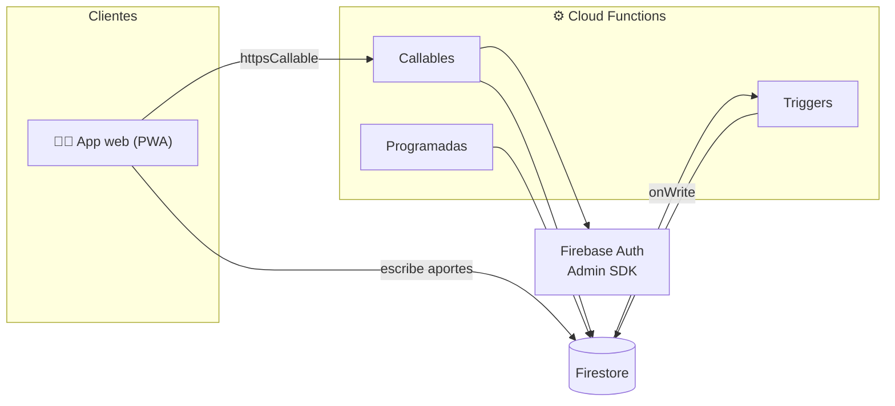

# 08 · Contratos y Cloud Functions

[← Monorepo y arquitectura](07-monorepo-y-arquitectura.md) · [Índice](README.md) · [Siguiente: Seguridad →](09-seguridad-y-auditoria.md)

---

## 1. Por qué existen Cloud Functions

La fase de exploración concluyó "sin backend propio". Sigue siendo cierto —no hay
servidores que administrar— pero **cuatro requisitos son imposibles sólo desde el cliente**:

| Requisito                                 | Por qué el cliente no puede                                                                                            |
| ----------------------------------------- | ---------------------------------------------------------------------------------------------------------------------- |
| El admin crea cajeros (RF-02)             | `createUserWithEmailAndPassword` **cambia la sesión activa**: el admin quedaría logueado como el usuario recién creado |
| Roles verificables (RNF-08)               | Los _custom claims_ sólo se asignan desde el Admin SDK                                                                 |
| Totales y auditoría confiables (I-2, I-5) | Si el cliente pudiera escribirlos, serían falsificables                                                                |
| **Cierre verificado (RF-16, I-10)**       | La UI puede evadirse; la condición debe revalidarse en servidor                                                        |

Cloud Functions es **parte de Firebase**: serverless, sin infraestructura que mantener.
No contradice la decisión de exploración, la completa. Requiere plan Blaze.



---

## 2. Catálogo de funciones

| Nombre                | Tipo         | Invocador | Propósito                                              |
| --------------------- | ------------ | --------- | ------------------------------------------------------ |
| `crearCajero`         | callable     | admin     | Crea usuario en Auth + perfil + claims                 |
| `actualizarCajero`    | callable     | admin     | Cambia nombre, rol o sucursales                        |
| `desactivarCajero`    | callable     | admin     | Desactiva y revoca tokens                              |
| `abrirSesion`         | callable     | admin     | Abre sesión garantizando unicidad; siembra líneas      |
| `cerrarSesion`        | callable     | admin     | **Verifica sincronización**, congela y genera snapshot |
| `onAporteEscrito`     | trigger      | Firestore | Agrega total, marca resumen, registra auditoría        |
| `recalcularResumenes` | cron 30 s    | —         | Recalcula resúmenes marcados `dirty`                   |
| `reconciliarLineas`   | cron semanal | —         | Detecta y corrige totales inconsistentes               |
| `purgarAuditoria`     | cron mensual | —         | Exporta y purga auditoría > 12 meses                   |

---

## 3. Contratos de las callables

### `crearCajero`

**Entrada** (`contracts/schemas/crear_cajero.schema.json`)

```json
{
  "nombre": "Ana Ramírez",
  "correo": "ana@negocio.com",
  "passwordTemporal": "Temp2026#",
  "rol": "cajero",
  "sucursalesAsignadas": ["suc_norte", "suc_centro"]
}
```

**Salida:** `{ "uid": "abc123", "creado": true }`

| Código de error     | Cuándo                                                            |
| ------------------- | ----------------------------------------------------------------- |
| `unauthenticated`   | Sin token válido                                                  |
| `permission-denied` | El invocador no tiene claim `rol == "admin"`                      |
| `invalid-argument`  | Correo inválido, contraseña < 8, rol desconocido, > 10 sucursales |
| `already-exists`    | El correo ya está registrado                                      |

```typescript
export const crearCajero = onCall({ region: "us-central1" }, async (req) => {
  exigirAdmin(req);
  const d = validar(req.data, crearCajeroSchema);

  const auth = getAuth();
  const user = await auth.createUser({
    email: d.correo,
    password: d.passwordTemporal,
    displayName: d.nombre,
  });

  // Los claims son la fuente de verdad para las Security Rules
  await auth.setCustomUserClaims(user.uid, {
    rol: d.rol, // "admin" | "cajero"
    sucursales: d.sucursalesAsignadas,
  });

  const db = getFirestore();
  await db.doc(`usuarios/${user.uid}`).set({
    nombre: d.nombre,
    correo: d.correo,
    rol: d.rol,
    sucursalesAsignadas: d.sucursalesAsignadas,
    activo: true,
    creadoEn: FieldValue.serverTimestamp(),
    creadoPor: req.auth!.uid,
  });

  await registrarAuditoria(db, {
    tipo: "USUARIO_CREADO",
    usuarioId: user.uid,
    usuarioNombre: d.nombre,
    ejecutadoPor: req.auth!.uid,
  });

  return { uid: user.uid, creado: true };
});
```

> **Propagación de claims.** Al cambiarlos, el token vigente conserva los antiguos hasta
> ~1 hora. Por eso `actualizarCajero` y `desactivarCajero` llaman a
> `auth.revokeRefreshTokens(uid)`, y el cliente escucha `idTokenChanges` para refrescar.

### `abrirSesion`

**Entrada:** `{ "sucursalId": "suc_norte" }` → **Salida:** `{ "sesionId": "ses_20260802_norte_01" }`

Implementa la invariante I-1 con una transacción sobre el documento de la sucursal:

```typescript
export const abrirSesion = onCall(async (req) => {
  exigirAdmin(req);
  const { sucursalId } = validar(req.data, abrirSesionSchema);
  const db = getFirestore();
  const sucursalRef = db.doc(`sucursales/${sucursalId}`);

  const { sesionId } = await db.runTransaction(async (tx) => {
    const suc = await tx.get(sucursalRef);
    if (!suc.exists) throw new HttpsError("not-found", "Sucursal inexistente");

    // I-1: una sola sesión abierta, garantizado atómicamente
    if (suc.get("sesionAbiertaId")) {
      throw new HttpsError("failed-precondition", "Ya existe un conteo abierto en esta sucursal");
    }

    const sesionId = generarSesionId(sucursalId);
    tx.create(db.doc(`sesiones/${sesionId}`), {
      sucursalId,
      sucursalNombre: suc.get("nombre"),
      estado: "abierta",
      abiertaEn: FieldValue.serverTimestamp(),
      abiertaPor: req.auth!.uid,
      cerradaEn: null,
      cerradaPor: null,
      participantes: [],
      totalUnidades: 0,
    });
    tx.update(sucursalRef, { sesionAbiertaId: sesionId });
    return { sesionId };
  });

  await sembrarLineas(sesionId); // lotes de 400 (límite de 500 ops)
  return { sesionId };
});
```

La siembra crea una línea por categoría activa con `cantidadTotal: 0` y el
`valorUnitario` **copiado y congelado** (invariante I-7): cambiar el catálogo después no
altera conteos en curso ni históricos.

### `cerrarSesion` — reforzada en la v2

**Entrada**

```json
{ "sesionId": "ses_20260802_norte_01", "forzar": false }
```

**Salida**

```json
{ "cerrada": true, "totalUnidades": 1840, "totalMonetario": 12450000 }
```

**Salida cuando falta alguien por sincronizar** → error `failed-precondition` con detalle:

```json
{ "sinConfirmar": [{ "uid": "uid_luis", "nombre": "Luis Pérez" }] }
```

```typescript
export const cerrarSesion = onCall(async (req) => {
  exigirAdmin(req);
  const { sesionId, forzar } = validar(req.data, cerrarSesionSchema);
  const db = getFirestore();
  const sesionRef = db.doc(`sesiones/${sesionId}`);
  const sesion = await sesionRef.get();

  if (sesion.get("estado") !== "abierta") {
    throw new HttpsError("failed-precondition", "La sesión no está abierta");
  }

  // ── RF-16 / I-10: verificación de sincronización ─────────────────
  const sync = await db.doc(`sesiones/${sesionId}/sincronizacion/estado`).get();
  const participantes: string[] = sesion.get("participantes") ?? [];
  const sinConfirmar = participantes.filter(
    (uid) => !sync.get(`participantes.${uid}.confirmadoEn`),
  );

  if (sinConfirmar.length > 0 && !forzar) {
    await registrarAuditoria(db, {
      tipo: "CIERRE_BLOQUEADO",
      sesionId,
      detalle: { sinConfirmar },
      ejecutadoPor: req.auth!.uid,
    });
    throw new HttpsError("failed-precondition", "Hay cajeros con conteos sin sincronizar", {
      sinConfirmar: await nombresDe(db, sinConfirmar),
    });
  }
  // ─────────────────────────────────────────────────────────────────

  await recalcularResumen(sesionId); // recálculo final, sin esperar al cron
  const resumen = await db.doc(`sesiones/${sesionId}/resumen/actual`).get();

  await db.runTransaction(async (tx) => {
    tx.update(sesionRef, {
      estado: "cerrada",
      cerradaEn: FieldValue.serverTimestamp(),
      cerradaPor: req.auth!.uid,
      forzado: sinConfirmar.length > 0,
      sinConfirmarAlCerrar: sinConfirmar,
    });
    tx.update(db.doc(`sucursales/${sesion.get("sucursalId")}`), {
      sesionAbiertaId: null,
    });
    tx.create(db.doc(`sucursales/${sesion.get("sucursalId")}/historicos/${sesionId}`), {
      sesionId,
      cerradaEn: FieldValue.serverTimestamp(),
      totalUnidades: resumen.get("totalUnidades"),
      totalMonetario: resumen.get("totalMonetario"),
      porCategoria: resumen.get("porCategoria"),
    });
  });

  await registrarAuditoria(db, {
    tipo: "SESION_CERRADA",
    sesionId,
    detalle: { forzado: sinConfirmar.length > 0, sinConfirmar },
    ejecutadoPor: req.auth!.uid,
  });

  return {
    cerrada: true,
    totalUnidades: resumen.get("totalUnidades"),
    totalMonetario: resumen.get("totalMonetario"),
  };
});
```

Los pasos de cierre van en una transacción: una sesión cerrada sin snapshot dejaría el
comparativo entre sucursales incompleto.

### `desactivarCajero`

```typescript
await auth.updateUser(uid, { disabled: true });
await auth.revokeRefreshTokens(uid); // corta la sesión activa (I-8)
await db.doc(`usuarios/${uid}`).update({ activo: false });
```

---

## 4. Funciones programadas

### `recalcularResumenes` (cada 30 s)

```typescript
export const recalcularResumenes = onSchedule("every 30 seconds", async () => {
  const db = getFirestore();
  const sesiones = await db.collection("sesiones").where("estado", "==", "abierta").get();

  for (const sesion of sesiones.docs) {
    const resumenRef = sesion.ref.collection("resumen").doc("actual");
    if (!(await resumenRef.get()).get("dirty")) continue; // nada cambió

    const lineas = await sesion.ref.collection("lineas").where("cantidadTotal", ">", 0).get();

    const porCategoria: Record<string, unknown> = {};
    let totalUnidades = 0,
      totalMonetario = 0;
    let mayor = null,
      menor = null;

    for (const l of lineas.docs) {
      const cantidad = l.get("cantidadTotal");
      const subtotal = cantidad * l.get("valorUnitario");
      porCategoria[l.id] = { cantidad, subtotal, actualizadaEn: l.get("actualizadaEn") };
      totalUnidades += cantidad;
      totalMonetario += subtotal;
      if (!mayor || cantidad > mayor.cantidad) mayor = { categoriaId: l.id, cantidad };
      if (!menor || cantidad < menor.cantidad) menor = { categoriaId: l.id, cantidad };
    }

    await resumenRef.set(
      {
        totalUnidades,
        totalMonetario,
        numCategoriasConConteo: lineas.size,
        categoriaMayor: mayor,
        categoriaMenor: menor,
        porCategoria,
        recalculadoEn: FieldValue.serverTimestamp(),
        dirty: false,
      },
      { merge: true },
    );
  }
});
```

Con 1–2 conteos mensuales por sucursal, la mayoría de ejecuciones sale en la primera
consulta sin hacer nada. Costo despreciable.

### `reconciliarLineas` (semanal)

Recalcula `cantidadTotal` desde los aportes y compara. Una discrepancia indica un trigger
fallido. Corrige y registra un evento `RECONCILIACION`.

> Esto es posible **porque los aportes son la fuente de verdad**. Si el diseño guardara
> sólo el total, un dato corrupto sería irrecuperable.

---

## 5. Convenciones transversales

| Aspecto      | Convención                                                                |
| ------------ | ------------------------------------------------------------------------- |
| Región       | `us-central1` para todas                                                  |
| Validación   | JSON Schema de `contracts/` en cada callable; nunca confiar en `req.data` |
| Autorización | `exigirAdmin(req)` antes de cualquier lectura                             |
| Errores      | `HttpsError` con códigos estándar; el cliente los mapea a `Failure`       |
| Idempotencia | Triggers con campo `version`                                              |
| Logging      | Estructurado con `sesionId` y `uid`; nunca contraseñas                    |
| Secretos     | Ninguno en el código                                                      |

### Invocación desde la app web

```typescript
// packages/data/src/firebase/admin-repository-impl.ts
import { getFunctions, httpsCallable, FunctionsError } from "firebase/functions";

async function cerrarSesion(sesionId: string, forzar = false): Promise<void> {
  try {
    const cerrar = httpsCallable(getFunctions(app, "us-central1"), "cerrarSesion");
    await cerrar({ sesionId, forzar });
  } catch (e) {
    const err = e as FunctionsError;
    if (
      err.code === "functions/failed-precondition" &&
      err.details &&
      "sinConfirmar" in (err.details as object)
    ) {
      const sinConfirmar = (err.details as { sinConfirmar: { nombre: string }[] }).sinConfirmar;
      throw new CierreBloqueadoError(sinConfirmar.map((u) => u.nombre));
    }
    switch (err.code) {
      case "functions/permission-denied":
        throw new SinPermisoError();
      case "functions/invalid-argument":
        throw new DatosInvalidosError(err.message);
      default:
        throw new ErrorDesconocidoError(err);
    }
  }
}
```

---

[← Monorepo y arquitectura](07-monorepo-y-arquitectura.md) · [Índice](README.md) · [Siguiente: Seguridad →](09-seguridad-y-auditoria.md)
