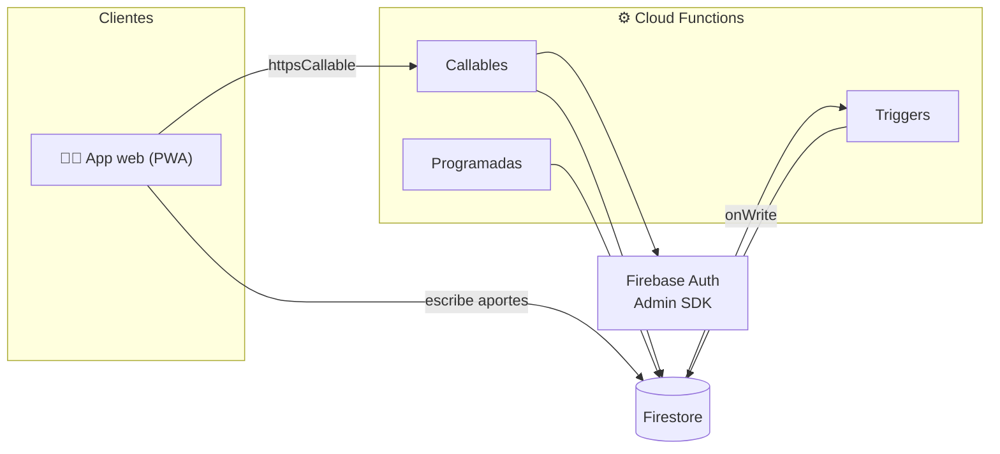

# 08 · Contratos y Cloud Functions

[← Monorepo y arquitectura](07-monorepo-y-arquitectura.md) · [Índice](README.md) · [Siguiente: Seguridad →](09-seguridad-y-auditoria.md)

---

## 1. Por qué existen Cloud Functions

La fase de exploración concluyó "sin backend propio". Sigue siendo cierto —no hay
servidores que administrar— pero **cuatro requisitos son imposibles sólo desde el cliente**:

| Requisito                                 | Por qué el cliente no puede                                                                                            |
| ----------------------------------------- | ---------------------------------------------------------------------------------------------------------------------- |
| El admin crea cajeros (RF-02)             | `createUserWithEmailAndPassword` **cambia la sesión activa**: el admin quedaría logueado como el usuario recién creado |
| Roles verificables (RNF-08)               | Los _custom claims_ sólo se asignan desde el Admin SDK                                                                 |
| Totales y auditoría confiables (I-2, I-5) | Si el cliente pudiera escribirlos, serían falsificables                                                                |
| **Cierre verificado (RF-16, I-10)**       | La UI puede evadirse; la condición debe revalidarse en servidor                                                        |

Cloud Functions es **parte de Firebase**: serverless, sin infraestructura que mantener.
No contradice la decisión de exploración, la completa. Requiere plan Blaze.



---

## 2. Catálogo de funciones

| Nombre                | Tipo         | Invocador | Propósito                                              |
| --------------------- | ------------ | --------- | ------------------------------------------------------ |
| `crearCajero`         | callable     | admin     | Crea usuario en Auth + perfil + claims                 |
| `actualizarCajero`    | callable     | admin     | Cambia nombre, rol o sucursales                        |
| `desactivarCajero`    | callable     | admin     | Desactiva y revoca tokens                              |
| `abrirSesion`         | callable     | admin     | Abre sesión garantizando unicidad; siembra líneas      |
| `cerrarSesion`        | callable     | admin     | **Verifica sincronización**, congela y genera snapshot |
| `onAporteEscrito`     | trigger      | Firestore | Agrega total, marca resumen, registra auditoría        |
| `recalcularResumenes` | cron cada minuto | —     | Recalcula resúmenes marcados `dirty`                   |
| `reconciliarLineas`   | cron semanal | —         | Detecta y corrige totales inconsistentes               |
| `purgarAuditoria`     | cron mensual | —         | Exporta y purga auditoría > 12 meses                   |

---

## 3. Contratos de las callables

### `crearCajero`

**Entrada** (`contracts/schemas/crear_cajero.schema.json`)

```json
{
  "nombre": "Ana Ramírez",
  "correo": "ana@negocio.com",
  "passwordTemporal": "Temp2026#",
  "rol": "cajero",
  "sucursalesAsignadas": ["suc_norte", "suc_centro"]
}
```

**Salida:** `{ "uid": "abc123", "creado": true }`

| Código de error     | Cuándo                                                            |
| ------------------- | ----------------------------------------------------------------- |
| `unauthenticated`   | Sin token válido                                                  |
| `permission-denied` | El invocador no tiene claim `rol == "admin"`                      |
| `invalid-argument`  | Correo inválido, contraseña < 8, rol desconocido, > 10 sucursales |
| `already-exists`    | El correo ya está registrado                                      |

```typescript
export const crearCajero = onCall({ region: "us-central1" }, async (req) => {
  exigirAdmin(req);
  const d = validar(req.data, crearCajeroSchema);

  const auth = getAuth();
  const user = await auth.createUser({
    email: d.correo,
    password: d.passwordTemporal,
    displayName: d.nombre,
  });

  // Los claims son la fuente de verdad para las Security Rules
  try {
    await auth.setCustomUserClaims(user.uid, {
      rol: d.rol, // "admin" | "cajero"
      sucursales: d.sucursalesAsignadas,
    });

    const db = getFirestore();
    await db.doc(`usuarios/${user.uid}`).set({
      nombre: d.nombre,
      correo: d.correo,
      rol: d.rol,
      sucursalesAsignadas: d.sucursalesAsignadas,
      activo: true,
      creadoEn: FieldValue.serverTimestamp(),
      creadoPor: req.auth!.uid,
    });

    await registrarAuditoria(db, {
      tipo: "USUARIO_CREADO",
      usuarioId: user.uid,
      usuarioNombre: d.nombre,
      ejecutadoPor: req.auth!.uid,
    });
  } catch (error) {
    // D-6: paso 1 no es idempotente (consumió el correo); sin compensar, todo
    // reintento muere con already-exists y el huérfano queda sin claims.
    await auth.deleteUser(user.uid);
    throw error;
  }

  return { uid: user.uid, creado: true };
});
```

> **Propagación de claims.** Al cambiarlos, el token vigente conserva los antiguos hasta
> ~1 hora. Por eso `actualizarCajero` y `desactivarCajero` llaman a
> `auth.revokeRefreshTokens(uid)`, y el cliente escucha `idTokenChanges` para refrescar.

### `abrirSesion`

**Entrada:** `{ "sucursalId": "suc_norte" }` → **Salida:** `{ "sesionId": "ses_20260802_norte_01" }`

Implementa la invariante I-1 con una transacción sobre el documento de la sucursal:

```typescript
export const abrirSesion = onCall(async (req) => {
  exigirAdmin(req);
  const { sucursalId } = validar(req.data, abrirSesionSchema);
  const db = getFirestore();
  const sucursalRef = db.doc(`sucursales/${sucursalId}`);

  const { sesionId } = await db.runTransaction(async (tx) => {
    const suc = await tx.get(sucursalRef);
    if (!suc.exists) throw new HttpsError("not-found", "Sucursal inexistente");

    // I-1: una sola sesión abierta, garantizado atómicamente
    if (suc.get("sesionAbiertaId")) {
      throw new HttpsError("failed-precondition", "Ya existe un conteo abierto en esta sucursal");
    }

    const sesionId = generarSesionId(sucursalId);
    tx.create(db.doc(`sesiones/${sesionId}`), {
      sucursalId,
      sucursalNombre: suc.get("nombre"),
      estado: "abierta",
      abiertaEn: FieldValue.serverTimestamp(),
      abiertaPor: req.auth!.uid,
      cerradaEn: null,
      cerradaPor: null,
      participantes: [],
      totalUnidades: 0,
    });
    tx.update(sucursalRef, { sesionAbiertaId: sesionId });
    return { sesionId };
  });

  await sembrarLineas(sesionId); // lotes de 400 (límite de 500 ops)
  return { sesionId };
});
```

La siembra crea una línea por categoría activa con `cantidadTotal: 0` y el
`valorUnitario` **copiado y congelado** (invariante I-7): cambiar el catálogo después no
altera conteos en curso ni históricos.

### `cerrarSesion` — reforzada en la v2

**Entrada**

```json
{ "sesionId": "ses_20260802_norte_01", "forzar": false }
```

**Salida**

```json
{ "cerrada": true, "totalUnidades": 1840, "totalMonetario": 12450000 }
```

**Salida cuando falta alguien por sincronizar** → error `failed-precondition` con detalle:

```json
{ "sinConfirmar": [{ "uid": "uid_luis", "nombre": "Luis Pérez" }] }
```

```typescript
export const cerrarSesion = onCall(async (req) => {
  exigirAdmin(req);
  const { sesionId, forzar } = validar(req.data, cerrarSesionSchema);
  const db = getFirestore();
  const sesionRef = db.doc(`sesiones/${sesionId}`);
  const sesion = await sesionRef.get();

  if (sesion.get("estado") !== "abierta") {
    throw new HttpsError("failed-precondition", "La sesión no está abierta");
  }

  // ── Fase A (fuera de cualquier transacción): RF-16 / I-10 ──
  // sincronizado(uid) ⟺ confirmadoEn != null && confirmadoEn >= (ultimoAporteServidor ?? 0)
  // (`lib/sincronizacion.ts`, `verificarSincronizacion`). Un cajero que vuelve
  // a aportar después de confirmar queda con una confirmación obsoleta y NO
  // cuenta como sincronizado. `usuarios/{uid}.activo === false` excluye al
  // participante de este bloqueo (se audita como `excluidosPorInactivo`, pero
  // no impide el cierre). Un aporte que llegue entre la Fase A y la Fase B ya
  // queda dentro de la instantánea que la Fase B lee.
  const participantes: string[] = sesion.get("participantes") ?? [];
  const { sinConfirmar, excluidosPorInactivo } = await verificarSincronizacion(
    db,
    sesionId,
    participantes,
  );

  if (sinConfirmar.length > 0 && !forzar) {
    await db.runTransaction((tx) =>
      registrarAuditoria(tx, db, {
        tipo: "CIERRE_BLOQUEADO",
        sesionId,
        sinConfirmar,
        excluidosPorInactivo,
      }),
    );
    throw new HttpsError("failed-precondition", "Hay cajeros con conteos sin sincronizar", {
      sinConfirmar,
    });
  }
  // ─────────────────────────────────────────────────────────────────

  // ── Fase B (UNA transacción): congela la sesión Y crea el snapshot
  // histórico en el mismo commit — el recálculo YA NO corre antes de la
  // transacción de congelamiento (bug corregido): un aporte que llegara en
  // esa ventana dejaría `historicos/{sesionId}` en desacuerdo con la sesión
  // congelada. Dos guardias hacen segura la reejecución de un cierre: la
  // relectura de `estado` de abajo, y `tx.create(historicoRef)`.
  return db.runTransaction(async (tx) => {
    const sesionActual = await tx.get(sesionRef);
    if (sesionActual.get("estado") !== "abierta") {
      throw new HttpsError("failed-precondition", "La sesión no está abierta");
    }

    const lineas = await tx.get(sesionRef.collection("lineas").where("cantidadTotal", ">", 0));
    const resumenCalculado = calcularResumen(lineas.docs); // `lib/resumen.ts`
    const sucursalRef = db.doc(`sucursales/${sesion.get("sucursalId")}`);

    tx.update(sesionRef, {
      estado: "cerrada",
      cerradaEn: FieldValue.serverTimestamp(),
      cerradaPor: req.auth!.uid,
      forzado: forzar,
      sinConfirmarAlCerrar: sinConfirmar,
      totalUnidades: resumenCalculado.totalUnidades,
    });
    tx.update(sucursalRef, { sesionAbiertaId: null });
    tx.create(sucursalRef.collection("historicos").doc(sesionId), {
      sesionId,
      cerradaEn: FieldValue.serverTimestamp(),
      totalUnidades: resumenCalculado.totalUnidades,
      totalMonetario: resumenCalculado.totalMonetario,
      porCategoria: resumenCalculado.porCategoria,
    });
    // `set` sin `merge` (`resumen` es 100% derivado); `marcaAportes` queda
    // fuera: una sesión cerrada ya no entra en la consulta del cron.
    tx.set(sesionRef.collection("resumen").doc("actual"), {
      ...resumenCalculado,
      recalculadoEn: FieldValue.serverTimestamp(),
      dirty: false,
    });

    registrarAuditoria(tx, db, {
      tipo: "SESION_CERRADA",
      sesionId,
      forzado: forzar,
      sinConfirmar,
      excluidosPorInactivo,
    });

    return { sesionId };
  });
});
```

Los pasos de cierre van en una transacción: una sesión cerrada sin snapshot dejaría el
comparativo entre sucursales incompleto.

### `desactivarCajero`

```typescript
await auth.updateUser(uid, { disabled: true });
await auth.revokeRefreshTokens(uid); // corta la sesión activa (I-8)
await db.doc(`usuarios/${uid}`).update({ activo: false });
```

---

## 4. Funciones programadas

### `recalcularResumenes` (cada minuto)

> **Corrección (slice 1 de `complete-cloud-functions`):** la versión anterior de este
> pseudocódigo leía `lineas` y escribía `resumen` **fuera de cualquier transacción, sin
> comparar nada**. Eso podía persistir `dirty: false` sobre un resumen que ya había
> quedado desactualizado por un aporte concurrente — el defecto que este slice corrige.
> La regla vigente es un compare-and-clear de tres pasos sobre un marcador monotónico
> `resumen.marcaAportes` (ver invariante I-M en [05 · Concurrencia](05-concurrencia-offline-tiempo-real.md#3-implementación-del-trigger)):

```typescript
export const recalcularResumenes = onSchedule(
  { schedule: "every 1 minutes", region: "us-central1" }, // Cloud Scheduler no baja de 1 min
  async () => {
    await recalcularResumenesImpl(getFirestore());
  },
);

export async function recalcularResumenesImpl(db: Firestore): Promise<void> {
  const sesiones = await db.collection("sesiones").where("estado", "==", "abierta").get();

  for (const sesion of sesiones.docs) {
    const resumenRef = sesion.ref.collection("resumen").doc("actual");

    // Paso 1: capturar M = marcaAportes en el momento de leer `dirty`.
    const resumenAntes = await resumenRef.get();
    if (!resumenAntes.get("dirty")) continue; // nada cambió
    const marca = resumenAntes.get("marcaAportes") ?? 0;

    // Paso 2: leer `lineas` FUERA de cualquier transacción — un `.get()` ya
    // es una instantánea consistente; una tx de sólo lectura no aporta nada
    // aquí y SÍ bloquearía cada línea con un lock pesimista durante toda la
    // ejecución (`Transaction.get(query)`), reintroduciendo la contención que
    // `dirty` existe para evitar.
    const lineas = await sesion.ref.collection("lineas").where("cantidadTotal", ">", 0).get();
    const resumenCalculado = calcularResumen(lineas.docs); // totales + porCategoria

    // Paso 3: comparar y limpiar. Si `marcaAportes` cambió entre el paso 1 y
    // aquí, un aporte tocó `lineas` fuera de la ventana leída en el paso 2 —
    // no se escribe nada y `dirty` sigue `true` para el próximo ciclo.
    await db.runTransaction(async (tx) => {
      const resumenActual = await tx.get(resumenRef);
      if ((resumenActual.get("marcaAportes") ?? 0) !== marca) return; // nada

      tx.set(resumenRef, {
        // set SIN merge: `resumen` es 100% derivado; con merge, una categoría
        // cuyo cantidadTotal volvió a 0 dejaría una entrada `porCategoria`
        // fantasma para siempre.
        ...resumenCalculado,
        recalculadoEn: FieldValue.serverTimestamp(),
        dirty: false,
        marcaAportes: marca,
      });
    });
  }
}
```

`M` sin cambios entre el paso 1 y el paso 3 demuestra que ninguna transacción con
aportes se completó durante toda la ventana de lectura, porque el marcador sube
**dentro** de la misma transacción que muta `lineas` (invariante I-M). Si `M` cambió, el
cron no escribe nada y el próximo ciclo (≤1 min) recalcula; el resumen nunca se persiste
desactualizado y `dirty: false` nunca miente. Fallo aceptado, nombrado: bajo aportes
llegando más rápido que la ventana de lectura de `lineas` de forma sostenida, `dirty`
nunca se limpia (inanición, nunca dato incorrecto) — techo aceptado con 1–2 conteos
mensuales por sucursal.

Con 1–2 conteos mensuales por sucursal, la mayoría de ejecuciones sale en la primera
consulta sin hacer nada. Costo despreciable.

### `reconciliarLineas` (semanal)

Recalcula `cantidadTotal` desde los aportes y compara. Una discrepancia indica un trigger
fallido. Corrige y registra un evento `RECONCILIACION`. La corrección reescribe también
`aplicados`/`versiones` por completo (no `merge`), ajusta `sesiones.totalUnidades` con el
delta y vuelve a marcar `resumen/actual.dirty=true`.

> Esto es posible **porque los aportes son la fuente de verdad**. Si el diseño guardara
> sólo el total, un dato corrupto sería irrecuperable.

---

## 5. Convenciones transversales

| Aspecto      | Convención                                                                |
| ------------ | ------------------------------------------------------------------------- |
| Región       | `us-central1` para todas                                                  |
| Validación   | JSON Schema de `contracts/` en cada callable; nunca confiar en `req.data` |
| Autorización | `exigirAdmin(req)` antes de cualquier lectura                             |
| Errores      | `HttpsError` con códigos estándar; el cliente los mapea a `Failure`       |
| Idempotencia | Triggers con campo `version`                                              |
| Logging      | Estructurado con `sesionId` y `uid`; nunca contraseñas                    |
| Secretos     | Ninguno en el código                                                      |

### Invocación desde la app web

```typescript
// packages/data/src/firebase/admin-repository-impl.ts
import { getFunctions, httpsCallable, FunctionsError } from "firebase/functions";

async function cerrarSesion(sesionId: string, forzar = false): Promise<void> {
  try {
    const cerrar = httpsCallable(getFunctions(app, "us-central1"), "cerrarSesion");
    await cerrar({ sesionId, forzar });
  } catch (e) {
    const err = e as FunctionsError;
    if (
      err.code === "functions/failed-precondition" &&
      err.details &&
      "sinConfirmar" in (err.details as object)
    ) {
      const sinConfirmar = (err.details as { sinConfirmar: { nombre: string }[] }).sinConfirmar;
      throw new CierreBloqueadoError(sinConfirmar.map((u) => u.nombre));
    }
    switch (err.code) {
      case "functions/permission-denied":
        throw new SinPermisoError();
      case "functions/invalid-argument":
        throw new DatosInvalidosError(err.message);
      default:
        throw new ErrorDesconocidoError(err);
    }
  }
}
```

---

[← Monorepo y arquitectura](07-monorepo-y-arquitectura.md) · [Índice](README.md) · [Siguiente: Seguridad →](09-seguridad-y-auditoria.md)
