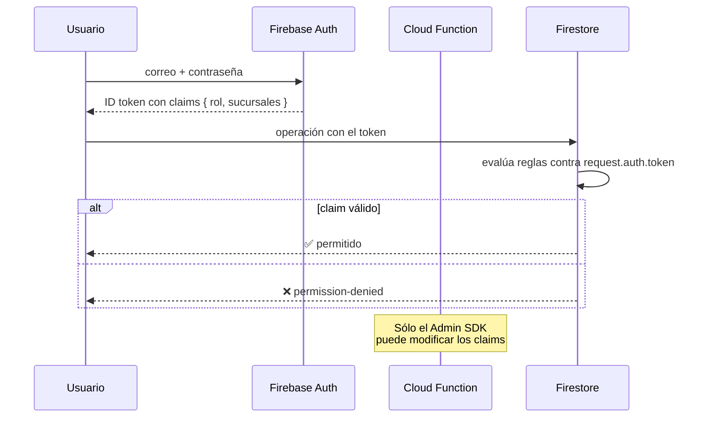

# 09 · Seguridad y auditoría

[← Contratos](08-contratos-y-cloud-functions.md) · [Índice](README.md) · [Siguiente: Análisis y dashboards →](10-analisis-y-dashboards.md)

---

## 1. Modelo de amenazas

La app es cliente-servidor sin servidor intermedio: **cualquiera con las DevTools del
navegador abiertas sobre la PWA puede escribir directamente en Firestore** usando el SDK
con su propio token. Las Security Rules no son configuración: son la única capa de
autorización.

> Con un cliente web, ese acceso es trivial: basta con abrir la consola del navegador,
> sin necesidad de descompilar nada. **El diseño ya es resistente a esto** —nada confía
> en el cliente— pero conviene decirlo explícitamente.

| #    | Amenaza                                                 | Impacto                      | Mitigación                                       |
| ---- | ------------------------------------------------------- | ---------------------------- | ------------------------------------------------ |
| A-1  | Cajero altera `cantidadTotal` para inflar el inventario | Fraude                       | `lineas` de sólo lectura para clientes           |
| A-2  | Cajero borra un evento de auditoría                     | Pérdida de trazabilidad      | `auditoria`: `write: if false`                   |
| A-3  | Cajero registra aportes en sucursales ajenas            | Datos contaminados           | Regla que valida sucursal en claims              |
| A-4  | Cajero escribe sobre una sesión cerrada                 | Alteración de evidencia      | Regla que lee `estado` de la sesión              |
| A-5  | Cajero se auto-asciende a admin editando su perfil      | Escalación                   | `usuarios` de sólo lectura; rol en claims        |
| A-6  | Usuario desvinculado conserva token válido              | Acceso indebido              | `revokeRefreshTokens` + `disabled`               |
| A-7  | Aporte negativo para restar del total                   | Corrupción                   | Validación en regla y trigger                    |
| A-8  | Fuerza bruta sobre contraseñas                          | Toma de cuenta               | App Check + política de contraseñas              |
| A-9  | Escritura masiva para inflar la factura                 | Abuso económico              | App Check, alertas, cuotas                       |
| A-10 | **Cajero consulta el valor total del inventario**       | Fuga de información sensible | Datos monetarios en documentos que no puede leer |
| A-11 | **Cajero marca su sincronización sin haberla hecho**    | Cierre con conteos perdidos  | Regla acotada + revalidación en servidor         |
| A-12 | **Contador crea o vincula catálogo en sucursal ajena o sesión cerrada** | Catálogo contaminado; alteración de evidencia | `exigirAdminOCajeroDeSesion`: claim + `estado` leídos en la MISMA transacción que escribe |

---

## 2. Autenticación y roles



**Los claims son la fuente de verdad para autorizar.** El documento `usuarios/{uid}`
existe para la UI. Si una regla dependiera de leerlo, un atacante que lograra escribirlo
escalaría privilegios, y cada evaluación costaría una lectura.

| Claim        | Contenido                                      | Origen                             |
| ------------ | ------------------------------------------------ | ---------------------------------- |
| `rol`        | `"admin"` \| `"admin_sucursal"` \| `"cajero"`  | `crearCajero` / `actualizarCajero` |
| `sucursales` | array de IDs (máx. 10; `admin_sucursal` exige exactamente 1, [ADR-27](13-decisiones-adr.md#adr-27)) | ídem                               |

### Política de contraseñas

- Mínimo 8 caracteres con al menos un número (validado en la callable).
- Contraseña temporal al alta; cambio obligatorio en el primer ingreso.
- Recuperación por correo con el flujo nativo de Firebase Auth.

### App Check

| Cliente   | Proveedor            |
| --------- | -------------------- |
| Web / PWA | reCAPTCHA Enterprise |

Sin App Check, la PWA es un vector abierto para escritura automatizada (A-9).

---

## 3. Security Rules completas

> **Erratas corregidas contra el emulador.** Dos expresiones de la versión
> original de este bloque no funcionaban, y ninguna de las dos fallaba de forma
> visible: el `affectedKeys()` de `sincronizacion/estado` producía *evaluation
> error* para toda escritura —denegando por igual lo permitido y lo prohibido—,
> y la regla de `aportes` no acotaba el campo `version`, dejando en manos del
> cliente la única guardia de idempotencia del trigger. Ambas se detectaron
> escribiendo los tests **afirmativos**, no los negativos. El texto de abajo es
> el que está desplegado y probado.

```javascript
rules_version = '2';
service cloud.firestore {
  match /databases/{database}/documents {

    // ─────────── Helpers ───────────
    function autenticado()  { return request.auth != null; }
    function esAdmin()      { return autenticado() && request.auth.token.rol == 'admin'; }
    function esCajero()     { return autenticado() && request.auth.token.rol == 'cajero'; }
    function miUid()        { return request.auth.uid; }

    // ADR-27: admin_sucursal válido sólo con EXACTAMENTE 1 sucursal en el
    // claim; 0 o 2+ falla cerrado (nunca hereda alcance total).
    function esAdminSucursal() {
      return autenticado() && request.auth.token.rol == 'admin_sucursal'
        && request.auth.token.sucursales.size() == 1;
    }
    // D6: excluye a propósito al cajero — historicos/resumen/auditoria
    // monetarios siguen fuera de su alcance (A-10/I-9).
    function puedeVerSucursal(sucursalId) {
      return esAdmin() || (esAdminSucursal() && sucursalId in request.auth.token.sucursales);
    }
    // usuarios get/list: admin_sucursal ve sólo quien comparte su sucursal.
    function veUsuario() {
      return esAdminSucursal()
        && request.auth.token.sucursales[0] in resource.data.sucursalesAsignadas;
    }

    function tieneSucursal(sucursalId) {
      return esAdmin() || sucursalId in request.auth.token.sucursales;
    }
    function sesion(sesionId) {
      return get(/databases/$(database)/documents/sesiones/$(sesionId)).data;
    }
    function sesionAbierta(sesionId) {
      return sesion(sesionId).estado == 'abierta';
    }

    // ─────────── usuarios ───────────
    match /usuarios/{uid} {
      allow get:  if autenticado() && (uid == miUid() || esAdmin() || veUsuario());
      allow list: if esAdmin() || veUsuario();
      allow write: if false;                              // ← A-5
    }

    // ─────────── sucursales ───────────
    match /sucursales/{sucursalId} {
      allow read:  if autenticado() && tieneSucursal(sucursalId);
      allow write: if false;
    }

    // ─────────── históricos (MONETARIO) ───────────
    match /sucursales/{sucursalId}/historicos/{sesionId} {
      allow read:  if puedeVerSucursal(sucursalId);       // ← A-10 · D6
      allow write: if false;
    }

    // ─────────── catálogo de valores ───────────
    match /categoriasValor/{categoriaId} {
      allow read:  if autenticado();
      allow write: if false;
    }

    // ─────────── sesiones ───────────
    match /sesiones/{sesionId} {
      allow read:  if autenticado() && tieneSucursal(resource.data.sucursalId);
      allow write: if false;                              // abrir/cerrar vía callables
    }

    // ─────────── líneas: UNIDADES, sin dinero ───────────
    match /sesiones/{sesionId}/lineas/{categoriaId} {
      allow read:  if autenticado() && tieneSucursal(sesion(sesionId).sucursalId);
      allow write: if false;                              // ← A-1
    }

    // ─────────── aportes: ÚNICO ESCRITO POR EL CLIENTE ───────────
    match /sesiones/{sesionId}/lineas/{categoriaId}/aportes/{uid} {

      allow read: if autenticado() && tieneSucursal(sesion(sesionId).sucursalId);

      allow create, update: if autenticado()
        && uid == miUid()                                       // sólo el propio
        && tieneSucursal(sesion(sesionId).sucursalId)            // ← A-3
        && sesionAbierta(sesionId)                               // ← A-4
        && request.resource.data.keys().hasOnly(
             ['uid', 'nombre', 'cantidad', 'registradoEn', 'dispositivoId', 'version'])
        && request.resource.data.cantidad is int
        && request.resource.data.cantidad >= 0                   // ← A-7
        && request.resource.data.cantidad <= 100000
        && request.resource.data.uid == miUid()
        // `version` es la ÚNICA guardia de idempotencia del trigger ([05](05-concurrencia-offline-tiempo-real.md)).
        // Sin acotarla aquí, el cliente la controla: bastaría reenviar una
        // corrección con la misma versión para que el trigger la descartara y
        // el total agregado quedara congelado por encima de la verdad — la
        // amenaza A-1 entrando por la puerta de atrás.
        //
        // Restricción que esto impone al cliente: `version` se escribe con
        // `increment(1)` mediante `update()` o `set({ merge: true })`, nunca con
        // un `set()` que reemplace el documento entero — en ese caso la regla
        // no ve el valor calculado y falla con "evaluation error".
        && request.resource.data.version is int
        && (resource == null
              ? request.resource.data.version == 1
              : request.resource.data.version > resource.data.version);

      // No se borran aportes: corregir a 0 deja rastro, borrar no.
      allow delete: if false;
    }

    // ─────────── resumen: MONETARIO, sólo admin ───────────
    match /sesiones/{sesionId}/resumen/{docId} {
      allow read:  if puedeVerSucursal(sesion(sesionId).sucursalId); // ← A-10 · I-9 · D6
      allow write: if false;
    }

    // ─────────── sincronización (RF-16) ───────────
    match /sesiones/{sesionId}/sincronizacion/estado {
      allow read: if autenticado() && tieneSucursal(sesion(sesionId).sucursalId);

      // El cajero SÓLO puede tocar su propia entrada, y sólo el campo confirmadoEn.
      //
      // El diff se hace por NIVELES. `affectedKeys()` sobre el documento
      // completo no admite comparar una clave anidada escrita como string con
      // puntos: la expresión `hasOnly(['participantes.' + miUid() + '.confirmadoEn'])`
      // produce "evaluation error" en el emulador para TODA escritura a esta
      // ruta. Y como falla igual en el caso afirmado y en el negado, una suite
      // que sólo probara casos negativos la daría por buena — por eso cada
      // regla necesita también su par afirmativo ([07 §9](07-monorepo-y-arquitectura.md)).
      allow update: if autenticado()
        && sesionAbierta(sesionId)
        && tieneSucursal(sesion(sesionId).sucursalId)
        && request.resource.data.diff(resource.data).affectedKeys()
             .hasOnly(['participantes', 'actualizadoEn'])
        && request.resource.data.participantes.diff(resource.data.participantes)
             .affectedKeys().hasOnly([miUid()])
        && request.resource.data.participantes[miUid()]
             .diff(resource.data.participantes[miUid()])
             .affectedKeys().hasOnly(['confirmadoEn']);

      allow create, delete: if false;
    }

    // ─────────── auditoría: INMUTABLE ───────────
    match /auditoria/{eventoId} {
      allow read:  if puedeVerSucursal(resource.data.sucursalId)
                      || (esCajero() && tieneSucursal(resource.data.sucursalId)); // D6
      allow write: if false;                              // ← A-2, sin excepciones
    }

    // ─────────── denegación por defecto ───────────
    match /{document=**} {
      allow read, write: if false;
    }
  }
}
```

### Observaciones de diseño

- **`allow write: if false` no bloquea al backend.** El Admin SDK omite las Security
  Rules por completo. La regla cierra el cliente, no el servidor. Ese es el efecto buscado.
- **A-11 sólo se mitiga parcialmente aquí.** La regla impide que un cajero confirme _por
  otro_, pero no que confirme por sí mismo teniendo pendientes: Firestore no puede saber
  qué hay en la cola local del cliente. La defensa real es que **el cliente sólo llama a
  confirmar cuando `hasPendingWrites` es falso**, y que el cierre queda auditado con la
  lista de quién confirmó. Es una salvaguarda contra el error honesto, no contra el
  sabotaje deliberado — y para el error honesto, que es el caso real, basta.
- **Costo de `get()` en reglas.** Cada `sesion(sesionId)` es una lectura facturada. Se
  acepta: hay 1–2 por escritura de aporte, y la alternativa es confiar en el cliente.
- **La denegación por defecto al final** protege colecciones que alguien agregue en el
  futuro sin escribir su regla.
- **El catálogo en el conteo (ADR-21) NO cambia una sola línea de estas reglas.**
  `vincularArea` y `crearCategoriaEnSesion` escriben con el Admin SDK, que las omite;
  `categoriasValor` y `sesiones/*/lineas` siguen en `write: if false` para todo cliente, y
  `areas` sigue en `read: if autenticado()`, que es lo que deja al contador leer el
  catálogo de áreas sin pasar por el `AdminRepository`. Lo que sí cambia es el **alcance**
  de la regla de `auditoria`: al denormalizar `sucursalId` en los eventos nuevos, la
  condición `esCajero() && tieneSucursal(resource.data.sucursalId)` —que ya existía por el
  ticket #45— empieza a cubrirlos. Un alcance nuevo necesita su propio par afirmativo/
  negativo aunque el texto de la regla sea idéntico (§4); está en `infra/test/reglas.test.ts`,
  bloque A-2.

---

## 4. Pruebas de las reglas

Las reglas son código: se prueban, y su test corre en CI antes de cada despliegue.

```typescript
const cajero = (uid: string, sucursales: string[]) =>
  testEnv.authenticatedContext(uid, { rol: "cajero", sucursales });
const admin = () => testEnv.authenticatedContext("uid_admin", { rol: "admin" });

describe("aportes", () => {
  it("un cajero no puede escribir el aporte de otro", async () => {
    await assertFails(
      cajero("uid_ana", ["suc_norte"])
        .firestore()
        .doc("sesiones/ses1/lineas/cat_5000/aportes/uid_luis")
        .set({ cantidad: 10, uid: "uid_luis" }),
    );
  });

  it("nadie puede escribir el total de una línea", async () => {
    await assertFails(
      admin().firestore().doc("sesiones/ses1/lineas/cat_5000").update({ cantidadTotal: 99999 }),
    );
  });

  it("no se aceptan aportes en sesión cerrada", async () => {
    await assertFails(
      cajero("uid_ana", ["suc_norte"])
        .firestore()
        .doc("sesiones/ses_cerrada/lineas/cat_5000/aportes/uid_ana")
        .set({ cantidad: 5, uid: "uid_ana" }),
    );
  });
});

describe("separación por rol", () => {
  it("un cajero NO puede leer el resumen monetario", async () => {
    await assertFails(
      cajero("uid_ana", ["suc_norte"]).firestore().doc("sesiones/ses1/resumen/actual").get(),
    );
  });

  it("un cajero SÍ puede leer las líneas de unidades", async () => {
    await assertSucceeds(
      cajero("uid_ana", ["suc_norte"]).firestore().doc("sesiones/ses1/lineas/cat_5000").get(),
    );
  });

  it("un cajero no puede leer la auditoría", async () => {
    await assertFails(cajero("uid_ana", ["suc_norte"]).firestore().collection("auditoria").get());
  });
});

describe("sincronización", () => {
  it("un cajero sólo confirma su propia entrada", async () => {
    await assertFails(
      cajero("uid_ana", ["suc_norte"])
        .firestore()
        .doc("sesiones/ses1/sincronizacion/estado")
        .update({ "participantes.uid_luis.confirmadoEn": new Date() }),
    );
  });
});

describe("auditoría", () => {
  it("es inmutable incluso para el admin", async () => {
    await assertFails(admin().firestore().doc("auditoria/e1").delete());
  });
});
```

**Criterio de aceptación:** cada regla tiene al menos un test que la afirma y otro que la
niega. Sin eso, no se despliega ([12](12-despliegue-y-entornos.md)).

---

## 5. Diseño de la auditoría

| Propiedad              | Cómo se logra                                                    |
| ---------------------- | ---------------------------------------------------------------- |
| **Inmutable**          | `allow write: if false` para todo cliente                        |
| **Completa**           | Escrita por el trigger en la **misma transacción** que el cambio |
| **Atribuible**         | `usuarioId` viene de `event.params`, no de datos del cliente     |
| **Contextual**         | Nombres denormalizados: refleja el estado del momento del hecho  |
| **Con hora confiable** | `serverTimestamp()`, no la hora del dispositivo                  |
| **Consultable**        | Índices por sucursal, usuario y sesión                           |

### Eventos relevantes para el nuevo flujo

| Evento                               | Cuándo                                            | Por qué importa                                         |
| ------------------------------------ | ------------------------------------------------- | ------------------------------------------------------- |
| `CIERRE_BLOQUEADO`                   | El admin intentó cerrar con cajeros sin confirmar | Documenta que la salvaguarda actuó                      |
| `SESION_CERRADA` con `forzado: true` | El admin anuló la verificación                    | Deja constancia de quién asumió el riesgo y sobre quién |
| `RECONCILIACION`                     | La función semanal corrigió un total              | Trazabilidad de correcciones automáticas                |
| `AREA_VINCULADA`                     | Un contador vinculó un área a una categoría sin área, durante su conteo | Es una mutación del catálogo GLOBAL hecha por un cajero: más sensible, no menos (ADR-21) |
| `CATEGORIA_CREADA` con `origen: "conteo"` | Un contador creó un producto desde su conteo | Distingue lo que nace en bodega de lo que nace en el panel; el admin lo precia después |

### Autorización por pertenencia a la sesión (ADR-21)

`vincularArea` y `crearCategoriaEnSesion` son las **únicas dos** callables de catálogo que
no empiezan con `exigirAdmin`. Autorizan por **pertenencia a la sesión**, no por rol:
admin siempre, y cajero sólo si la sesión es de una sucursal de su claim (A-3 / I-6) y está
`abierta` (A-4). El claim sigue siendo la fuente de verdad — nunca `usuarios/{uid}` (§2).

La sesión se lee **dentro de la misma transacción que escribe**, y el helper de
autorización recibe ese snapshot en vez de leerlo por su cuenta. No es un detalle de
estilo: si el helper hiciera su propio `get()`, el admin podría cerrar la sesión entre esa
lectura y el commit, y la escritura entraría igual sobre un conteo cerrado (A-4, A-12).

Ambos eventos **denormalizan `sucursalId`**, así que el propio contador puede leer en
auditoría lo que él mismo hizo. Los demás `CATEGORIA_*` —los que origina el admin desde el
panel— siguen sin el campo y por tanto siguen ilegibles para cualquier cajero.

### Detección de inconsistencias

`reconciliarLineas` compara semanalmente `cantidadTotal` contra la suma real de aportes.
Una discrepancia indica un trigger fallido o una escritura anómala. Corrige recalculando
desde los aportes y deja un evento `RECONCILIACION`. La corrección también reescribe
`aplicados`/`versiones` por completo, ajusta `sesiones.totalUnidades` y vuelve a marcar el
resumen dirty.

---

## 6. Protecciones complementarias

| Medida                                                | Propósito                                           |
| ----------------------------------------------------- | --------------------------------------------------- |
| **App Check** (Play Integrity + reCAPTCHA Enterprise) | Rechaza peticiones que no vengan de la app legítima |
| **Alerta de presupuesto** en Cloud Billing            | Aviso al superar el umbral mensual                  |
| **Cuota diaria de Firestore**                         | Tope de operaciones contra facturas descontroladas  |
| **`storage.rules` con denegación total**              | El proyecto no usa Storage desde el cliente         |
| **CSP en Firebase Hosting**                           | Reduce superficie de XSS en la PWA                  |
| **Sin datos personales sensibles**                    | Sólo nombre y correo laboral                        |

---

[← Contratos](08-contratos-y-cloud-functions.md) · [Índice](README.md) · [Siguiente: Análisis y dashboards →](10-analisis-y-dashboards.md)
