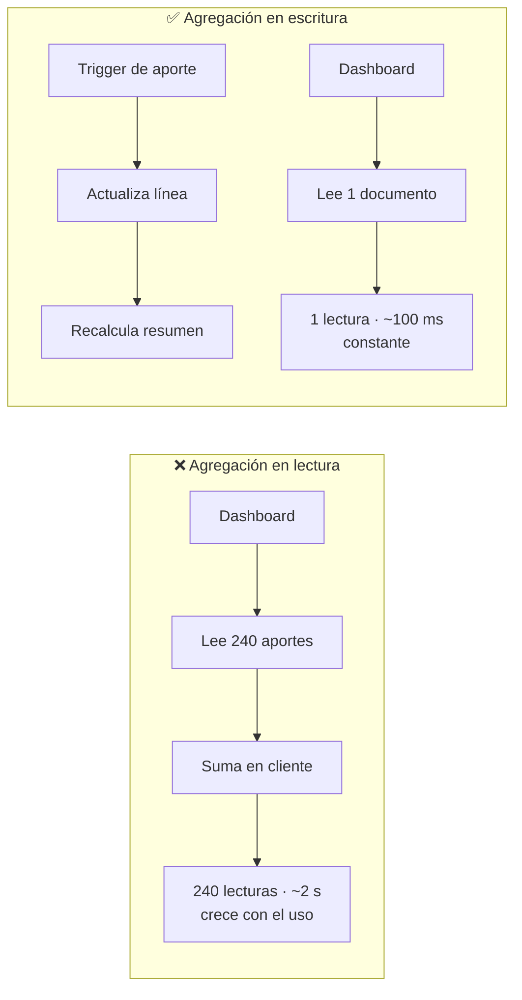

# 10 · Análisis y dashboards

[← Seguridad](09-seguridad-y-auditoria.md) · [Índice](README.md) · [Siguiente: UX y navegación →](11-ux-y-navegacion.md)

---

## 1. Dos dashboards, no uno

La v1 tenía un solo dashboard. Con dos roles definidos, hay **dos preguntas distintas**
que no se responden con la misma pantalla:

|                           | Dashboard del cajero                 | Dashboard del administrador              |
| ------------------------- | ------------------------------------ | ---------------------------------------- |
| **Pregunta que responde** | "¿Cuánto llevo y qué me falta?"      | "¿Qué me dice este inventario?"          |
| **Unidad**                | Unidades contadas                    | Unidades **y dinero**                    |
| **Alcance**               | La sesión en curso, su sucursal      | Todas las sucursales, histórico incluido |
| **Fuente**                | `lineas` (ya en caché por el conteo) | `resumen` + `historicos`                 |
| **Frescura**              | Tiempo real (< 3 s)                  | Hasta 30 s de desfase                    |
| **Gráficas**              | Barra de progreso                    | Barras, pastel, series temporales        |
| **Costo de lectura**      | 0 extra                              | 1 documento                              |

Mezclarlos daría al cajero el valor monetario consolidado del inventario, que es
justamente lo que la separación de datos impide ([04 §2](04-modelo-de-datos-firestore.md)).

---

## 2. Dashboard del cajero

Vive **dentro** de la pantalla de conteo, no en otra sección. El cajero no navega a un
dashboard: lo tiene siempre a la vista mientras cuenta.

```
┌────────────────────────────────────────────┐
│ Sucursal Norte · Conteo de agosto           │
│ 🟢 Sincronizado · 4 cajeros contando        │
├────────────────────────────────────────────┤
│  ▓▓▓▓▓▓▓▓▓▓▓▓▓░░░░░░░  47 / 60 categorías  │
│                                             │
│  Tu aporte      Equipo        Te faltan     │
│  412 u          1.840 u       13 categorías │
└────────────────────────────────────────────┘
```

| Métrica                  | Cálculo                                 | Fuente            |
| ------------------------ | --------------------------------------- | ----------------- |
| Categorías cubiertas     | `count(lineas donde cantidadTotal > 0)` | caché local       |
| Categorías sin contar    | `total − cubiertas`                     | caché local       |
| Tu aporte                | `Σ aportes propios`                     | caché local       |
| Total del equipo         | `sesion.totalUnidades`                  | 1 documento       |
| Cajeros activos          | `len(sesion.participantes)`             | mismo documento   |
| Estado de sincronización | `hasPendingWrites`                      | metadatos del SDK |

**Costo: cero lecturas adicionales.** Todo sale de datos que la pantalla de conteo ya
tiene suscritos. Esto importa especialmente en la PWA sobre datos móviles.

### Lista de pendientes

Un filtro "sólo sin contar" es la función más útil del dashboard del cajero: al final de
la jornada convierte 60 categorías en las 13 que faltan. Con conteo mensual, donde nadie
recuerda por dónde iba, esto evita recorrer la bodega dos veces.

---

## 3. Dashboard del administrador

### El problema que resuelve el diseño

Firestore no tiene `GROUP BY`. Calcular "unidades por categoría" leyendo todos los
aportes costaría 240 lecturas por sesión y crecería sin límite.

**Decisión: agregación en escritura, no en lectura.**



### Métricas

| Métrica                            | Fórmula                            | Fuente                               |
| ---------------------------------- | ---------------------------------- | ------------------------------------ |
| Unidades por categoría             | `Σ aportes`                        | `resumen.porCategoria[cat].cantidad` |
| Subtotal por categoría             | `cantidad × valorUnitario`         | `resumen.porCategoria[cat].subtotal` |
| Categoría con más unidades         | `max(cantidad)`                    | `resumen.categoriaMayor`             |
| Categoría con menos unidades       | `min(cantidad)` entre las contadas | `resumen.categoriaMenor`             |
| Total de unidades                  | `Σ cantidades`                     | `resumen.totalUnidades`              |
| Total monetario                    | `Σ subtotales`                     | `resumen.totalMonetario`             |
| Participación en unidades          | `cantidad / totalUnidades × 100`   | calculado al presentar               |
| Participación en dinero            | `subtotal / totalMonetario × 100`  | calculado al presentar               |
| Última actualización por categoría | `max(actualizadaEn)`               | `resumen.porCategoria[cat]`          |
| Comparativo entre sucursales       | métricas por sucursal              | `historicos`                         |
| Evolución mensual                  | serie de sesiones cerradas         | `historicos` ordenados               |

> **Los porcentajes no se almacenan.** Almacenarlos genera inconsistencias por redondeo
> cada vez que cambia el total, y no ahorra nada.

```typescript
// packages/shared/src/services/calculadora-analisis.ts
export function participacion(parte: number, total: number): number {
  return total === 0 ? 0 : (parte / total) * 100;
}

/** Ajusta el redondeo para que la suma mostrada sea exactamente 100,0 %
 *  (método del mayor resto). Sin esto un pastel puede mostrar 99,8 %
 *  y parecer un error de cálculo. */
export function distribuirRedondeo(porcentajes: number[]): number[] {
  /* ... */
}
```

### Composición

```
┌──────────────────────────────────────────────────────┐
│  Sucursal Norte · Conteo de agosto · 🟢 En curso      │
│  Actualizado hace 12 s                                │
├────────────────────┬────────────────────┬────────────┤
│ Total unidades     │ Valor total        │ Categorías │
│ 1.840              │ $12.450.000        │ 47 / 60    │
├────────────────────┴────────────────────┴────────────┤
│  🔄 Sincronización: 3 de 4 cajeros confirmados        │
│     ⚠️ Luis Pérez — sin confirmar                      │
├──────────────────────────────────────────────────────┤
│  📊 Unidades por categoría de valor    [barras]       │
├──────────────────────────────────────────────────────┤
│  🥧 Participación en dinero             [pastel]      │
├──────────────────────────────────────────────────────┤
│  ▲ Mayor: $2.000 (310 u)   ▼ Menor: $150.000 (2 u)   │
├──────────────────────────────────────────────────────┤
│  Tabla detallada · ordenable                          │
│  Valor │ Unidades │ Subtotal │ % Und │ % $ │ Últ.act. │
├──────────────────────────────────────────────────────┤
│  🏢 Comparativo entre sucursales        [barras]      │
└──────────────────────────────────────────────────────┘
```

> El bloque de sincronización es nuevo en la v2 y está deliberadamente **arriba**: es la
> información que el administrador necesita antes de decidir si puede cerrar el conteo.

---

## 4. Frescura de los datos

| Vista                         |  Latencia máxima | Justificación                                               |
| ----------------------------- | ---------------: | ----------------------------------------------------------- |
| Conteo y dashboard del cajero |            < 3 s | Tiempo real puro; el cajero necesita ver el avance          |
| Dashboard del administrador   |           < 30 s | Vista de supervisión; un desfase corto no cambia decisiones |
| Estado de sincronización      |            < 3 s | Condiciona una acción inmediata (cerrar o no)               |
| Comparativo histórico         | al cerrar sesión | Sólo tiene sentido sobre conteos finalizados                |

La UI muestra `recalculadoEn`. Ocultar la latencia genera desconfianza; mostrarla, lo
contrario.

---

## 5. Elección de gráfica

| Métrica                      | Gráfica                     | Por qué                                |
| ---------------------------- | --------------------------- | -------------------------------------- |
| Unidades por categoría       | Barras horizontales         | Muchas categorías con etiquetas largas |
| Participación en dinero      | Pastel, **top 6 + "Otros"** | Un pastel con 60 porciones es ilegible |
| Comparativo entre sucursales | Barras agrupadas            | Comparación directa entre pocas series |
| Evolución mensual            | Líneas                      | Serie temporal sobre sesiones cerradas |

> **Regla de legibilidad:** ninguna gráfica muestra más de 8 series. Con 60 categorías se
> grafican las principales y se agrupa el resto; el detalle completo vive en la tabla.

```tsx
<BarChart data={filas.slice(0, 8)}>
  <CartesianGrid vertical={false} />
  <XAxis dataKey="etiqueta" tick={{ fontSize: 10 }} />
  <YAxis />
  <Bar dataKey="cantidad" fill="var(--color-primary)" radius={[4, 4, 0, 0]} />
</BarChart>
```

> **Nota de bundle:** las gráficas sólo aparecen en vistas de administrador, que se
> consumen mayoritariamente en escritorio. El peso de `recharts` no afecta a la ruta
> crítica del cajero — pero conviene cargarlas con `React.lazy` para no inflar el bundle
> inicial ([06](06-plataforma-web.md)).

---

## 6. Comparativo entre sucursales

Se construye sobre `historicos`, no sobre sesiones abiertas: comparar un conteo a medio
hacer contra uno terminado produce conclusiones falsas.

**El comparativo mide ejecución del conteo, no tamaño de sucursal** ([ADR-20](13-decisiones-adr.md#adr-20)).
Rankear por dinero o por participación porcentual del último histórico premia siempre a la
sucursal más grande y no señala ninguna acción posible: participación es cuota sobre el
total de la red, sigue siendo una medida de tamaño aunque se exprese en porcentaje.

Columnas: Sucursal · Días sin contar · Último cierre · Duración · Unidades · Tendencia.
`Total $` aparece sólo en escritorio, como contexto secundario — nunca como criterio de
orden. Orden por defecto: **días sin contar descendente**, para que lo primero que se vea
sea la excepción que necesita atención, no la sucursal de siempre.

El umbral de "atrasada" es auto-calibrado por sucursal: se compara contra la mediana de
días entre sus propios cierres, no contra una constante fija para toda la red — una
sucursal de conteo quincenal y otra mensual se juzgan cada una contra su propia cadencia.

```typescript
async function compararEjecucion(): Promise<ComparativoSucursal[]> {
  const sucursales = await getDocs(collection(db, "sucursales"));
  const [series, sesionesCerradas] = await Promise.all([
    Promise.all(
      sucursales.docs.map((s) => historicosRecientesPorSucursal(s.id /* límite 12 */)),
    ),
    listarSesiones({ estado: "cerrada" }),
  ]);
  return construirComparativo(sucursales.docs, series, sesionesCerradas);
}
```

Datos: fan-out de `historicosRecientesPorSucursal` (ya existe, límite 12,
`packages/data/src/firebase/firestore-admin-repository.ts`) para la serie temporal de cada
sucursal, más **una** consulta `listarSesiones({estado: "cerrada"})` para calcular la
duración de cada conteo (`abiertaEn` → `cerradaEn`, dato que `Historico` no guarda). Sin
índices nuevos, sin reglas nuevas, sin Cloud Functions.

Costo: **N+1 lecturas** para la serie (6 con 5 sucursales) más 1 consulta adicional para
duraciones, constante en el tiempo — no crece con el volumen de conteos.

`collectionGroup("historicos")` sigue prohibido para traer todo de una sola consulta: no
existe regla `match /{path=**}/historicos/{id}` ni índice `COLLECTION_GROUP` para esa
colección, así que esa consulta pasa en el emulador y **falla en producción** por la
denegación por defecto de `infra/firestore.rules`.

> Con conteo mensual, el comparativo gana valor: cada punto de la serie es un mes, y en
> un año hay 12 puntos por sucursal — suficiente para ver tendencias reales y calibrar el
> umbral de "atrasada" con un historial significativo.

---

## 7. Estados de la vista

| Estado                | Qué se muestra                                                    |
| --------------------- | ----------------------------------------------------------------- |
| Cargando              | _Skeleton_ con la forma final del dashboard, no un spinner        |
| Sesión sin aportes    | "Aún no hay conteos registrados en esta sesión"                   |
| Sin conexión          | Últimos datos en caché + "Mostrando datos guardados · hace 8 min" |
| Datos inconsistentes  | Aviso discreto si `reconciliarLineas` detectó discrepancias       |
| Cajeros sin confirmar | Bloque destacado con nombres                                      |

> El _skeleton_ de "Cargando" es sobre carga de página/panel; el botón en vuelo de una
> acción que llama a una Cloud Function se especifica en `docs/DESIGN.md` ("Botón primario").

---

## 8. Exportación (fuera del alcance de v1)

Preparado en el diseño, no implementado:

- CSV/Excel del resumen y del detalle por categoría.
- PDF del acta de conteo cerrado, con firma del administrador que cerró y constancia de
  si el cierre fue forzado.
- Ambos generados por Cloud Function → Cloud Storage → enlace temporal.

---

[← Seguridad](09-seguridad-y-auditoria.md) · [Índice](README.md) · [Siguiente: UX y navegación →](11-ux-y-navegacion.md)
