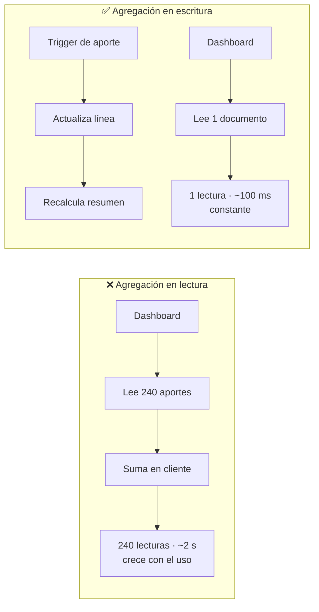

# 10 · Análisis y dashboards

[← Seguridad](09-seguridad-y-auditoria.md) · [Índice](README.md) · [Siguiente: UX y navegación →](11-ux-y-navegacion.md)

---

## 1. Dos dashboards, no uno

La v1 tenía un solo dashboard. Con dos roles definidos, hay **dos preguntas distintas**
que no se responden con la misma pantalla:

|                           | Dashboard del cajero                 | Dashboard del administrador              |
| ------------------------- | ------------------------------------ | ---------------------------------------- |
| **Pregunta que responde** | "¿Cuánto llevo y qué me falta?"      | "¿Qué me dice este inventario?"          |
| **Unidad**                | Unidades contadas                    | Unidades **y dinero**                    |
| **Alcance**               | La sesión en curso, su sucursal      | Todas las sucursales, histórico incluido |
| **Fuente**                | `lineas` (ya en caché por el conteo) | `lineas` en tiempo real + `historicos`   |
| **Frescura**              | Tiempo real (< 3 s)                  | Hasta 30 s de desfase                    |
| **Gráficas**              | Barra de progreso                    | Series temporales (sparkline)            |
| **Costo de lectura**      | 0 extra                              | 1 documento                              |

Mezclarlos daría al cajero el valor monetario consolidado del inventario, que es
justamente lo que la separación de datos impide ([04 §2](04-modelo-de-datos-firestore.md)).

> **La fuente real del dashboard del administrador es `lineas`, no `resumen`.**
> `AnalisisScreen.tsx` tiene prohibido en su propia cabecera leer `resumen/actual`:
> lo refresca un cron y puede quedar `dirty` indefinidamente, así que el dinero se
> calcula en cliente con `totalMonetarioSesion`/`subtotal` sobre el mismo listener
> de `lineas` en tiempo real que ya usa el cajero — el diseño original de esta
> sección asumía `resumen` como fuente y el código nunca lo hizo así.

---

## 2. Dashboard del cajero

Vive **dentro** de la pantalla de conteo, no en otra sección. El cajero no navega a un
dashboard: lo tiene siempre a la vista mientras cuenta.

```
┌────────────────────────────────────────────┐
│ Sucursal Norte · Conteo de agosto           │
│ 🟢 Sincronizado · 4 cajeros contando        │
├────────────────────────────────────────────┤
│  ▓▓▓▓▓▓▓▓▓▓▓▓▓░░░░░░░  47 / 60 categorías  │
│                                             │
│  Tu aporte      Equipo        Te faltan     │
│  412 u          1.840 u       13 categorías │
└────────────────────────────────────────────┘
```

| Métrica                  | Cálculo                                 | Fuente            |
| ------------------------ | --------------------------------------- | ----------------- |
| Categorías cubiertas     | `count(lineas donde cantidadTotal > 0)` | caché local       |
| Categorías sin contar    | `total − cubiertas`                     | caché local       |
| Tu aporte                | `Σ aportes propios`                     | caché local       |
| Total del equipo         | `sesion.totalUnidades`                  | 1 documento       |
| Cajeros activos          | `len(sesion.participantes)`             | mismo documento   |
| Estado de sincronización | `hasPendingWrites`                      | metadatos del SDK |

**Costo: cero lecturas adicionales.** Todo sale de datos que la pantalla de conteo ya
tiene suscritos. Esto importa especialmente en la PWA sobre datos móviles.

### Lista de pendientes

Un filtro "sólo sin contar" es la función más útil del dashboard del cajero: al final de
la jornada convierte 60 categorías en las 13 que faltan. Con conteo mensual, donde nadie
recuerda por dónde iba, esto evita recorrer la bodega dos veces.

---

## 3. Dashboard del administrador

### El problema que resuelve el diseño

Firestore no tiene `GROUP BY`. Calcular "unidades por categoría" leyendo todos los
aportes costaría 240 lecturas por sesión y crecería sin límite.

**Decisión: agregación en escritura, no en lectura.**



### Métricas

| Métrica                          | Fórmula                                              | Fuente                                       |
| --------------------------------- | ----------------------------------------------------- | --------------------------------------------- |
| Unidades y valor por categoría   | `Σ cantidadTotal`, `cantidadTotal × valorUnitario`     | `agruparPorDimension(lineas, "categoria")`   |
| Unidades y valor por cajero      | `Σ aplicados[uid]`, `aplicados[uid] × valorUnitario`   | `agruparPorDimension(lineas, "cajero")`      |
| Unidades y valor por área        | `Σ cantidadTotal`, `Σ subtotal`, agrupado por `area`   | `agruparPorDimension(lineas, "area")`        |
| Total de unidades                | `Σ cantidadTotal`                                      | `totalUnidadesSesion(lineas)`                |
| Total monetario                  | `Σ subtotal`                                           | `totalMonetarioSesion(lineas)`               |
| Participación de cada fila (%)   | método del mayor resto sobre `valor` de todas las filas | `distribuirRedondeo`, calculado al presentar |
| Variación vs. sesión anterior    | `(actual − anterior) / anterior × 100`                 | `variacion`, sobre `historicos`              |
| Comparativo entre sucursales     | métricas por sucursal                                  | `historicos`                                 |
| Evolución mensual (valor por cierre) | serie de sesiones cerradas                         | `historicos` ordenados                       |

> **"Categoría con más/menos unidades" no es una métrica propia.** Es la primera y la
> última fila de la misma tabla ordenable por Valor — pedirle al dato una segunda
> representación (`resumen.categoriaMayor`/`categoriaMenor`) duplicaba algo que ordenar
> ya resuelve.

> **Los porcentajes no se almacenan.** Almacenarlos genera inconsistencias por redondeo
> cada vez que cambia el total, y no ahorra nada.

```typescript
// packages/shared/src/services/calculadora-analisis.ts
export function participacion(parte: number, total: number): number {
  return total === 0 ? 0 : (parte / total) * 100;
}

/** Ajusta el redondeo para que la suma mostrada sea exactamente 100,0 %
 *  (método del mayor resto). Sin esto un pastel puede mostrar 99,8 %
 *  y parecer un error de cálculo. */
export function distribuirRedondeo(porcentajes: number[]): number[] {
  /* ... */
}
```

### Composición

El dashboard de sesión (`AnalisisScreen.tsx`) se redujo de 9 bloques —que repetían la
misma agregación por categoría tres veces (barras, pastel, tabla) más "Unidades por
área" y "Evolución mensual" aparte— a **3 secciones**, en este orden exacto:

```
┌──────────────────────────────────────────────────────┐
│  Análisis · Sucursal Norte          🟡 Sincronizado  │  ← cabecera
│  Sesión abierta · 1/08/2026, 5:05 a. m.               │
│  ⚠️ Luis Pérez — sin confirmar                         │
├──────────────────────────────────────────────────────┤
│  [ vs. sesión anterior ]                              │  ← resumen
│  Valor contado           $12.450.000  +8,2 %          │
│  ╱‾‾╲___╱‾‾ (sparkline "Valor contado por cierre")    │
│  Valor por unidad  $6.766  +1,1 %  │  Unidades  1.840  │
│                                       47/60 categorías │
├──────────────────────────────────────────────────────┤
│  Desglose por: [ Categoría ▾ ]                        │  ← tabla
│  Categoría │ Unidades │  Valor  │  %                  │
│  $150.000  │      2   │ $300.000│ 32,6 %               │
│  $2.000    │    310   │ $620.000│ 67,4 %               │
│  Total     │    312   │ $920.000│ 100,0 %              │
└──────────────────────────────────────────────────────┘
```

Cabecera, resumen y tabla reemplazan uno a uno los bloques viejos:

- **Cabecera**: el chip de sincronización (`ChipEstado`) sustituye al bloque
  "Estado de sincronización" completo — sólo quedan visibles, con nombre, los cajeros
  que **faltan** por confirmar; los que ya confirmaron viven ahora en el desglose por
  cajero de la tabla (ver §7).
- **Resumen**: el chip «vs. sesión anterior» más la card "Valor contado" (con la
  sparkline de evolución mensual dentro) y el par Valor por unidad/Unidades reemplazan
  las 3 tarjetas KPI, "Participación en dinero" (pastel) y "Extremos".
- **Tabla**: el `<select>` "Desglose por" (Categoría/Cajero/Área) reemplaza "Unidades
  por categoría" (barras), "Unidades por área" (barras duplicadas) y la tabla de
  detalle — las tres eran la misma pregunta ("cuánto hay de cada X") respondida tres
  veces con presentaciones distintas.

El comparativo entre sucursales no vive aquí (ADR-20): es uno de los 7 destinos del nav
del panel, no una sección de esta pantalla.

---

## 4. Frescura de los datos

| Vista                         |  Latencia máxima | Justificación                                               |
| ----------------------------- | ---------------: | ----------------------------------------------------------- |
| Conteo y dashboard del cajero |            < 3 s | Tiempo real puro; el cajero necesita ver el avance          |
| Dashboard del administrador   |           < 30 s | Vista de supervisión; un desfase corto no cambia decisiones |
| Estado de sincronización      |            < 3 s | Condiciona una acción inmediata (cerrar o no)               |
| Comparativo histórico         | al cerrar sesión | Sólo tiene sentido sobre conteos finalizados                |

La UI muestra `recalculadoEn`. Ocultar la latencia genera desconfianza; mostrarla, lo
contrario.

---

## 5. Elección de gráfica

El repositorio no tiene ninguna librería de gráficas (ni `recharts` ni ninguna otra) y no
va a tenerla: la única pieza gráfica del sistema es `Sparkline.tsx`, una curva SVG propia
(coordenadas + un `<circle>` por punto, sin dependencias) con su equivalente accesible en
texto en paralelo — nunca sólo el SVG. El componente de dona (pastel) y las barras
horizontales que usaba el dashboard de sesión se eliminaron del repositorio: la
agregación por categoría, por cajero y por área vive ahora en una sola tabla ordenable
con selector de dimensión (§3), y "cuánto hay de cada X" se responde una vez, no tres
con presentaciones distintas.

| Métrica                                  | Gráfica            | Por qué                                             |
| ------------------------------------------ | ------------------- | ---------------------------------------------------- |
| Comparativo entre sucursales (Tendencia) | Líneas (Sparkline) | Serie temporal compacta, una por fila de la tabla    |
| Evolución mensual (valor por cierre)     | Líneas (Sparkline) | Serie temporal sobre sesiones cerradas de una sesión |

> **Regla de legibilidad:** ninguna gráfica muestra más de 8 series. Su único usuario
> hoy es el comparativo entre sucursales (§6) — 12 puntos por sucursal, unas pocas
> sucursales a la vez; el detalle completo, cuando hace falta, vive en la tabla.

---

## 6. Comparativo entre sucursales

Se construye sobre `historicos`, no sobre sesiones abiertas: comparar un conteo a medio
hacer contra uno terminado produce conclusiones falsas.

**El comparativo mide ejecución del conteo, no tamaño de sucursal** ([ADR-20](13-decisiones-adr.md#adr-20)).
Rankear por dinero o por participación porcentual del último histórico premia siempre a la
sucursal más grande y no señala ninguna acción posible: participación es cuota sobre el
total de la red, sigue siendo una medida de tamaño aunque se exprese en porcentaje.

Columnas: Sucursal · Días sin contar · Último cierre · Duración · Unidades · Tendencia.
`Total $` aparece sólo en escritorio, como contexto secundario — nunca como criterio de
orden. Orden por defecto: **días sin contar descendente**, para que lo primero que se vea
sea la excepción que necesita atención, no la sucursal de siempre.

El umbral de "atrasada" es auto-calibrado por sucursal: se compara contra la mediana de
días entre sus propios cierres, no contra una constante fija para toda la red — una
sucursal de conteo quincenal y otra mensual se juzgan cada una contra su propia cadencia.

```typescript
async function compararEjecucion(): Promise<ComparativoSucursal[]> {
  const sucursales = await getDocs(collection(db, "sucursales"));
  const [series, sesionesCerradas] = await Promise.all([
    Promise.all(
      sucursales.docs.map((s) => historicosRecientesPorSucursal(s.id /* límite 12 */)),
    ),
    listarSesiones({ estado: "cerrada" }),
  ]);
  return construirComparativo(sucursales.docs, series, sesionesCerradas);
}
```

Datos: fan-out de `historicosRecientesPorSucursal` (ya existe, límite 12,
`packages/data/src/firebase/firestore-admin-repository.ts`) para la serie temporal de cada
sucursal, más **una** consulta `listarSesiones({estado: "cerrada"})` para calcular la
duración de cada conteo (`abiertaEn` → `cerradaEn`, dato que `Historico` no guarda). Sin
índices nuevos, sin reglas nuevas, sin Cloud Functions.

Costo: **N+1 lecturas** para la serie (6 con 5 sucursales) más 1 consulta adicional para
duraciones, constante en el tiempo — no crece con el volumen de conteos.

`collectionGroup("historicos")` sigue prohibido para traer todo de una sola consulta: no
existe regla `match /{path=**}/historicos/{id}` ni índice `COLLECTION_GROUP` para esa
colección, así que esa consulta pasa en el emulador y **falla en producción** por la
denegación por defecto de `infra/firestore.rules`.

> Con conteo mensual, el comparativo gana valor: cada punto de la serie es un mes, y en
> un año hay 12 puntos por sucursal — suficiente para ver tendencias reales y calibrar el
> umbral de "atrasada" con un historial significativo.

---

## 7. Estados de la vista

| Estado                | Qué se muestra                                                    |
| --------------------- | ----------------------------------------------------------------- |
| Cargando              | _Skeleton_ con la forma final del dashboard, no un spinner        |
| Sesión sin aportes    | Resumen en "0 / 0 categorías contadas"; la tabla pinta "Todavía no hay unidades contadas." |
| Sin conexión          | Últimos datos en caché + "Mostrando datos guardados · {fecha}" (`fecha()`, no un relativo "hace X min") |
| Datos inconsistentes  | Aviso discreto (`role="status"`) si `reconciliarLineas` detectó discrepancias |
| Cajeros sin confirmar | Bloque destacado con nombres — sólo los que faltan; los confirmados con sus cifras viven en el desglose por cajero |

> El _skeleton_ de "Cargando" es sobre carga de página/panel; el botón en vuelo de una
> acción que llama a una Cloud Function se especifica en `docs/DESIGN.md` ("Botón primario").

---

## 8. Exportación

**Implementado — PDF del análisis de sesión ([ADR-28](13-decisiones-adr.md#adr-28)).**
El botón "Exportar PDF" de la pantalla de análisis genera y descarga el PDF **en el
navegador** (jsPDF + jspdf-autotable, cargadas con `import()` dinámico): cabecera con
sucursal y fechas, el resumen de las tres cards, la dimensión y el orden elegidos, y la
tabla con su fila total en el mismo orden que se ve en pantalla. Cero Cloud Function,
cero Cloud Storage.

Preparado en el diseño, no implementado:

- CSV/Excel del resumen y del detalle por categoría.
- PDF del acta de conteo cerrado, con firma del administrador que cerró y constancia de
  si el cierre fue forzado. Un acta con firma sí puede requerir servidor (constancia no
  alterable por el cliente); el PDF de análisis de arriba no la sustituye.

---

[← Seguridad](09-seguridad-y-auditoria.md) · [Índice](README.md) · [Siguiente: UX y navegación →](11-ux-y-navegacion.md)
