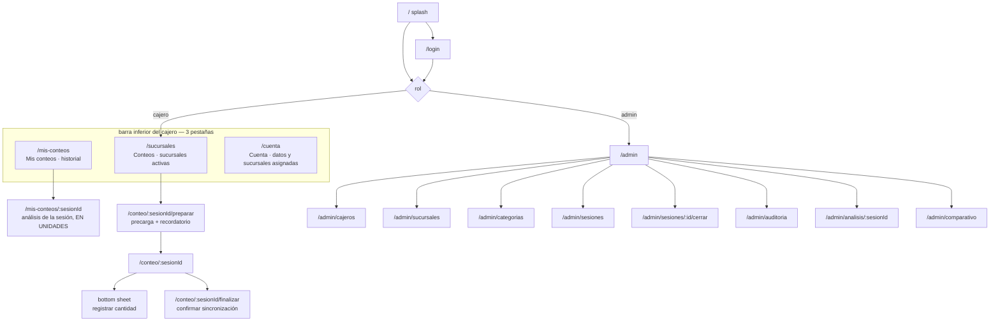
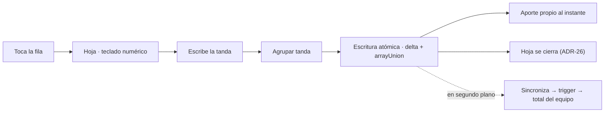
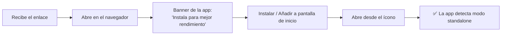

# 11 · Experiencia de usuario y navegación

[← Análisis y dashboards](10-analisis-y-dashboards.md) · [Índice](README.md) · [Siguiente: Despliegue →](12-despliegue-y-entornos.md)

---

## 1. Contexto real de uso

El diseño de interfaz responde a cómo se cuenta de verdad:

- El cajero está **de pie**, con el teléfono en una mano y productos en la otra.
- Hay **poca luz** en bodegas y a veces **guantes**.
- La conectividad es mixta: WiFi en algunas sucursales, datos móviles en otras.
- El conteo es **repetitivo**: la misma acción 60 veces seguidas.
- **Ocurre una vez cada quince o treinta días**: nadie recuerda cómo funciona la app.

| Contexto           | Decisión de UI                                                       |
| ------------------ | -------------------------------------------------------------------- |
| Una sola mano      | Acciones principales en la mitad inferior                            |
| Repetición         | Teclado numérico visible; avance automático a la siguiente categoría |
| Poca luz / guantes | Objetivos táctiles ≥ 48 dp, alto contraste, tema oscuro              |
| Señal intermitente | Estado de sincronización siempre visible, nunca bloqueante           |
| **Uso mensual**    | **Recordatorio de flujo al abrir; sin depender de memoria muscular** |
| **Datos móviles**  | **Aviso de precarga con WiFi; consumo visible**                      |
| Error humano       | Corregir el aporte propio es un toque, sin diálogos                  |

> **El uso mensual es la restricción de UX más subestimada.** Una app que se usa a diario
> puede permitirse ser sutil; una que se usa doce veces al año tiene que explicarse sola
> cada vez.

---

## 2. Mapa de navegación



Dos rutas nuevas en la v2: `preparar` (antes de contar) y `finalizar` (después). Enmarcan
la sesión y son donde viven la precarga y la confirmación de sincronización.

### La barra de pestañas del cajero

Las tres pestañas son **hermanas alcanzables entre sí**, no un árbol: desde cualquiera se
llega a las otras dos. Antes `/mis-conteos` colgaba de un enlace al pie de `/sucursales` y
era un salto **sin vuelta** — el cajero quedaba varado en el historial.

> **La barra no se esconde en `/conteo/*`: no se monta.** Las cuatro rutas de pestaña viven
> dentro de un layout route (`LayoutCajero`) y las tres de conteo quedan fuera de él. Una
> condicional sobre `pathname` sería reimplementar el routing a mano y se desincronizaría en
> la primera ruta nueva. Bajo `/admin` manda `AdminLayout`, que tiene su propia navegación.

El análisis de `/mis-conteos/:sesionId` es el **dashboard operativo del cajero** de RF-14:
unidades del equipo, aporte propio y desglose por categoría / área / compañero. **Nunca
importes** — I-9 y ADR-07 lo hacen estructural, no cosmético: `sesiones/*/resumen` es
`read: if esAdmin()` en las reglas, así que el dato monetario ni siquiera llega al cliente
del cajero. El desglose por persona muestra "Tú" y "Compañero N", nunca un uid ni un nombre
de tercero: `usuarios` es `list: if esAdmin()`.

### Panel acotado por sucursal (admin_sucursal)

`admin_sucursal` entra al mismo `/admin` que Gerente, pero `AdminLayout` **no
renderiza el destino Comparativo** para ese rol — la comparativa cruza todas
las sucursales, y este rol sólo ve la propia (D8, `docs/../changes/rol-admin-sucursal`).
`PanelAdmin` (`router.tsx`) resuelve su propio `useAuthState` y **no monta**
`AdminRepositoryProvider`/`AdminLayout` hasta que resuelve: así el repositorio
Firestore nunca se construye con un alcance a medio resolver por una carrera
de renders. El rol resuelto viaja a las pantallas hijas por
`<Outlet context={{ rol }} />`; `CajerosScreen` lo lee con
`useOutletContext()` y sólo ofrece "Cajero" en el selector de rol — igual que
el servidor, que ya rechaza cualquier otro rol para este caller.

### Guardas de ruta

```tsx
function RequireAuth({ children }: { children: JSX.Element }) {
  const auth = useAuthState();
  const location = useLocation();

  if (auth === undefined) return <SplashScreen />;
  if (auth === null) return <Navigate to="/login" state={{ from: location }} replace />;

  if (location.pathname.startsWith("/admin") && !auth.esAdmin) {
    return <Navigate to="/sucursales" replace />;
  }
  return children;
}
```

> La guarda es **conveniencia**, no seguridad. La autorización real está en las Security
> Rules ([09](09-seguridad-y-auditoria.md)). Esto importa más en un cliente web, donde
> manipular el código es trivial.

---

## 3. Pantalla de preparación (nueva)

Aparece al entrar a una sesión. Resuelve tres problemas de una vez: el olvido por uso
mensual, la precarga sobre WiFi y la instalación de la PWA.

```
┌────────────────────────────────────────────┐
│  Conteo de agosto · Sucursal Norte          │
│                                             │
│  📶 Esta sucursal usa datos móviles         │
│     Conéctate al WiFi antes de bajar        │
│                                             │
│  ✅ Catálogo cargado (60 categorías)        │
│  ✅ Sesión sincronizada                     │
│                                             │
│  Cómo funciona:                             │
│  1. Elige un valor de la lista              │
│  2. Escribe cuántas unidades contaste TÚ    │
│  3. El sistema suma lo de todo el equipo    │
│  4. Al terminar, pulsa "Finalizar"          │
│                                             │
│           [  Empezar a contar  ]            │
└────────────────────────────────────────────┘
```

El paso 2 es el que más se malinterpreta: el cajero debe registrar **lo que él contó**,
no el total del estante. Decirlo cada vez cuesta una línea de texto y evita conteos
duplicados.

---

## 4. Pantalla de conteo

La pantalla crítica del sistema.

```
┌────────────────────────────────────────────┐
│ ← Sucursal Norte · Conteo de agosto        │
│ 🟢 Sincronizado · 4 cajeros contando       │
├────────────────────────────────────────────┤
│ ▓▓▓▓▓▓▓▓▓▓▓░░░░  47/60   [Sólo pendientes] │
├────────────────────────────────────────────┤
│ 🔍 Buscar valor…                            │
├────────────────────────────────────────────┤
│ [ Todas las áreas ▾ ] [ Sin área (12) ] [ + Producto ] │
├────────────────────────────────────────────┤
│  $1.000                                 12 │
│  Tú: 12 · Equipo: 45                       │
├────────────────────────────────────────────┤
│  $2.000                                 30 │
│  Tú: 30 · Equipo: 310                      │
├────────────────────────────────────────────┤
│  $5.000                                  0 │
│  Tú: — · Equipo: 55                        │
├────────────────────────────────────────────┤
│  Tu aporte: 412 u      Equipo: 1.840 u     │
│           [  Finalizar conteo  ]           │
└────────────────────────────────────────────┘
```

> **Sin importes.** El cajero ve unidades, nunca dinero — coherente con la separación de
> datos, que además hace imposible mostrarlos aunque alguien lo intentara.

### Los dos números, siempre separados

| Número     | Origen                     | Offline                        | Etiqueta     |
| ---------- | -------------------------- | ------------------------------ | ------------ |
| **Tú**     | Aporte propio, caché local | Siempre correcto e instantáneo | "Tú: 12"     |
| **Equipo** | Línea agregada, servidor   | Puede estar desactualizado     | "Equipo: 45" |

Con un solo número, el cajero vería cifras "saltando" al sincronizar y perdería la
confianza. Separándolos, el número que él controla nunca cambia solo.

### Interacción de registro



Tocar la fila abre la **Hoja** (teclado numérico y desglose de tandas). Cada aporte se registra
como una tanda en el ledger `partidas` (`deltaCantidad` + `agregarPartida`), y cada borrado
retira la partida exacta (`quitarPartida` vía `arrayRemove`). El stepper `−`/`+` fue
eliminado (ADR-24, issue #90) para blindar la invariante `cantidad === suma(partidas)`:
ningún aporte puede existir sin su correspondiente tanda explicada en el ledger. "Agrupar"
cierra la Hoja (ADR-26, pedido del cliente): para otra tanda o para borrar una de la misma
categoría, el cajero vuelve a tocar la fila.

### Catálogo desde el conteo (ADR-21)

`Sin área (N)` es **autoextinguible**: sólo aparece mientras quedan categorías con el
sentinel `"Sin área"` (`N = número de líneas en ese estado`); en cuanto la última se
vincula, el botón desaparece solo, sin que el cajero tenga que cerrar nada. Abre una hoja
que lista esas categorías y, al tocar una, despliega las áreas ya existentes del catálogo —
**el contador vincula, nunca crea, un área** (ADR-21). `+ Producto` siempre está disponible
con la sesión abierta: da de alta una categoría nueva dentro de la sesión en curso, con
`valorUnitario: 0` — el admin la precia después, la separación monetaria de I-9 no se cruza
desde el conteo.

> **Punto de atención de UX:** la captura por tandas en la Hoja permite registrar múltiplos
> (por ejemplo, bolsas de 50 o paquetes de 100) y auditar o borrar tandas individuales con la
> papelera, manteniendo el conteo siempre justificado y transparente.

---

## 5. Estados de sincronización

| Estado                      | Indicador                                  | Detección                           |
| --------------------------- | ------------------------------------------ | ----------------------------------- |
| Sincronizado                | 🟢 "Sincronizado"                          | `!hasPendingWrites && !isFromCache` |
| **Pendientes**              | 🔴 **banner fijo no descartable**          | `hasPendingWrites`                  |
| Sin conexión                | 🔴 "Sin conexión · tus conteos se guardan" | `navigator.onLine` + `isFromCache`  |
| Sesión cerrada por el admin | ⚫ Modal bloqueante + salida               | `estado != 'abierta'`               |

**Tono del mensaje offline:** nunca alarmante. El cajero no hizo nada mal. "Sin conexión ·
tus conteos se guardan y se enviarán solos", no "Error de red".

**Excepción deliberada:** con pendientes, el mensaje **sí** es insistente, porque cerrar
la app en ese estado tiene consecuencias reales ([06](06-plataforma-web.md)):

```
🔴 No cierres la aplicación
   Tienes 12 conteos sin enviar.
   Busca señal o WiFi para que se guarden.
   [ Reintentar ahora ]
```

---

## 6. Pantalla de finalización (nueva)

```
┌────────────────────────────────────────────┐
│  Finalizar tu conteo                        │
│                                             │
│  Contaste 412 unidades en 47 categorías     │
│  Faltan 13 categorías sin contar            │
│                                             │
│  ⏳ Enviando 12 conteos…                    │
│     No cierres la app                       │
│                                             │
│         [ Esperando conexión ]              │
└────────────────────────────────────────────┘
```

Al llegar a cero pendientes:

```
│  ✅ Todo enviado                            │
│     [  Confirmar y salir  ]                 │
```

El botón de confirmar **sólo se habilita con cero pendientes**. Al pulsarlo, el cliente
escribe su `confirmadoEn` ([04](04-modelo-de-datos-firestore.md)), que es lo que permite
al administrador cerrar la sesión.

---

## 7. Instalación de la PWA

Parte del procedimiento de alta de **todo** cajero, no una sugerencia opcional: una PWA
instalada tiene mejores garantías de almacenamiento que una pestaña de navegador.



> Chrome y Android ofrecen un prompt nativo de instalación (`beforeinstallprompt`); Safari
> en iOS requiere el flujo manual "Compartir → Añadir a pantalla de inicio", más largo.
> El diagrama muestra el caso más restrictivo.

La app detecta si está instalada y, si no lo está, muestra un aviso persistente con
instrucciones ilustradas. Si el cajero sigue usándola desde una pestaña tras el primer
conteo, el administrador lo ve en el panel (`pwaInstalada`) y puede insistir.

```typescript
const estaInstalada = window.matchMedia("(display-mode: standalone)").matches;
```

---

## 8. Panel de administrador

Mismo cliente React, servido como PWA en escritorio.

| Sección              | Contenido                                                  |
| -------------------- | ---------------------------------------------------------- |
| Inicio               | Sesiones abiertas por sucursal; acceso a abrir/cerrar      |
| Cajeros              | Alta, edición de sucursales, activación/desactivación      |
| Sucursales           | Alta y edición; tipo de conectividad; estado de sesión     |
| Categorías de valor  | Catálogo con orden y activación; **sin borrado**           |
| Sesiones             | Histórico con filtros; acceso al detalle                   |
| **Cierre de sesión** | Estado de sincronización por cajero; cierre o anulación    |
| Auditoría            | Tabla paginada con filtros combinables                     |
| Análisis             | Dashboard de la sesión ([10](10-analisis-y-dashboards.md)) |
| Comparativo          | Últimos conteos cerrados de todas las sucursales           |

> **admin_sucursal no ve Comparativo.** El nav de `AdminLayout` lo filtra
> antes de renderizar — cruza sucursales, y este rol está acotado a la
> propia — y no es un accidente de permisos: el servidor jamás lo autorizaría
> aunque el enlace apareciera.

### Pantalla de cierre

```
┌──────────────────────────────────────────────┐
│  Cerrar conteo · Sucursal Norte · agosto      │
├──────────────────────────────────────────────┤
│  Estado de sincronización                     │
│  ✅ Ana Ramírez      hace 4 min                │
│  ✅ Carlos Díaz      hace 6 min                │
│  ✅ María Gómez      hace 2 min                │
│  ⚠️ Luis Pérez       sin confirmar             │
├──────────────────────────────────────────────┤
│  Total: 1.840 unidades · $12.450.000          │
│                                               │
│  [ Cerrar conteo ]  ← deshabilitado           │
│  Forzar cierre de todos modos ▸               │
└──────────────────────────────────────────────┘
```

La anulación está disponible pero escondida tras un desplegable, con confirmación
explícita y advertencia de que los conteos no sincronizados de Luis se perderán. Queda en
auditoría con `forzadoPor` ([09](09-seguridad-y-auditoria.md)).

### Diseño adaptativo

| Ancho       | Disposición                                               |
| ----------- | --------------------------------------------------------- |
| < 600 px    | Navegación inferior; tablas como tarjetas                 |
| 600–1024 px | Barra lateral de iconos; tablas con scroll horizontal     |
| > 1024 px   | Menú lateral fijo; tablas completas; gráficas lado a lado |

---

## 9. Accesibilidad y localización

| Aspecto              | Decisión                                                                                       |
| -------------------- | ---------------------------------------------------------------------------------------------- |
| Contraste            | Mínimo AA (4.5:1)                                                                              |
| Tamaño táctil        | ≥ 48×48 px                                                                                     |
| Escalado de texto    | Probado hasta 200 % (unidades `rem`)                                                           |
| Lectores de pantalla | HTML semántico + `aria-label` en filas: "Valor 5.000, tu aporte 12, total del equipo 45"       |
| Moneda               | `Intl.NumberFormat('es-CO', { style: 'currency', currency: 'COP', maximumFractionDigits: 0 })` |
| Fechas               | Formato local; auditoría con fecha y hora completas                                            |
| Idioma               | Español (CO); textos centralizados para futuras traducciones                                   |

> **Accesibilidad con DOM real:** al renderizar HTML nativo en vez de dibujar sobre
> canvas, el árbol de accesibilidad lo construye el navegador, no la app. Verificar con
> VoiceOver en iOS y con un lector de pantalla en Chrome/Android sigue siendo parte de las
> pruebas del prototipo ([06](06-plataforma-web.md)).

---

## 10. Prevención de errores

| Riesgo                                           | Prevención                                                              |
| ------------------------------------------------ | ----------------------------------------------------------------------- |
| Contar dos veces la misma categoría              | Marca "ya aportaste aquí" en la fila                                    |
| Registrar el total del estante en vez del propio | Recordatorio en la pantalla de preparación; etiqueta "Tú:" en cada fila |
| Cerrar la app con pendientes                     | Banner insistente + pantalla de finalización                            |
| Cerrar la sesión con cajeros sin sincronizar     | Bloqueo en el panel + revalidación en servidor                          |
| Confundir sucursales                             | Nombre siempre en la barra superior, con color distintivo               |
| Cantidad absurda por dedo torpe                  | Confirmación suave si supera 10× el promedio de la categoría            |
| Producto creado por error o duplicado            | Confirmación explícita «¿Crear el producto «X»?» antes de escribir; el nombre queda editable con «Corregir» |
| Olvidar cómo funciona tras un mes                | Pantalla de preparación con los cuatro pasos                            |
| Perder trabajo al cerrar la app                  | Cada aporte se persiste al instante (con la salvedad de PWA)            |

---

[← Análisis y dashboards](10-analisis-y-dashboards.md) · [Índice](README.md) · [Siguiente: Despliegue →](12-despliegue-y-entornos.md)
