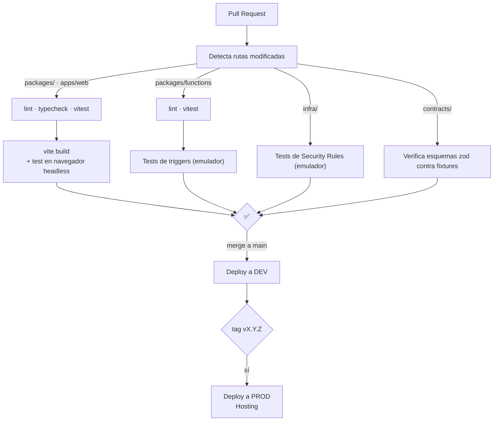

# 12 · Despliegue, entornos y observabilidad

[← UX y navegación](11-ux-y-navegacion.md) · [Índice](README.md) · [Siguiente: ADR →](13-decisiones-adr.md)

---

## 1. Entornos

Tres proyectos de Firebase separados. Compartir un proyecto entre desarrollo y producción
es la vía más rápida a corromper datos reales de inventario.

| Entorno | Proyecto Firebase       | Uso                                | Plan                         |
| ------- | ----------------------- | ---------------------------------- | ---------------------------- |
| Local   | Emulator Suite          | Desarrollo y pruebas automatizadas | —                            |
| Dev     | `conteo-eficiente-dev`  | Pruebas con dispositivos reales    | Blaze, tope bajo             |
| Prod    | `conteo-eficiente-prod` | Negocio real                       | Blaze, alerta de presupuesto |

### Modos de build

```bash
npm run dev --workspace apps/web            # vite --mode dev
npm run build --workspace apps/web          # vite build --mode prod
```

```typescript
// packages/shared/src/config/entorno.ts
export type Entorno = "dev" | "prod";

const valor = import.meta.env.MODE === "prod" ? "prod" : "dev";

export const Config = {
  actual: valor as Entorno,
  esProd: valor === "prod",
  nombreApp: valor === "prod" ? "Conteo" : "Conteo DEV",
};
```

Los proyectos de Firebase difieren por configuración (`firebaseConfig` inyectada según el
modo de build), y **los dominios de hosting también** (`conteo.web.app` y
`conteo-dev.web.app`): en una PWA, confundir entornos es fácil porque sólo cambia una URL.

---

## 2. Pipeline del monorepo

El monorepo hace el CI más largo, así que se ejecuta **por rutas afectadas**.



```yaml
# .github/workflows/ci.yml (fragmento)
jobs:
  web:
    if: contains(steps.changes.outputs.paths, 'packages/') ||
      contains(steps.changes.outputs.paths, 'apps/web/')
    steps:
      - run: npm ci
      - run: npm run lint --workspace apps/web
      - run: npm run typecheck --workspace apps/web
      - run: npm run test --workspace apps/web
      - run: npm run build --workspace apps/web

  functions:
    steps:
      - run: npm ci --workspace packages/functions
      - run: npm run test --workspace packages/functions

  rules:
    steps:
      - run: firebase emulators:exec --only firestore,functions
          "npm run test:rules"
```

**Regla de oro:** las Security Rules no se despliegan si sus tests fallan. Una regla mal
desplegada abre la base de datos entera; es el único fallo con consecuencias
irreversibles.

### Orden de despliegue

```bash
firebase deploy --only firestore:indexes   # 1. índices (pueden tardar minutos)
firebase deploy --only firestore:rules     # 2. reglas
firebase deploy --only functions           # 3. funciones
firebase deploy --only hosting             # 4. PWA
```

Los índices van primero: una consulta desplegada antes de su índice falla en ejecución.
El hosting va **al final** para que la app nunca quede sirviendo una versión que
adelanta un esquema todavía no desplegado.

---

## 3. Distribución

| Canal                               | Destinatario                             | Mecanismo                                                                   |
| ----------------------------------- | ---------------------------------------- | --------------------------------------------------------------------------- |
| Firebase Hosting (canal de preview) | Equipo de pruebas                        | Deploy de preview en cada PR                                                |
| **Firebase Hosting (producción)**   | **Todos los cajeros y el administrador** | Despliegue en cada tag                                                      |
| Play Store / App Store              | No aplica                                | Descartado ([ADR-11](13-decisiones-adr.md), [ADR-15](13-decisiones-adr.md)) |

Costo total de distribución: **USD 0**. Sin tiendas, sin cuotas anuales, sin proceso de
revisión.

### Control de versión mínima — crítico con uso mensual

Un cajero puede abrir la app un mes después del último uso, con una versión desactualizada
o con un service worker antiguo. Si el esquema cambió, un cliente viejo escribiendo
aportes con formato antiguo corrompería las agregaciones.

```typescript
// Al arrancar, antes de mostrar cualquier pantalla
const config = await getDoc(doc(db, "config/app"));
const minima = config.get("versionMinima");
if (versionActual < minima) {
  mostrarBloqueoActualizacion(); // "Hay una versión nueva disponible: recarga la página"
}
```

El bloqueo fuerza la actualización del service worker (`registration.update()`) y recarga.
Por eso `index.html` **nunca se cachea** ([06](06-plataforma-web.md)).

---

## 4. Observabilidad

| Herramienta                                       | Qué vigila                                                                            |
| ------------------------------------------------- | ------------------------------------------------------------------------------------- |
| **Cloud Logging**                                 | Ejecución de funciones, errores de triggers, latencias                                |
| **Firebase Performance**                          | Arranque y renderizado del cliente web                                                |
| **Google Analytics** (evento `excepcion_cliente`) | Errores no capturados en el cliente, vía `window.onerror` / _error boundary_ de React |
| **Google Analytics**                              | Eventos de negocio                                                                    |
| **Alertas de presupuesto**                        | Gasto mensual sobre el umbral                                                         |

### Métricas de salud

| Métrica                            | Objetivo | Alerta si                                     |
| ---------------------------------- | -------: | --------------------------------------------- |
| Tasa de error de `onAporteEscrito` |  < 0,1 % | > 1 % en 10 min                               |
| Latencia p95 del trigger           |    < 2 s | > 5 s                                         |
| Líneas inconsistentes              |        0 | ≥ 1                                           |
| Escrituras diarias                 |  < 6.000 | > 15.000                                      |
| Fallos de escritura por permisos   |       ~0 | Repunte → regla mal desplegada o abuso        |
| **Cierres forzados por sesión**    |        0 | ≥ 1 (revisar por qué un cajero no sincronizó) |
| **Aportes perdidos detectados**    |        0 | ≥ 1 (fallo grave del diseño)                  |

### Eventos de negocio

```typescript
logEvent(analytics, "aporte_registrado", {
  sucursal_id: sucursalId,
  offline: estabaOffline ? 1 : 0,
});

logEvent(analytics, "sesion_finalizada", {
  pendientes_al_finalizar: pendientes,
  segundos_esperando_sync: espera,
});
```

**Estas dos métricas responden las preguntas abiertas del diseño:**

1. `pendientes_al_finalizar` alto de forma sostenida → el riesgo de la PWA es real y hay
   que reforzar la salvaguarda (mejor precarga, recordatorios más tempranos).
2. `offline == 1` con frecuencia alta → el diseño offline-first era necesario, lo cual
   valida la decisión completa. Si fuera casi siempre cero, buena parte de la complejidad
   sobra y conviene saberlo.

> Medir lo que el diseño supone es la única forma de que la fase siguiente no repita los
> errores de la anterior.

---

## 5. Respaldo y recuperación

| Riesgo                         | Mitigación                                      | Objetivo                   |
| ------------------------------ | ----------------------------------------------- | -------------------------- |
| Borrado accidental             | Exportación diaria a Cloud Storage              | RPO 24 h                   |
| Regla mal desplegada           | Reversión a la versión anterior                 | < 10 min                   |
| Función con error              | Reversión de revisión                           | < 10 min                   |
| Agregaciones corruptas         | `reconciliarLineas` recalcula desde los aportes | < 1 h                      |
| **Service worker atrapado**    | `index.html` sin caché + bloqueo por versión    | Siguiente apertura         |
| **Aportes perdidos en la PWA** | **No hay recuperación posible**                 | **Sólo prevención: RF-16** |

> La última fila es incómoda y por eso está escrita. Si un aporte nunca llegó al servidor,
> no existe copia de respaldo que lo recupere. Toda la defensa es preventiva, y por eso la
> verificación de sincronización es un requisito y no una recomendación.

---

## 6. Costo operativo estimado

| Concepto                           |           Escenario base |  Escenario ×5 |
| ---------------------------------- | -----------------------: | ------------: |
| Firestore                          | Dentro de cuota gratuita |  ~USD 1–2/mes |
| Cloud Functions                    | Dentro de cuota gratuita |    ~USD 1/mes |
| Hosting (PWA)                      |                   Gratis |        Gratis |
| Cloud Storage (respaldos)          |           < USD 0,10/mes | ~USD 0,50/mes |
| **Distribución (tiendas de apps)** |   **USD 0 — descartada** |         USD 0 |
| **Total mensual recurrente**       |              **≈ USD 0** |   **≈ USD 2** |

Sin distribución nativa, no hay ningún costo de tienda que pagar ni anual ni una sola vez
([ADR-11](13-decisiones-adr.md), [ADR-15](13-decisiones-adr.md)). El costo de esa decisión
no es monetario: es la menor durabilidad del almacenamiento local, compensada por RF-16.

---

[← UX y navegación](11-ux-y-navegacion.md) · [Índice](README.md) · [Siguiente: ADR →](13-decisiones-adr.md)
