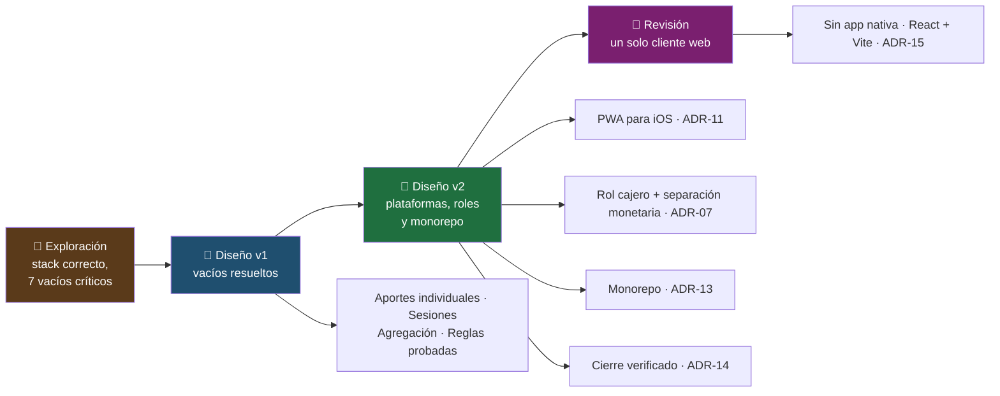

# 13 · Decisiones de arquitectura (ADR)

[← Despliegue](12-despliegue-y-entornos.md) · [Índice](README.md)

---

Registro de las decisiones con consecuencias duraderas. Cada una indica el contexto, la
alternativa descartada y el precio que se paga. Una decisión sin costo declarado suele ser
una decisión no examinada.

| ADR           | Decisión                                            | Estado                     |
| ------------- | --------------------------------------------------- | -------------------------- |
| [01](#adr-01) | Conteo por aportes individuales                     | ✅ Aceptada                |
| [02](#adr-02) | El conteo es una sesión con apertura y cierre       | ✅ Aceptada                |
| [03](#adr-03) | Agregación en escritura mediante triggers           | ✅ Aceptada                |
| [04](#adr-04) | Cloud Functions como complemento, no backend propio | ✅ Aceptada                |
| [05](#adr-05) | Autorización por custom claims                      | ✅ Aceptada                |
| [06](#adr-06) | Firestore sobre Supabase                            | ✅ Aceptada                |
| [07](#adr-07) | Separación estructural de datos monetarios por rol  | 🆕 Aceptada                |
| [08](#adr-08) | Arquitectura por capas con repositorios abstractos  | ✅ Aceptada                |
| [09](#adr-09) | Valores monetarios como enteros                     | ✅ Aceptada                |
| [10](#adr-10) | Resumen agrupado por `dirty`                        | ✅ Aceptada                |
| [11](#adr-11) | iOS cubierto con PWA, no con App Store              | 🔄 **Revisada**            |
| [12](#adr-12) | Flutter + Flutter Web sobre Expo/React Native       | 🔄 **Superada por ADR-15** |
| [13](#adr-13) | Monorepo                                            | ✅ Aceptada                |
| [14](#adr-14) | Verificación de sincronización antes del cierre     | ✅ Aceptada                |
| [15](#adr-15) | **React + Vite sobre continuar con Flutter Web**    | 🆕 Aceptada                |
| [16](#adr-16) | Filtros de auditoría de uno en uno                  | 🆕 Aceptada                |
| [17](#adr-17) | IDs de proyecto Firebase reales, no `conteo-eficiente-*` | 🆕 Aceptada           |
| [18](#adr-18) | Medir RNF-01 con dos clientes contra el emulador   | 🆕 Aceptada                |
| [19](#adr-19) | Confirmación antes de "Salir" para el cajero        | 🆕 Aceptada                |
| [20](#adr-20) | El comparativo mide ejecución, no tamaño            | 🆕 Aceptada                |

---

## ADR-01 {#adr-01}

### Conteo por aportes individuales

**Contexto.** Varios cajeros cuentan la misma sucursal a la vez. El diseño de exploración
guardaba un campo `cantidad` por categoría, escrito por cualquiera.

**Decisión.** Cada cajero escribe un documento propio (`aportes/{uid}`). El total es la
suma agregada por el backend. El cliente **nunca** escribe un total.

| Alternativa                                   | Por qué se descartó                                                                         |
| --------------------------------------------- | ------------------------------------------------------------------------------------------- |
| `FieldValue.increment` sobre campo compartido | Resuelve la concurrencia pero no permite saber quién contó qué ni corregir el aporte propio |
| Transacción con lectura previa                | Falla offline: requiere conexión                                                            |
| Bloqueo por categoría                         | Elimina el paralelismo, que es el motivo de usar varios dispositivos                        |

**Consecuencias.** ✅ Cero pérdida bajo concurrencia · ✅ Offline sin resolución de
conflictos · ✅ Auditoría gratuita · ✅ Totales recalculables · ⚠️ Más documentos y
dependencia de un trigger · ⚠️ El total del equipo llega con 1–2 s de retraso.

---

## ADR-02 {#adr-02}

### El conteo es una sesión con apertura y cierre

**Decisión.** Entidad `SesionDeConteo` con estados `abierta → cerrada`, una sola abierta
por sucursal, snapshot histórico al cerrar.

**Refuerzo en la v2.** Con conteo quincenal o mensual, cada sesión es el **único registro
de inventario del período**. Sin la entidad, no habría con qué comparar meses ni forma de
saber si el dato es definitivo.

**Consecuencias.** ✅ Históricos y comparativos · ✅ Auditoría con contexto · ✅ Evidencia
contable · ⚠️ Un paso administrativo más · ⚠️ Sin reapertura: los errores post-cierre
requieren sesión de corrección.

---

## ADR-03 {#adr-03}

### Agregación en escritura mediante triggers

**Decisión.** Los agregados se calculan cuando los datos cambian y se guardan en
documentos derivados. La consulta lee datos ya calculados.

| Alternativa                              | Por qué se descartó                                                             |
| ---------------------------------------- | ------------------------------------------------------------------------------- |
| Cálculo en cliente al abrir el dashboard | 240× más lecturas; latencia y costo crecientes                                  |
| Aggregation queries de Firestore         | No producen el mapa por categoría en una consulta ni sirven para el tiempo real |
| BigQuery + exportación                   | Sobredimensionado; latencia de minutos                                          |

**Consecuencias.** ✅ Dashboard de 1 lectura · ✅ Escala sin degradar · ⚠️ Los derivados
pueden desincronizarse → `reconciliarLineas` semanal · ⚠️ 30 s de frescura en el dashboard.

---

## ADR-04 {#adr-04}

### Cloud Functions como complemento, no backend propio

**Decisión.** Callables + triggers. No se despliega ni administra ningún servidor.

**Consecuencias.** ✅ Cumple requisitos imposibles desde el cliente · ✅ Coherente con "sin
infraestructura" · ⚠️ Obliga al plan Blaze (≈ USD 0–3/mes) · ⚠️ Cold starts de 1–3 s.

---

## ADR-05 {#adr-05}

### Autorización por custom claims

**Decisión.** `rol` y `sucursales` viajan en el token. Las reglas leen el token, no
Firestore.

**Consecuencias.** ✅ Sin lecturas por evaluación · ✅ No manipulable desde el cliente ·
⚠️ Propagación diferida (~1 h), mitigada con `revokeRefreshTokens` · ⚠️ Duplicación entre
claims y perfil.

---

## ADR-06 {#adr-06}

### Firestore sobre Supabase

| Criterio                    | Firestore            | Supabase                   | Ventaja       |
| --------------------------- | -------------------- | -------------------------- | ------------- |
| **Offline en el navegador** | IndexedDB, del SDK   | Implementación propia      | **Firestore** |
| Tiempo real                 | Nativo               | Nativo (replication)       | Empate        |
| Agregaciones                | Precalculadas a mano | `GROUP BY` en SQL          | **Supabase**  |
| Autorización                | Security Rules       | Row Level Security         | Empate        |
| Integración con el cliente  | SDK JS muy maduro    | SDK JS bueno, menos maduro | **Firestore** |
| Costo a esta escala         | Gratis               | Gratis                     | Empate        |
| Lock-in                     | Alto                 | Postgres estándar          | **Supabase**  |

**Decisión.** Firestore.

**Justificación reforzada en la v2.** El requisito más difícil es el conteo offline y
concurrente. Firestore lo resuelve de forma nativa en el navegador; con Supabase habría
que construir la cola offline y la reconciliación a mano, precisamente donde aparecen los
defectos silenciosos que este diseño busca eliminar.

**Consecuencias.** ✅ Offline y tiempo real sin código propio en el cliente · ⚠️
**Lock-in reconocido**, mitigado parcialmente por repositorios abstractos ([ADR-08](#adr-08)) ·
⚠️ El análisis requiere mantener código de agregación.

---

## ADR-07 {#adr-07}

### Separación estructural de datos monetarios por rol

**Contexto.** El rol de cajero puede ver unidades pero no el valor consolidado del
inventario. Firestore **autoriza por documento, no por campo**: filtrar en la UI no
protege nada, porque el SDK entrega el documento completo.

**Decisión.** Los importes viven en documentos que el cajero no puede leer (`resumen`,
`historicos`). Las líneas contienen sólo unidades.

| Alternativa                             | Por qué se descartó                                  |
| --------------------------------------- | ---------------------------------------------------- |
| Ocultar campos en la interfaz           | No es seguridad: el documento llega igual al cliente |
| Duplicar líneas en versión "sin dinero" | Doble escritura, doble riesgo de divergencia         |
| Cloud Function como proxy de lectura    | Pierde el tiempo real, que es el requisito central   |

**Consecuencias.** ✅ La restricción es real, no cosmética · ✅ Verificable con tests de
reglas · ⚠️ El `subtotal` se movió fuera de `lineas`, cambio respecto a la v1 · ⚠️ El
cajero conoce valor y unidades: **la separación no oculta lo deducible**, impide entregar
el consolidado.

---

## ADR-08 {#adr-08}

### Arquitectura por capas con repositorios abstractos

**Decisión.** Capas (sin Clean Architecture completa) con la capa de datos expuesta como
interfaces, con implementación Firestore y una falsa para pruebas.

**Consecuencias.** ✅ Lógica probable sin Firebase, en milisegundos · ✅ Aísla el lock-in
de [ADR-06](#adr-06) · ✅ En el monorepo, `packages/shared` no depende ni de React ·
⚠️ Una capa de indirección más.

---

## ADR-09 {#adr-09}

### Valores monetarios como enteros

**Decisión.** Todo importe como entero en la unidad mínima. Prohibido `double` para dinero.

**Consecuencias.** ✅ Cálculos exactos · ✅ `FieldValue.increment` sin deriva · ⚠️ Requiere
formateo consistente en presentación.

---

## ADR-10 {#adr-10}

### Resumen agrupado por `dirty`

**Decisión.** Los triggers marcan `dirty: true`; una función programada recalcula cada 30 s.

**Alternativa descartada.** Contadores fragmentados: correctos y más escalables, pero
multiplican por 10 los documentos sin beneficio a esta escala.

**Consecuencias.** ✅ Sin contención · ⚠️ 30 s de frescura · 🔁 Camino de crecimiento
definido si el volumen creciera un orden de magnitud.

---

## ADR-11 {#adr-11}

### iOS cubierto con PWA, no con App Store — **revisada**

**Estado anterior (v1):** _iOS pospuesto indefinidamente._
**Estado actual:** _iOS es requisito de v1, cubierto mediante PWA._

**Contexto.** La mitad de los cajeros usa iPhone. Sin soporte iOS, la mitad del personal
no puede trabajar: no es un recorte de alcance, es un sistema que no cumple su función.
La membresía anual de la App Store (USD 99) no estaba en la cotización aprobada.

**Decisión.** Cubrir iOS con la PWA servida desde Firebase Hosting. Android mantiene app
nativa vía Play Store.

| Alternativa                      | Por qué se descartó                                          |
| -------------------------------- | ------------------------------------------------------------ |
| App Store con app nativa         | USD 99/año fuera de presupuesto; requiere D-U-N-S y revisión |
| Distribución sólo por TestFlight | Requiere igualmente los USD 99                               |
| Programa Enterprise (USD 299)    | Exige entidad con 100+ empleados                             |
| Posponer iOS                     | Deja sin herramienta a la mitad del personal                 |

**Consecuencias.**

- ✅ USD 0 de costo de distribución en iOS; USD 99 anuales ahorrados.
- ✅ Actualizaciones instantáneas, sin revisión de tienda.
- ✅ Sirve además como panel de administrador en escritorio.
- ⚠️ **Menor durabilidad del almacenamiento local** → mitigado por [ADR-14](#adr-14).
- ⚠️ Instalación manual a pantalla de inicio, con fricción de soporte.
- ⚠️ Rendimiento de entrada de texto a validar ([ADR-12](#adr-12), superada por [ADR-15](#adr-15)).

### Revisión posterior: de "PWA para iOS" a "web para todos"

**Contexto de la revisión.** Esta ADR asumía que Android seguía cubierto con app nativa y
que la PWA era la excepción para resolver iOS. El dueño del producto decidió después
eliminar también la app Android nativa: **no hay ningún cliente nativo en el sistema**,
para ninguna plataforma. La disyuntiva "Android nativo + PWA para iOS" que esta ADR
resolvía deja de existir — no porque la decisión haya sido incorrecta, sino porque su
premisa (que Android debía quedarse nativo) ya no aplica.

**Efecto sobre esta decisión.** Todo lo que aquí se argumentó a favor de la PWA para
cubrir iOS —costo de distribución, actualizaciones instantáneas, reversibilidad— aplica
ahora **a todo el personal, no sólo a quienes usan iPhone**. La decisión no se revierte:
se generaliza. La única pieza que sí cambia es la base técnica del cliente, tratada en
[ADR-15](#adr-15): ya no tiene sentido pagar el costo de un motor de renderizado
(CanvasKit/Skwasm) pensado para compartir código con una app nativa que ya no existe.

**Estado:** 🔄 Revisada — la decisión de fondo (PWA en vez de tienda de aplicaciones) se
mantiene y se extiende a todo el sistema; el "Reversible sin cambios de diseño" original
(añadir un target nativo sobre el mismo proyecto Flutter) ya no aplica tal cual, ver
[ADR-15](#adr-15) para el costo real de volver a nativo con el stack actual.

---

## ADR-12 {#adr-12}

### Flutter + Flutter Web sobre Expo/React Native — 🔄 superada por [ADR-15](#adr-15)

> **Registro histórico.** Esta decisión se tomó cuando el sistema todavía tenía dos
> clientes (Android nativo + PWA) y "una base de código para ambos" era una ventaja real.
> Al eliminarse la app Android nativa, esa ventaja desapareció y la decisión se
> reevaluó: ver [ADR-15](#adr-15). Se conserva el texto original sin editar, porque la
> justificación de entonces era correcta _dado el contexto de entonces_ — es precisamente
> el cambio de contexto lo que la volvió obsoleta.

**Contexto.** Al convertirse la web en plataforma de producción para la mitad del
personal, se reevaluó el framework. El renderizador HTML de Flutter fue eliminado: hoy
sólo existen CanvasKit y Skwasm, que dibujan sobre canvas y añaden más de 1 MB de motor.
Safari móvil es la superficie menos pulida de Flutter Web.

| Opción                          | Android | iPhone          | Bases | Riesgo principal                                         |
| ------------------------------- | ------- | --------------- | :---: | -------------------------------------------------------- |
| **A. Flutter + Flutter Web**    | Nativo  | PWA CanvasKit   |   1   | Carga inicial ~2 MB; entrada de texto en Safari          |
| B. Expo (RN + react-native-web) | Nativo  | PWA en DOM real |   1   | Metro no tiene soporte de primera clase para PWA/Workbox |
| C. Web-first + Capacitor        | WebView | PWA excelente   |   1   | Pierde el SDK nativo de Firestore en Android             |
| D. Flutter Android + web React  | Nativo  | PWA excelente   |   2   | Doble mantenimiento                                      |

**Decisión.** Opción A.

**Justificación.**

1. La UI es el mejor caso para CanvasKit: sin imágenes de red, sin video, sin vistas HTML
   embebidas — donde se concentran los problemas conocidos.
2. C sería contradictorio: quita a Android la única ventaja que justifica la app nativa.
3. D duplica el mantenimiento para un equipo pequeño.
4. El costo de cambiar más adelante es acotado: de los 13 documentos, **sólo el 07 es
   específico del framework**.

**Validación obligatoria.** Prototipo de la pantalla de conteo, compilado con `--wasm`,
probado en iPhone real con datos móviles ([06](06-plataforma-web.md)).

| Métrica                              | Umbral                         |
| ------------------------------------ | ------------------------------ |
| Primera interacción en 4G            | < 8 s                          |
| Arranque con service worker caliente | < 3 s                          |
| Scroll con 60 filas                  | sin saltos perceptibles        |
| Teclado numérico                     | sin retrasos ni saltos de foco |

**Detonante de reevaluación:** si el teclado resulta molesto, se compara la opción B
contra pagar la App Store.

**Consecuencias.** ✅ Una base de código · ✅ Aprovecha el trabajo ya hecho · ⚠️ ~2,2 MB de
carga inicial · ⚠️ Accesibilidad web requiere verificación explícita con VoiceOver.

---

## ADR-13 {#adr-13}

### Monorepo

**Contexto.** Cuatro artefactos cambian juntos: app, funciones, reglas e índices. Un
cambio de esquema los toca todos.

**Decisión.** Un repositorio con `apps/`, `packages/`, `contracts/` e `infra/`, orquestado
con npm workspaces.

| Alternativa                   | Por qué se descartó                                    |
| ----------------------------- | ------------------------------------------------------ |
| Repos separados por artefacto | Cambios de contrato en 4 PRs; despliegues desordenados |
| Repo único sin paquetes       | Impide que `shared` sea puro y testeable sin React     |
| Submódulos de Git             | Complejidad de sincronización sin beneficio real       |

**Consecuencias.** ✅ Cambios de contrato atómicos y revisables · ✅ Un solo CI, con tests
de reglas contra el código que las usa · ✅ `packages/shared` compartido y puro · ✅
Repositorio de un solo lenguaje (TypeScript), sin la fricción de coordinar Dart y
TypeScript que tenía el diseño anterior · ⚠️ CI más largo, mitigado con ejecución por
rutas.

---

## ADR-14 {#adr-14}

### Verificación de sincronización antes del cierre

**Contexto.** El riesgo real de la PWA no es que se borre el almacenamiento al abrir —eso
sólo obliga a reautenticarse—, sino que un cajero **cierre la app con aportes en cola** y
no la vuelva a abrir en treinta días. Con conteo mensual, ese lapso excede los plazos de
limpieza del navegador. El fallo sería **silencioso**: el total sale bajo y parece normal.

**Decisión.** Tres capas:

1. Banner persistente en el cliente mientras haya escrituras pendientes.
2. Confirmación explícita del cajero al finalizar, sólo habilitada con cero pendientes.
3. `cerrarSesion` revalida en servidor y bloquea el cierre si falta alguien.

Con anulación disponible para el administrador, bajo confirmación y con registro en
auditoría.

| Alternativa                              | Por qué se descartó                                    |
| ---------------------------------------- | ------------------------------------------------------ |
| Confiar en la persistencia del navegador | El fallo es silencioso e irrecuperable                 |
| Reenvío desde un servidor                | Imposible: los datos nunca salieron del dispositivo    |
| Bloquear el cierre sin anulación         | Un cajero ausente paralizaría el cierre del inventario |

**Consecuencias.** ✅ Convierte un riesgo silencioso en una alerta explícita · ✅ Deja
rastro auditable de quién asumió el riesgo · ⚠️ Un paso más en el flujo del cajero · ⚠️ No
protege contra sabotaje deliberado, sólo contra el error honesto — que es el caso real.

---

## ADR-15 {#adr-15}

### React + Vite sobre continuar con Flutter Web

**Contexto.** [ADR-12](#adr-12) eligió Flutter + Flutter Web precisamente porque producía
**una base de código para Android nativo y para la PWA de iOS a la vez**. El dueño del
producto decidió después eliminar la app Android nativa por completo: el sistema tiene un
único cliente, siempre web. Con eso, la razón de ser de Flutter Web desaparece — no hay
segunda plataforma con la que compartir código. Lo que en ADR-12 era el precio aceptado de
esa ventaja (CanvasKit/Skwasm añadiendo más de 1 MB de motor, el riesgo de entrada de
texto en Safari móvil) pasa a ser **puro costo, sin ningún beneficio que lo compense**.

**Decisión.** Reescribir el cliente en React + Vite + TypeScript, usando el SDK de
Firebase para JavaScript y `vite-plugin-pwa` para el service worker, el manifest y la
instalabilidad.

| Alternativa                                  | Por qué se descartó                                                                                                                           |
| -------------------------------------------- | --------------------------------------------------------------------------------------------------------------------------------------------- |
| Quedarse en Flutter Web (sin Android nativo) | Se sigue pagando el motor de canvas sin la razón que lo justificaba: ningún cliente nativo con quien compartir código                         |
| Vue + Vite                                   | Ecosistema y comunidad más chicos que React para este tipo de app CRUD-con-tiempo-real; sin ventaja concreta que lo justifique frente a React |
| Svelte/SvelteKit                             | Curva de aprendizaje adicional para el equipo sin beneficio claro sobre React para este alcance                                               |
| **React + Vite**                             | Elegida: DOM real, ecosistema más grande, bundle más chico, sin motor de renderizado propio                                                   |

**Justificación.**

1. Sin segunda plataforma, "una base de código para dos objetivos" — el argumento central
   de ADR-12 — deja de aplicar. Ya no hay dos objetivos.
2. React sobre DOM real elimina de raíz el riesgo de entrada de texto en Safari que
   [ADR-12](#adr-12) dejaba como validación pendiente: no hay canvas que capture eventos
   de teclado de forma distinta al resto de la web.
3. React es el framework más usado del ecosistema web: reduce el riesgo de contratación y
   la curva de entrada para quien se sume al proyecto más adelante.
4. Vite + `vite-plugin-pwa` da un bundle de cliente sustancialmente más chico que un motor
   Flutter Web (~400 KB frente a ~2,2 MB), lo que ayuda directamente al presupuesto de
   datos móviles ([02](02-estimaciones-y-restricciones.md)).

**Consecuencias.**

- ⚠️ **Se pierde el argumento de "una sola base de código".** Es una pérdida sólo en el
  papel: con un único cliente web, ese argumento nunca tuvo nada que compartir. No hay
  código real que se deje de reutilizar.
- ✅ Ecosistema web estándar: más librerías, más documentación, más gente que ya lo conoce.
- ✅ Bundle inicial más chico, arranque más rápido en 4G.
- ✅ Soporte de PWA nativo del navegador (manifest, service worker) sin capas de
  compatibilidad añadidas por el framework.
- ✅ Repositorio de un solo lenguaje: Melos desaparece, sólo queda npm workspaces
  ([ADR-13](#adr-13)).
- ⚠️ **Costo de reescritura del cliente.** El trabajo de UI hecho en Flutter no es
  reutilizable; sólo el backend (Firestore, Cloud Functions, Security Rules) se conserva
  intacto.
- 🔁 De los documentos de este diseño, sólo [06](06-plataforma-web.md) y este ADR son
  específicos del framework de cliente; el resto describe contratos de datos y backend,
  que no cambiaron.

---

## ADR-16 {#adr-16}

### Filtros de auditoría de uno en uno

**Contexto.** [11](11-ux-y-navegacion.md) (§271) dibuja la tabla de auditoría con "filtros
combinables". `listarAuditoria` sólo acepta un campo a la vez
(`packages/data/src/repositories/admin-repository.ts`, `FiltroAuditoria`): no es un vacío
sin examinar, sino un recorte con precio conocido desde el propio código.

**Decisión.** Un solo filtro activo por consulta (`tipo`, `sucursalId`, `usuarioId` o
`sesionId`), nunca combinados.

**Consecuencias.** ✅ Cada campo usa su índice autoindexado de un solo campo, sin tocar
`infra/firestore.indexes.json` · ⚠️ El admin no puede acotar por dos campos a la vez
(p.ej. sucursal + tipo) en una sola consulta.

**Detonante de reactivación:** si el negocio pide combinar filtros, cada combinación exige
su propio índice compuesto de Firestore — evaluar ahí el costo real de infraestructura
contra el beneficio, no antes.

---

## ADR-17 {#adr-17}

### IDs de proyecto Firebase reales, no `conteo-eficiente-*`

**Contexto.** [12](12-despliegue-y-entornos.md) §1 fijaba `conteo-eficiente-dev` /
`conteo-eficiente-prod` como los IDs de los proyectos Firebase (Ticket 4, issue #13). Al
crearlos en la consola, esos nombres no quedaron disponibles y Firebase asignó
`sistema-inventario-b7592` (dev) y `e-inventario` (prod). El `project_id` de Firebase es
inmutable una vez creado el proyecto.

**Decisión.** Conservar los proyectos con sus IDs reales y actualizar `.firebaserc` y el
doc 12 a esos valores, en vez de borrar y recrear los proyectos para forzar el nombre
`conteo-eficiente-*`.

**Consecuencias.** ✅ Cero fricción de recrear proyectos y reconfigurar Auth, Blaze y
service accounts desde cero · ⚠️ cualquier doc o script que asuma el patrón
`conteo-eficiente-*` — en particular los dominios de hosting por defecto que [12](12-despliegue-y-entornos.md)
§1 nombraba `conteo.web.app`/`conteo-dev.web.app` — debe leer el ID real desde
`.firebaserc`, no inferirlo del nombre del producto. Pendiente de resolver en el ticket de
deploy (5/6/7): usar los dominios `*.web.app` por defecto o crear sitios de Hosting con
alias custom.

---

## ADR-18 {#adr-18}

### Medir RNF-01 con dos clientes contra el emulador

**Contexto.** RNF-01 ([01](01-requisitos-y-alcance.md) §4) exige "cambio visible en otro
dispositivo en < 3 s con red estable" pero nunca se había medido — el único concepto de
"latencia" en el repo era `retrasoSincronizacionMs`
(`packages/data/src/fakes/fake-conteo-repository.ts`), un `setTimeout` de UI en el fake de
pruebas, que no mide propagación real (issue #62).

**Decisión.** Test de integración automatizado (`infra/test/rnf-01-latencia-sincronizacion.test.ts`)
que abre dos clientes contra el emulador de Firestore — dos cajeros distintos de la misma
sucursal, reutilizando el patrón de conexión ya establecido en
`infra/test/reglas.test.ts` (`@firebase/rules-unit-testing` + reglas reales) — escribe un
aporte real desde uno (mismo shape que `FirestoreConteoRepository.registrarAporte`) y
cronometra con `onSnapshot` cuánto tarda el otro en verlo, en varias iteraciones (p50/p95).
El resultado real queda registrado en el propio ticket (#62), no en una nota aparte.

| Alternativa                          | Por qué se descartó                                                          |
| ------------------------------------- | ----------------------------------------------------------------------------- |
| Smoke manual documentado              | No corre en CI; depende de que alguien lo repita a mano antes de cada release |
| Medir contra producción               | El emulador ya es el patrón establecido en este repo para este tipo de prueba |

**Consecuencias.** ✅ Corre en CI, cifra reproducible · ✅ Usa el mismo camino de escritura y
lectura que la app real (`aportes/{uid}`, `onSnapshot`), no una escritura de prueba
arbitraria · ⚠️ El emulador local no reproduce la latencia de red real de producción — el
umbral de 3 s se valida ampliamente de sobra en el emulador (decenas de ms), lo cual acota
la propagación de Firestore en sí, no la variable de red que RNF-01 también contempla ·
⚠️ Encontrado en el camino: los archivos de `infra/test/` comparten una sola instancia del
emulador (mismo `projectId`); correrlos en paralelo (por defecto en vitest) provoca
contención real contra ese estado externo compartido en cuanto hay 3 o más archivos. Se
corrigió con `fileParallelism: false` en `vitest.config.ts` (raíz), sin tocar el contenido
de los tests existentes.

---

## ADR-19 {#adr-19}

### Confirmación antes de "Salir" para el cajero, desviación deliberada del patrón sin-diálogo

**Contexto.** El patrón establecido en este repo (#56, "Abrir conteo") es ejecutar la
acción directo al click, sin diálogo de confirmación, mostrando el resultado después.
`BotonSalir` (`apps/web/src/ui/BotonSalir.tsx`) rompía ese patrón al revés de lo esperado:
invocaba `onSalir` (`signOut(auth)` en `lib/router.tsx`) directo al click, sin ningún paso
intermedio, y un toque accidental durante un conteo activo cerraba la sesión del cajero de
golpe (issue #72).

**Decisión.** Agregar confirmación sólo en `BotonSalir`, con un `<dialog>` nativo inline
(mismo patrón que `ModalSesionCerrada.tsx`: `showModal()`/`close()` por ref, sin estado de
React) con dos botones, Cancelar/Salir — así los 8 consumidores de `BotonSalir`
(`CabeceraCajero` → `SucursalesScreen`/`PrepararScreen`/`FinalizarScreen`/`MisConteosScreen`,
y `ConteoScreen` directo) quedan protegidos sin tocarlos. `AdminLayout.tsx` llama `onSalir`
directo (dos botones, sidebar y barra inferior) y se dejó sin confirmar a propósito: el
costo de un error ahí es menor — el admin no está a mitad de un conteo con datos en riesgo
como el cajero.

| Alternativa                                        | Por qué se descartó                                                          |
| --------------------------------------------------- | ----------------------------------------------------------------------------- |
| Componente `<Modal>` genérico reutilizable          | Un solo consumidor real hoy (`BotonSalir`); YAGNI mientras no aparezca un segundo caso |
| Confirmar también en `AdminLayout`                  | Costo de error distinto al del cajero — no está documentando un conteo a mitad de camino |

**Consecuencias.** ✅ Un toque accidental en "Salir" ya no cierra la sesión del cajero a
mitad de un conteo · ✅ los 8 consumidores existentes quedan protegidos sin cambios propios,
porque `BotonSalir` es el único punto de entrada · ⚠️ `AdminLayout` sigue sin confirmación —
un futuro lector no debería "corregir" `BotonSalir` para que combine con el resto de la app
quitándole la confirmación, ni asumir que `AdminLayout` necesita la misma por consistencia.

---

## ADR-20 {#adr-20}

### El comparativo mide ejecución, no tamaño

**Contexto.** [10 §6](10-analisis-y-dashboards.md#6-comparativo-entre-sucursales) ya había
detectado el problema de fondo: "las sucursales tienen tamaños distintos, así que el
comparativo destaca participación porcentual y no sólo totales absolutos". El diagnóstico
era correcto — pero la receta no lo cura, porque la **participación porcentual sigue
siendo una medida de tamaño**: es la cuota de esa sucursal sobre el total de la red, no su
desempeño. `ComparativoScreen.tsx` ordena hoy por esa participación en dinero del último
histórico cerrado, así que la sucursal más grande encabeza siempre la tabla — llueva o
truene, cuente al día o lleve dos meses sin cerrar — y la pantalla no señala ninguna acción
posible: un admin no puede hacer nada distinto sabiendo que Norte pesa el 40 % de la red.

**Decisión.** El comparativo mide **ejecución del conteo**, no tamaño. Columnas: Sucursal ·
Días sin contar · Último cierre · Duración · Unidades · Tendencia (`Total $` sólo en
escritorio, como contexto, nunca como criterio de orden). Orden por defecto: días sin
contar descendente — lo primero que se ve es la excepción, no la sucursal más grande.

El umbral de "atrasada" es **auto-calibrado**: cada sucursal se compara contra la mediana
de días entre sus propios cierres, así que una sucursal que cuenta quincenal y otra que
cuenta mensual se juzgan cada una contra su propia cadencia, sin constante mágica ni
pantalla de configuración.

Datos: fan-out de `historicosRecientesPorSucursal` (ya existe, límite 12,
`packages/data/src/firebase/firestore-admin-repository.ts`) para la serie temporal —
exactamente lo que [10 §6](10-analisis-y-dashboards.md#6-comparativo-entre-sucursales) ya
pedía en su párrafo final y nunca se construyó — más UNA consulta
`listarSesiones({estado:"cerrada"})` para las duraciones (`abiertaEn` → `cerradaEn`, que
`Historico` no guarda). Sin índices nuevos, sin reglas nuevas, sin Cloud Functions.

Siguen vigentes las restricciones que ya fijaba
[10 §6](10-analisis-y-dashboards.md#6-comparativo-entre-sucursales): se construye sólo
sobre `historicos`, nunca sobre sesiones abiertas — comparar un conteo a medio hacer
contra uno terminado produce conclusiones falsas, y es [ADR-02](#adr-02) el que hace del
histórico el único registro definitivo del período. El fan-out N+1 sigue siendo
deliberado, y
`collectionGroup("historicos")` sigue prohibido: no existe regla
`match /{path=**}/historicos/{id}` ni índice `COLLECTION_GROUP` para esa colección, así que
esa consulta pasa en el emulador y falla en producción por la denegación por defecto de
`infra/firestore.rules`.

| Alternativa                                  | Por qué se descartó                                                                                              |
| --------------------------------------------- | ------------------------------------------------------------------------------------------------------------------ |
| Mantener el ranking por dinero                | Mide tamaño, no desempeño: la sucursal más grande encabeza siempre y la pantalla no señala ninguna acción posible |
| Umbral fijo de días para toda la red          | Injusto para quien cuenta quincenal y ciego para quien cuenta mensual: una sola constante no sirve a dos cadencias |
| `collectionGroup("historicos")`               | No existe regla `/{path=**}/historicos/{id}` ni índice `COLLECTION_GROUP`: funciona en el emulador y falla en producción |

**Consecuencias.** ✅ La primera fila visible es la excepción que necesita acción, no la
sucursal más grande de siempre · ✅ El umbral se auto-calibra por sucursal, sin constante
mágica ni pantalla de configuración · ✅ Reutiliza datos y consultas existentes: cero
índices nuevos, cero reglas nuevas, cero Cloud Functions · ⚠️ Dos fuentes de lectura en vez
de una (fan-out de `historicos` + `listarSesiones`) — más lecturas que el ranking simple
por dinero, aunque el costo sigue siendo N+1 constante, no crece con el uso · ⚠️ El dinero
deja de ser el criterio de orden; un lector acostumbrado al ranking anterior puede
extrañarlo — se mantiene visible como columna de contexto en escritorio para no perderlo
del todo.

**Detonante de reevaluación:** si el negocio pide comparar ejecución por área o categoría
de valor entre sucursales, no sólo a nivel de sesión completa, hace falta un campo
`porArea` en `Historico` que hoy no existe. Añadirlo está fuera de alcance de este ADR
porque exige tocar el trigger de cierre en Cloud Functions y no puede aplicarse
retroactivamente: los históricos son inmutables una vez escritos ([ADR-02](#adr-02)), así
que sólo alimentaría con datos las sesiones cerradas después del cambio, no el histórico
acumulado hasta hoy.

---

## ADR-21 {#adr-21}

### `"Sin área"` es un hueco, no un valor congelado — **superseded por [ADR-23](#adr-23)**

> **Superseded.** [ADR-23](#adr-23) rediseña el área como división de trabajo del
> contador: el sentinel `SIN_AREA`, el campo `LineaConteo.area` y la lectura de
> [ADR-07](#adr-07) que sostenía esta decisión ya no aplican. Se conserva como registro
> histórico de por qué el modelo anterior existió.

**Contexto.** La invariante I-7 ([03 §6](03-modelo-de-dominio.md)) congela `valorUnitario`
en la línea al sembrarla, por una razón contable concreta: si el negocio sube un precio de
$5.000 a $5.500, el conteo histórico tiene que conservar el valor vigente al momento de
contar. El campo `area` heredó la misma regla por analogía.

Pero no es el mismo dato. `"Sin área"` **no es un área que alguien eligió**: es el fallback
literal de `nombresPorArea.get(categoria.get("areaId")) ?? "Sin área"` en
`abrir-sesion.ts`. Congelar un fallback no protege evidencia — perpetúa un vacío durante
toda la sesión. Y el contador de pie frente al estante es exactamente quien sabe a qué área
pertenece ese producto: obligarlo a llamar al admin y esperar al siguiente conteo convierte
un dato recuperable en un dato perdido, porque los conteos de esta sesión son justo los que
no se pueden rehacer.

**Decisión.** `area` sigue congelada **salvo cuando vale el sentinel `SIN_AREA`**. Un
contador de la sesión puede vincular un **área existente** a una categoría **sin área**; la
línea de esa sesión se actualiza sólo si su `area === SIN_AREA`. Una línea con área real
**nunca** se re-etiqueta, así que ningún análisis ya atribuido cambia bajo los pies de
nadie.

Cuatro límites que forman parte de la decisión, no de su implementación:

- **El contador no crea áreas**, sólo vincula las que ya existen — [03 §6](03-modelo-de-dominio.md)
  lo decía y se mantiene. Tampoco edita ni borra categorías: eso sigue siendo del admin.
- **`valorUnitario` no se toca jamás.** `crearCategoriaEnSesion` escribe `valor: 0` y el
  admin precia después; el contrato ni siquiera acepta el campo (I-9, [ADR-07](#adr-07)).
- **El alcance es UNA sesión**, la del llamador. No es pereza: el claim del cajero autoriza
  una sucursal (A-3 / I-6), así que escribir en la sesión de otra sucursal sería la
  escritura cross-tenant que las reglas existen para impedir. La vinculación sobre la
  categoría es idempotente justamente por eso — el cajero de la otra sucursal etiqueta su
  propia línea cuando le toque.
- **`SIN_AREA` deja de ser un literal duplicado.** Estaba copiado en tres archivos, uno de
  ellos admitiéndolo por escrito; al pasar de rótulo a **condición de una invariante** ya no
  puede vivir en tres sitios, y sube a `packages/shared/src/models/linea-conteo.ts`.

| Alternativa                                        | Por qué se descartó                                                                                                     |
| -------------------------------------------------- | ----------------------------------------------------------------------------------------------------------------------- |
| Dejar el hueco hasta la próxima sesión             | Los datos del conteo en curso son precisamente los que no se pueden rehacer; el vínculo llegaría cuando ya no sirve      |
| Permitir editar un área ya asignada                | **Superseded por [ADR-22](#adr-22)** para el caso de categoría sin `areaId` de catálogo: el riesgo señalado ("análisis atribuido cambia a mitad de sesión") se mitiga con auditoría explícita en vez de prohibirse por completo |
| Propagar a todas las sesiones abiertas             | Escritura fuera del alcance del claim (A-3/I-6); necesitaría una tarea de servidor sin `request.auth`, no un ensanche del permiso del cajero |
| Dejar que el contador fije también el precio        | Cruza la separación monetaria por rol de [ADR-07](#adr-07) e I-9, que es estructural y no cosmética                      |

**Consecuencias.** ✅ La sesión en curso queda analizable por área, que es lo que el
contador necesita mientras cuenta · ✅ Cero reglas nuevas, cero índices nuevos: las
callables escriben con Admin SDK y `areas` ya era legible por cualquier autenticado · ✅ El
contador ve en auditoría lo que él mismo hizo, porque los dos eventos denormalizan
`sucursalId` y la regla del ticket #45 ya los cubría · ⚠️ I-7 deja de ser una sola frase:
ahora distingue `valorUnitario` (congelado siempre) de `area` (congelada salvo el
sentinel), y esa distinción hay que leerla antes de tocar cualquiera de los dos ·
⚠️ Dos sucursales con sesión abierta pueden vincular la misma categoría; la segunda llamada
es idempotente y sólo etiqueta su propia línea · ⚠️ Aparece una tercera forma de
autorización en las callables —por pertenencia a la sesión, junto a "admin" y "autenticado"—
que hay que sostener (A-12, [09 §1](09-seguridad-y-auditoria.md)).

**Detonante de reevaluación:** si el negocio pide reasignar áreas de conteos **ya
cerrados**, esto no basta. Habría que tocar `Historico`, que es inmutable una vez escrito
([ADR-02](#adr-02)), así que el cambio no podría aplicarse retroactivamente al histórico
acumulado — sólo a los cierres posteriores.

---

## ADR-22 {#adr-22}

### Reetiquetado de línea por sesión — supersede parcial de ADR-21 — **superseded por [ADR-23](#adr-23)**

> **Superseded.** [ADR-23](#adr-23) borra el reetiquetado que esta decisión introdujo: el
> área deja de ser un campo de línea que se corrige, así que no hay nada que reetiquetar.
> Se conserva como registro histórico.

**Contexto.** [ADR-21](#adr-21) resolvió el hueco de `"Sin área"`, pero sólo en un
sentido: de `SIN_AREA` a un área real, una sola vez. En la práctica, el cajero de pie
frente al estante cuenta primero y clasifica después — y a veces se equivoca. Caso real:
cuenta 20 líneas de una categoría de precio (naturalmente sin área en el catálogo) y las
vincula a "talleres"; luego nota que 2 de esas 20 son en realidad de "aseo". Con la regla
de ADR-21 ("una línea con área real nunca se re-etiqueta"), esa corrección ya no cabe
dentro de la misma sesión — el análisis por área queda mal atribuido hasta el próximo
conteo, exactamente el mismo problema de "dato recuperable convertido en dato perdido"
que ADR-21 ya había identificado, sólo que un paso más tarde en el flujo.

ADR-21 evaluó y rechazó explícitamente "permitir editar un área ya asignada", por temor a
que "un análisis atribuido cambie a mitad de sesión". Ese riesgo es real pero no es
absoluto: ya existe `registrarAuditoria` como mecanismo de trazabilidad para toda escritura
sensible ([09](09-seguridad-y-auditoria.md)), y una corrección deliberada y auditada no es
lo mismo que un cambio silencioso.

**Decisión.** El cajero puede reetiquetar, dentro de su sesión abierta, el área de
cualquier línea **cuya categoría siga sin `areaId` en el catálogo**, tantas veces como
quiera, incluyendo volver a `SIN_AREA`. El cambio es local a
`sesiones/{sesionId}/lineas/{categoriaId}.area`; **nunca** escribe
`categoriasValor/{categoriaId}.areaId`. Una categoría con `areaId` ya fijado por admin en
el catálogo permanece con su línea congelada sin excepción — la condición dura de ADR-21
para ese caso no cambia. Cada reetiquetado se audita (`tipo: "LINEA_REETIQUETADA"`) como
mitigación explícita al riesgo que ADR-21 señaló: el cambio es deliberado y trazable, no
silencioso.

Esto supersede parcialmente a ADR-21 en la fila "Permitir editar un área ya asignada" de
su tabla de alternativas descartadas, sólo para el subconjunto de categorías sin `areaId`
de catálogo. Para categorías con `areaId` fijado por admin, ADR-21 sigue vigente sin
cambios: esa línea sigue sin re-etiquetarse jamás.

| Alternativa                                        | Por qué se descartó                                                                                                     |
| -------------------------------------------------- | ----------------------------------------------------------------------------------------------------------------------- |
| Mantener la regla original de ADR-21 (una sola vez) | Deja sin corrección el caso real observado: el cajero se da cuenta del error en la misma sesión y no tiene forma de arreglarlo |
| Permitir reetiquetar también líneas con `areaId` de catálogo | Rompe la condición dura que el usuario fijó explícitamente: un área fijada por admin es intocable por el cajero, sin excepción |
| Reetiquetar sin auditoría                          | Reabre exactamente el riesgo que ADR-21 señaló, sin la mitigación de trazabilidad que lo vuelve aceptable                |

**Consecuencias.** ✅ El cajero puede corregir una clasificación errónea dentro de la
misma sesión, sin esperar al próximo conteo · ✅ La condición dura se mantiene intacta: una
categoría con `areaId` de admin sigue siendo intocable · ✅ Cada corrección queda en
auditoría, así que un análisis que cambió de área es rastreable, no misterioso · ⚠️ I-7
gana una segunda excepción explícita, además del sentinel `SIN_AREA` de ADR-21: hay que
leer ambas antes de tocar `area` · ⚠️ Un análisis por área ya visto durante la sesión puede
cambiar si el cajero reetiqueta después — mitigado por auditoría, no eliminado.

**Detonante de reevaluación:** si el negocio pide reetiquetar líneas de sesiones **ya
cerradas**, esto no basta — mismo límite de inmutabilidad de `Historico` que señala ADR-21.

---

## ADR-23 {#adr-23}

### El área es división de trabajo del contador, no atributo congelado de la línea — supersede [ADR-21](#adr-21) y [ADR-22](#adr-22)

**Contexto.** El cliente cuenta repartiendo el trabajo: varios contadores se dividen el
local **por áreas** y cada uno cuenta su zona. El modelo que dejaron [ADR-21](#adr-21) y
[ADR-22](#adr-22) no representa eso — trata el área como un atributo casi-congelado de la
línea, algo que se "descubre" y se corrige, no algo que el contador elige de entrada para
organizar su trabajo.

Además, ambos ADR construyen su decisión sobre una lectura de [ADR-07](#adr-07) que no se
sostiene: ADR-21 rechazó "que el contador fije también el precio" razonando que "cruza la
separación monetaria por rol de ADR-07 e I-9, que es estructural y no cosmética". Pero el
texto de ADR-07 dice lo contrario de esa lectura: *"El cajero conoce valor y unidades: la
separación no oculta lo deducible, impide entregar el consolidado."* Lo que ADR-07 protege
son `resumen` e `historicos` — el consolidado — no el valor unitario de la línea, que ya
viaja sin protección en cada `LineaConteo` y que además está impreso en la etiqueta de la
categoría (p. ej. `"$5.000"`). La restricción que ADR-21/22 creían heredar de ADR-07 nunca
existió.

Cuatro problemas concretos que produce el modelo anterior:

1. **No se puede contar la misma categoría en dos áreas** — la línea es
   `sesiones/{sesionId}/lineas/{categoriaId}`, una fila por categoría, y
   `CategoriaValor.areaId?: string` admite sólo una.
2. **El contador se auto-bloquea.** Si el admin fija un área al crear la categoría
   (`areaFijaPorAdmin`), esa línea nunca se puede reetiquetar — el flujo premia no
   clasificar.
3. **El análisis agrupa por NOMBRE de área**, no por id: dos áreas homónimas (una activa,
   otra borrada y recreada con el mismo nombre) se funden en silencio.
4. **El cajero no ve dinero por convención de UI, no por seguridad** — como corrige el
   párrafo anterior, ADR-07 nunca lo prohibió.

**Decisión.** El área pasa a ser el contexto de trabajo que el contador elige **al entrar
a la sesión**, no un dato que se descubre línea por línea:

- **Catálogo N:M.** `CategoriaValor.areaIds?: readonly string[]` reemplaza
  `areaId?: string` — una categoría puede vivir en varias áreas, un área agrupa varias
  categorías.
- **Desglose, no identidad.** La línea sigue siendo
  `sesiones/{sesionId}/lineas/{categoriaId}` — una categoría, una fila — y gana
  `porArea: Readonly<Record<areaId, number>>`, el desglose de `cantidadTotal` por área.
  `LineaConteo.area` (nombre congelado) y `areaFijaPorAdmin` se retiran del modelo en la
  unidad que agrega `porArea`.
- **El aporte lleva el área.** `Aporte` gana `areaId`: el área activa del contador en el
  momento de aportar. La clave del documento pasa de `{uid}` a `{uid}__{areaId}` — el
  mismo contador puede aportar a la misma categoría desde dos áreas distintas de la misma
  sesión sin pisarse.
- **Área activa obligatoria.** El contador elige un área al entrar a la sesión
  (persistida en `localStorage` por `sesionId`); "Empezar a contar" queda deshabilitado
  hasta elegir. El catálogo filtra por esa área por defecto, con un interruptor "ver
  todo" visible.
- **"Sin área" es un aviso pasivo del catálogo**, nunca un bloqueo ni un sentinel de
  dominio: una categoría sin `areaIds` simplemente aparece marcada así en la pantalla de
  administración. `SIN_AREA` se retira del modelo en la misma unidad que introduce `porArea`.
- **El cajero ve precio unitario y subtotal de su propia línea** — nunca el total de la
  sesión: `resumen` sigue siendo admin-only, sin cambios en `firestore.rules`. Corrige la
  lectura errónea de ADR-07 señalada arriba.
- **Precio opcional al crear producto desde el conteo** — ya no se fuerza `valor: 0`.
- **El reetiquetado deja de tener sentido.** `HojaAreas`, `reetiquetarLineaEnSesion` y el
  sentinel `SIN_AREA` se retiran en la unidad que introduce `porArea`: corregir una
  clasificación errónea pasa a ser cambiar de área activa y aportar de nuevo, no reescribir
  un campo congelado.
- **`eliminarArea` bloquea sólo por referencias del catálogo** (`categoriasValor.areaIds`),
  igual que `eliminarCategoria` bloquea por `lineas.categoriaId`. **Corrección posterior
  (issue #86, revisión del veredicto de Judgment Day):** la primera implementación
  intentó bloquear además por conteos vivos consultando
  `collectionGroup("lineas").where(\`porArea.${areaId}\`, ">", 0)` — una ruta de campo
  **dinámica**, que Firestore no puede indexar (`fieldOverrides` cubre rutas fijas, no
  una por cada área). La consulta fallaba en producción con "requires an index" para
  *cualquier* área, usada o no. La alternativa correcta —un campo materializado
  `areasPresentes: string[]` en cada línea, consultable con `array-contains`, mismo
  patrón que `categoriaId`— se evaluó y se descartó: exige tocar el trigger
  `onAporteEscrito`, `reconciliarLineas`, la siembra de `abrirSesion` y todo fixture
  existente que construye un `LineaConteo` (26+ archivos, ninguno relacionado con
  áreas), para proteger algo que `porArea` no fija de todas formas — a diferencia de
  `valorUnitario`/`etiqueta` de `categoriaId` (protegidos por I-7), un `areaId` que pasa
  a apuntar a un área borrada sólo degrada a mostrar el id crudo en pantalla (ya cubierto
  por el fallback `?? areaId` en AnalisisConteoScreen/FinalizarScreen), nunca corrompe ni
  pierde un conteo. Es la misma garantía por la que `eliminarCategoria` ya no compensa
  sus propias referencias colgantes.

Supersede **total** a [ADR-21](#adr-21) y [ADR-22](#adr-22): el sentinel `SIN_AREA`, el
reetiquetado de línea y la condición dura "una categoría con `areaId` de admin es
intocable" dejan de tener sentido en un modelo donde el área ya no es un atributo de la
línea, sino un desglose (`porArea`) que se construye con la elección de área activa del
contador al aportar — y donde corregir es simplemente aportar desde otra área.

| Alternativa | Por qué se descartó |
| --- | --- |
| Clave compuesta `lineas/{categoriaId}__{areaId}` | El dinero es propiedad de la categoría, no del área: duplicaría `valorUnitario` en N documentos de la misma categoría y rompería `resumen.porCategoria` (indexado por `linea.id`, `packages/functions/src/lib/resumen.ts:54`) — se rompe el eje contable para modelar un reparto de trabajo |
| Mantener el reetiquetado de ADR-22 sobre `porArea` | Reintroduce el mismo problema que motivó borrarlo: un campo que se "corrige" en vez de un aporte nuevo que ya lleva su área — dos caminos para el mismo resultado |
| Asignación formal de contadores a áreas por el admin | El equipo ya se reparte hablando; sin evidencia de que haga falta forzarlo en el modelo |
| Progreso en vivo por área en el panel admin | Pertenece al panel (`PanelScreen`), no al catálogo ni al modelo de dominio — no es una decisión de esta ADR |

**Consecuencias.** ✅ Una categoría puede contarse en varias áreas simultáneamente,
resolviendo el problema #1 · ✅ El contador nunca vuelve a auto-bloquearse: no hay campo
congelado que un admin pueda fijar por adelantado · ✅ El análisis agrupa por `areaId`, no
por nombre — dos áreas homónimas ya no se funden en silencio · ✅ El cajero ve el precio de
su propia línea, alineado con lo que ADR-07 realmente permite · ⚠️ `LineaConteo` gana un
campo (`porArea`) que replica información ya presente en los aportes — es un desglose
materializado, no una fuente nueva de verdad, y hay que mantenerlo coherente con la suma
de aportes por área en el mismo trigger que ya mantiene `cantidadTotal` (I-2) · ⚠️ La clave
de `Aporte` cambia de `{uid}` a `{uid}__{areaId}`: cualquier código que asuma un aporte por
cajero por línea queda invalidado, no sólo el que lee `area` · ⚠️ Sin migración ni
compatibilidad hacia atrás (entorno de desarrollo, datos de prueba): se despliega y se
borra lo que haya.

**Detonante de reevaluación:** si el negocio pide asignar formalmente contadores a áreas
(en vez de que cada uno elija la suya), o mover unidades ya contadas de un área a otra sin
volver a contarlas, esta ADR no alcanza — ambos casos quedaron fuera de alcance
deliberadamente.

---

## Evolución del diseño

**El backend nunca cambió.** Firestore, las Cloud Functions, las Security Rules y el
modelo de aportes son los mismos desde la v1. **El cliente sí cambió**, cuando dejó de
tener sentido pagar el precio de un motor de renderizado pensado para dos plataformas al
quedar sólo una.

---

[← Despliegue](12-despliegue-y-entornos.md) · [Índice](README.md)
