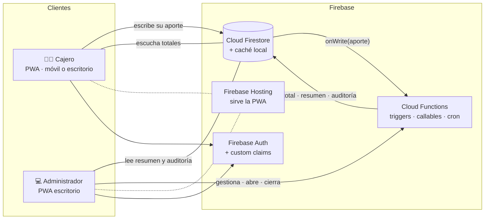

# Fase de Diseño v2 — conteoDeProductosEficiente

> Sistema de conteo de inventario agrupado por **valor monetario**, multi-sucursal,
> colaborativo en tiempo real, con auditoría inmutable y análisis por rol.
>
> **Plataforma:** Web única (PWA instalable, escritorio y móvil) · **Repositorio:** monorepo
> **Stack:** React · Vite · TypeScript · Firebase · Recharts

---

## Índice

| #   | Documento                                                                     | Qué responde                                                      |
| --- | ----------------------------------------------------------------------------- | ----------------------------------------------------------------- |
| 01  | [Requisitos y alcance](01-requisitos-y-alcance.md)                            | Qué hace el sistema, roles, qué **no** hace                       |
| 02  | [Estimaciones y restricciones](02-estimaciones-y-restricciones.md)            | Volumen, costo, límites de Firestore                              |
| 03  | [Modelo de dominio](03-modelo-de-dominio.md)                                  | Entidades, invariantes, ciclo de vida del conteo                  |
| 04  | [Modelo de datos en Firestore](04-modelo-de-datos-firestore.md)               | Colecciones, documentos, índices                                  |
| 05  | [Concurrencia, offline y tiempo real](05-concurrencia-offline-tiempo-real.md) | Cómo se evita la pérdida de conteos                               |
| 06  | [Plataforma web](06-plataforma-web.md)                                        | Garantías de la PWA, offline, instalación, soporte de navegadores |
| 07  | [Monorepo y arquitectura](07-monorepo-y-arquitectura.md)                      | Organización del repositorio y capas de la app                    |
| 08  | [Contratos y Cloud Functions](08-contratos-y-cloud-functions.md)              | Callables, triggers, esquemas                                     |
| 09  | [Seguridad y auditoría](09-seguridad-y-auditoria.md)                          | Roles, claims, Security Rules, inmutabilidad                      |
| 10  | [Análisis y dashboards](10-analisis-y-dashboards.md)                          | Dashboard de cajero y dashboard de administrador                  |
| 11  | [Experiencia de usuario y navegación](11-ux-y-navegacion.md)                  | Flujos, rutas, estados offline, instalación de PWA                |
| 12  | [Despliegue, entornos y observabilidad](12-despliegue-y-entornos.md)          | CI del monorepo, distribución, monitoreo                          |
| 13  | [Decisiones de arquitectura (ADR)](13-decisiones-adr.md)                      | Registro de decisiones con alternativas y consecuencias           |

---

## Cambios respecto a la v1

Esta versión incorpora cuatro definiciones que no existían cuando se escribió la v1.

| Cambio                                                                   | Impacto                                                                                                                | Documento                                                                                              |
| ------------------------------------------------------------------------ | ---------------------------------------------------------------------------------------------------------------------- | ------------------------------------------------------------------------------------------------------ |
| **Rol único de conteo: "cajero"** (reemplaza "trabajador")               | Dos roles en total: `admin` y `cajero`. Dashboards separados por rol                                                   | [01](01-requisitos-y-alcance.md), [09](09-seguridad-y-auditoria.md), [10](10-analisis-y-dashboards.md) |
| **Todo el personal usa la misma app web** (mitad del equipo con iPhone)  | Sin app nativa para nadie: Android e iOS se cubren por igual con **una PWA**                                           | [06](06-plataforma-web.md), [ADR-11](13-decisiones-adr.md), [ADR-15](13-decisiones-adr.md)             |
| **Conteo quincenal o mensual**                                           | Menor volumen, pero **cada sesión es un evento de alto valor**; el ciclo de uso excede la ventana de borrado de Safari | [02](02-estimaciones-y-restricciones.md), [06](06-plataforma-web.md)                                   |
| **Conectividad mixta** (WiFi en unas sucursales, datos móviles en otras) | Presupuesto de datos por sesión; precarga obligatoria de catálogo                                                      | [06](06-plataforma-web.md), [11](11-ux-y-navegacion.md)                                                |
| **Monorepo**                                                             | Reglas, funciones, app y contratos versionados juntos; CI unificado                                                    | [07](07-monorepo-y-arquitectura.md), [12](12-despliegue-y-entornos.md)                                 |

Se mantienen íntegras las siete correcciones que la v1 aplicó sobre la fase de
exploración (aportes individuales, sesiones de conteo, offline-first, Cloud Functions,
Security Rules, agregación precalculada y panel web).

---

## Vista de 10.000 pies

**Principio rector, invariable desde la v1:** el cliente nunca escribe un total; sólo
declara _su_ aporte. Todo dato derivado lo produce el backend. Esto hace el sistema
correcto bajo concurrencia, correcto offline y resistente a manipulación — y es también lo
que permite que cajero y administrador compartan exactamente el mismo cliente web, sin
reglas distintas por rol ni por dispositivo.

---

## Las dos decisiones estructurales de esta versión

**1. Una sola aplicación web, con sus garantías declaradas explícitamente.**
No hay app nativa: Android e iOS, cajero y administrador, usan la misma PWA instalable.
El offline es _suficiente_, no robusto como el de una app nativa, y el diseño lo dice
explícitamente en vez de fingir una paridad que no existe, con una salvaguarda operativa
que compensa la diferencia. → [06](06-plataforma-web.md)

**2. Un solo repositorio para app, funciones, reglas y contratos.**
Un cambio de esquema toca cuatro artefactos; en repositorios separados eso se
desincroniza. El monorepo lo hace un único commit revisable. → [07](07-monorepo-y-arquitectura.md)

---

## Cómo leer estos documentos

- **Implementar:** 04 → 05 → 06 → 07 → 08 → 09
- **Sustentar el proyecto:** 01 → 02 → 03 → 05 → 13
- **Evaluar riesgos y costos:** 02 → 06 → 12 → 13
