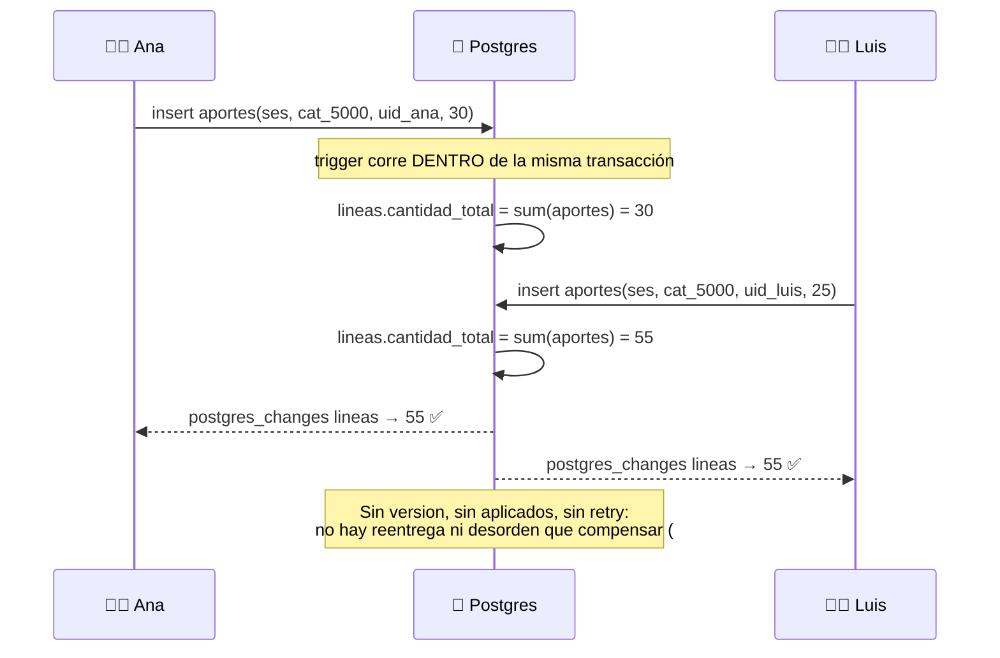
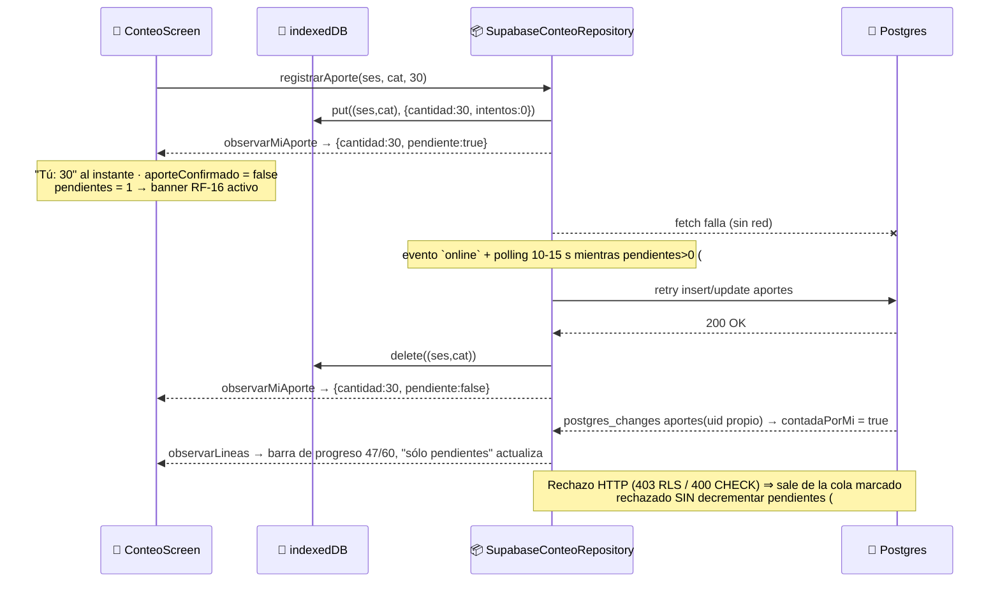
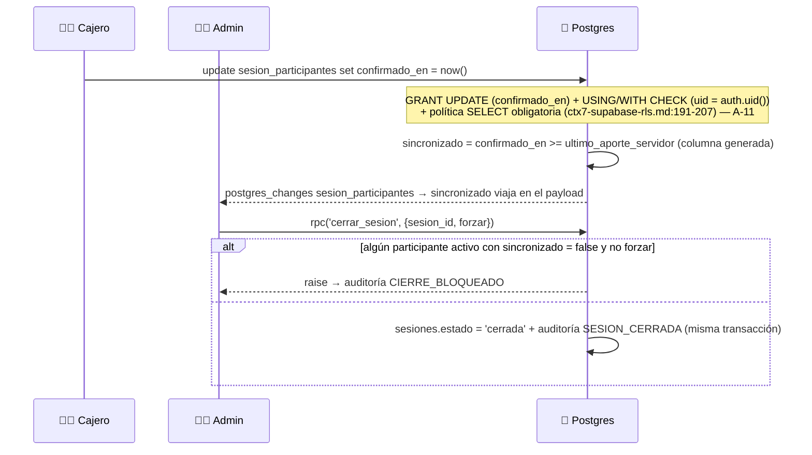

# Design — migracion-firebase-a-supabase

Phase: `sdd-design` · Store: `hybrid` · Engram: `sdd/migracion-firebase-a-supabase/design`
Depends on: `proposal.md`, `exploration.md`, decision map #22 (#23/#24/#25/#26/#27/#28/#29 CLOSED).

> **Size note.** This artifact exceeds the 800-word default budget because the launch prompt
> demands the full Postgres schema, the auth model, the GRANT/RLS split, the function
> redistribution, the client seam, carve-out A's resolution, seam tooling, and a testing
> options analysis, plus the sequence diagrams `openspec/config.yaml:126` mandates.
> Explicitly requested explanation is not debt.

> **Scope boundary (binding).** Firebase stays live and untouched. "Done" means the Supabase
> backend exists and is verifiable, **not** that anything uses it. Cutover is #32 (OPEN,
> `prioridad:baja`), out of scope. The migration **translates**; it does not improve
> (#24 D5, #28 D4).

---

## Technical Approach

The seam is `packages/data/src/repositories/` — `ConteoRepository`
(`packages/data/src/repositories/conteo-repository.ts:19-77`, 9 members) and
`AdminRepository` (`packages/data/src/repositories/admin-repository.ts:112-157`, 20 members).
**Both interfaces survive the backend swap member-for-member.** Nothing is added, nothing is
removed. Only the adapters under `packages/data/src/firebase/` are replaced, and
`packages/data/src/fakes/*` (zero SDK dependency, verified) keeps ~40 `apps/web` UI test
files green unmodified. That property is the whole reason a big-bang backend swap is
affordable at 3 sucursales and ~6 sesiones/month.

Three places where the seam **cannot** survive unchanged, stated explicitly:

| Where                                                                     | What changes                             | Why it is unavoidable                                                                       |
| ------------------------------------------------------------------------- | ---------------------------------------- | ------------------------------------------------------------------------------------------- |
| `LineaConteo.versiones` (`packages/shared/src/models/linea-conteo.ts:14`) | → `contadaPorMi: boolean`                | The per-uid map was a Firestore document-shipping artifact. See D-2.                        |
| `Aporte.version` (`packages/shared/src/models/aporte.ts:12`)              | → `pendiente: boolean`                   | The monotonic counter existed only for at-least-once trigger idempotency (#23 H2). See D-2. |
| `Pagina.siguienteCursor` (`admin-repository.ts:27-30`)                    | opacity survives, concrete value changes | It hides a `QueryDocumentSnapshot` today; PostgREST has no snapshot. See D-8.               |

Everything else is adapter-internal. Direction of the change is **deletion**: 1292 measured
lines across 20 files in `packages/functions/src/**` (re-measured; #27's own text says
"1143") collapse to one Edge Function with three operations plus schema.

---

## Architecture Decisions

Format follows `docs/diseno/13-decisiones-adr.md`: context, decision, rejected alternatives
with the reason, and declared consequences. _"Una decisión sin costo declarado suele ser una
decisión no examinada."_

### D-1 · `lineas` is maintained by a full re-aggregate trigger, not a delta

**Contexto.** #23 D2 fixes `lineas` as a real table maintained by a synchronous trigger
(Realtime publishes tables, not views — #23 H3; the publication statement takes a table,
`ctx7-supabase-realtime.md:9-15`). D2 deletes `version`/`versiones`/`aplicados`, which were
exactly the per-uid baseline the current delta trigger computes against
(`packages/functions/src/triggers/on-aporte-escrito.ts:54-60,80`). The trigger's internal
shape is not fixed by any closed ticket.

**Decisión.** One `AFTER INSERT OR UPDATE ON aportes FOR EACH ROW` function that **recomputes
from source**:

```sql
update public.lineas l
   set cantidad_total = (select coalesce(sum(a.cantidad),0) from public.aportes a
                          where a.sesion_id = new.sesion_id and a.categoria_id = new.categoria_id),
       num_aportantes = (select count(*) from public.aportes a
                          where a.sesion_id = new.sesion_id and a.categoria_id = new.categoria_id),
       actualizada_en = now(), actualizada_por = new.uid
 where l.sesion_id = new.sesion_id and l.categoria_id = new.categoria_id;
-- + the same shape for sesiones.total_unidades and an upsert into sesion_participantes
```

| Alternativa                     | Por qué se descartó                                                                                                                                                                 |
| ------------------------------- | ----------------------------------------------------------------------------------------------------------------------------------------------------------------------------------- |
| Delta con `OLD`/`NEW`           | Needs a per-uid applied baseline to be correct under correction; that baseline is `aplicados`, which #23 D2 deletes. Re-introducing it re-introduces the bug the migration removes. |
| Vista materializada con refresh | Not transactional — the exact defect #23 D2 eliminates — and cannot be published to Realtime.                                                                                       |
| Vista + agregación en cliente   | Forces a rewrite of `ConteoScreen`, `AnalisisScreen` and `CierreScreen` to save one table (#23 D2 (a)).                                                                             |

**Ticket detail corrected.** #23's disappearance inventory lists `lineas.numAportantes`, but
D2's own body says it "pasa a `count(*)`" and `packages/shared/src/services/riesgo.ts:18-20`
(`promedioCategoria`) still consumes it. The **column survives**, written by the trigger as
`count(*)`. The inventory line is about the hand-incremented Firestore field, not the concept.
`specs/esquema-postgres/spec.md:24-29` inherited the same imprecise "MUST NOT exist" wording
and **is being corrected** to keep `num_aportantes` as a trigger-written column.

**Consecuencias.** ✅ Desync is unrepresentable — `reconciliarLineas` (92 lines) has nothing
left to reconcile · ✅ `num_aportantes` is free in the same statement · ✅ No `retry`, no
version guard, no ordering compensation · ⚠️ Each aporte re-reads ≤ ~4 rows for the line and
≤ ~240 for the session total.

```
-- ponytail: full re-aggregate over ≤60 categorías × ≤4 cajeros. A delta trigger buys
-- nothing at this scale and needs a baseline row that #23 D2 deleted. Switch to a delta
-- if a single sesión ever exceeds ~10k aportes.
```

**A-4 is not duplicated here.** "No aggregating onto a closed session" is enforced once, by
the `WITH CHECK` on `aportes` (`private.sesion_abierta`), so the row never exists. A constraint
before application logic; the trigger carries no `estado` guard.

### D-2 · Carve-out A — `versiones[uid]` splits into two signals that already exist. **Zero new columns.**

**Contexto.** `LineaConteo.versiones` is the sole data source for four live behaviours
(`packages/shared/src/services/progreso.ts:18-19,30-40`,
`apps/web/src/ui/primitivos/BarraProgreso.tsx:5`, consumed at `apps/web/src/ui/ConteoScreen.tsx:141,145,157`
and `apps/web/src/ui/FinalizarScreen.tsx:38`; `packages/shared/src/services/sincronizacion.ts:18-21`,
consumed at `apps/web/src/ui/FilaCategoria.tsx:44`). No closed ticket owns its replacement.

The field answers **two different questions** that Firestore happened to fuse into one map:

| Question                                    | Consumer                                            | Signal that already survives                                                |
| ------------------------------------------- | --------------------------------------------------- | --------------------------------------------------------------------------- |
| "Have I counted this categoría at all?"     | `estaPendiente`, `siguientePendiente`, progress bar | An `aportes` row exists for `(sesion_id, categoria_id, uid)` (#23)          |
| "Has my last keystroke reached the server?" | `aporteConfirmado` (RF-16 per line)                 | No entry for `(sesionId, categoriaId)` in the local write queue (#26 D1/D5) |

**Decisión.** Add **no column, no table, no repository method.** Two model fields change shape
inside `packages/shared`, and the composition happens inside the adapter:

```ts
// packages/shared/src/models/linea-conteo.ts — `versiones` map removed
readonly contadaPorMi: boolean;   // this uid has a server-side aportes row for this line

// packages/shared/src/models/aporte.ts — `version` removed
readonly pendiente: boolean;      // this value is still in the local queue, unacknowledged
```

```ts
// packages/shared/src/services/progreso.ts       (uid parameter becomes redundant)
export const estaPendiente = (linea: LineaConteo): boolean => !linea.contadaPorMi;
// packages/shared/src/services/sincronizacion.ts (linea parameter becomes redundant)
export const aporteConfirmado = (aporte: Aporte | null): boolean =>
  aporte != null && !aporte.pendiente;
```

`SupabaseConteoRepository.observarLineas` composes the `lineas` Realtime stream with the
current user's own-aporte set — seeded once at subscribe time by
`select categoria_id from aportes where sesion_id = eq.X` (≤60 rows, RLS-scoped) and kept live
by the own-aporte channel #25 D5 already mandates. `observarMiAporte` emits the queue value in
preference to the Realtime value (#26 D3), so it already knows which one it emitted.

| Alternativa                                          | Por qué se descartó                                                                                                                                                                                                                                                                                                                                                      |
| ---------------------------------------------------- | ------------------------------------------------------------------------------------------------------------------------------------------------------------------------------------------------------------------------------------------------------------------------------------------------------------------------------------------------------------------------ |
| New `lineas.contada_por` array/jsonb column          | Reproduces the deleted map under a new name; the data is already in `aportes`, which the client already streams.                                                                                                                                                                                                                                                         |
| New `ConteoRepository.observarMisCategorias(...)`    | An 11th interface member, a second stream for `ConteoScreen` to merge, and a matching fake — to deliver a fact `observarLineas` can carry for free. Shallower interface, more code.                                                                                                                                                                                      |
| Keep a monotonic `version` for the cross-device `>=` | The `>=` (`sincronizacion.ts:20`) existed to avoid a false _negative_ when the same cajero advanced the line from another device. The queue is per-device: this device's send either got a 2xx (confirmed) or did not. Last-write-wins across devices is already declared domain behaviour (`docs/diseno/05-concurrencia-offline-tiempo-real.md:218`, #26 closing note). |

**Why this is strictly better than what it replaces.** Today `aporteConfirmado` _infers_ server
acknowledgement from a document field because the write is deliberately un-awaited
(`packages/data/src/firebase/firestore-conteo-repository.ts:167-171`). With supabase-js the
HTTP response **is** the acknowledgement, so the inference disappears. `pendientes` (RF-16
session gate, `observarEscriturasPendientes`) and `aporteConfirmado` (RF-16 per line) now read
the **same** queue instead of two independent mechanisms that had to agree.

**Consecuencias.** ✅ No new schema · ✅ `progreso.ts` and `sincronizacion.ts` each lose a
parameter and their whole comparison branch · ✅ `LineaConteo` stops carrying other cajeros'
data to every client · ⚠️ `observarLineas` now merges two sources inside the adapter (depth at
the seam, complexity moved not deleted) · ⚠️ `progreso.test.ts` and `sincronizacion.test.ts`
are rewritten; their affirmative/negative case matrix transfers 1:1.

### D-3 · Schema — ten tables, two views, Spanish identifiers verbatim

Domain vocabulary survives into table and column names (`openspec/config.yaml:36-37`).
`snake_case` because it is Postgres; the adapter maps to the existing camelCase models
exactly where `packages/data/src/firebase/mappers.ts:38-51` does today.

| Table                  | PK                                             | Load-bearing detail                                                                                           |
| ---------------------- | ---------------------------------------------- | ------------------------------------------------------------------------------------------------------------- |
| `perfiles`             | `id uuid` → `auth.users(id) on delete cascade` | `rol text check (rol in ('admin','cajero'))`, `activo bool not null default true` (#23 D3)                    |
| `perfil_sucursales`    | `(perfil_id, sucursal_id)`                     | Both FKs real — this is the table that governs access (#23 D3)                                                |
| `sucursales`           | `id text`                                      | Slug preserved (`suc_norte`). **No** `sesion_abierta_id` (#23 D8)                                             |
| `categorias`           | `id text`                                      | `valor int not null check (valor > 0)`, immutable — no `actualizarCategoria` exists (#23 H4)                  |
| `sesiones`             | `id uuid default gen_random_uuid()`            | `create unique index on sesiones (sucursal_id) where estado = 'abierta'` — I-1 becomes unviolatable (#23 D8)  |
| `lineas`               | `(sesion_id, categoria_id)`                    | `etiqueta`, `valor_unitario` frozen at seeding (I-7); `cantidad_total`, `num_aportantes` trigger-written only |
| `aportes`              | `(sesion_id, categoria_id, uid)`               | FK `(sesion_id, categoria_id) → lineas`; `check (cantidad >= 0 and cantidad <= 100000)` (A-7, #28 D3)         |
| `sesion_participantes` | `(sesion_id, uid)`                             | `nombre` denormalized frozen (#25 D4); `sincronizado` generated (#27 D6)                                      |
| `auditoria`            | `id bigint generated always as identity`       | Indexed columns + `detalle jsonb` (#23 D5)                                                                    |
| `config`               | `id text check (id = 'app')`                   | Single row enforced by the PK's CHECK — a constraint, not a trigger                                           |

```sql
-- #27 D6, verbatim shape: both operands in the same row, comparison immutable
sincronizado boolean generated always as
  (confirmado_en is not null and confirmado_en >= coalesce(ultimo_aporte_servidor, '-infinity'::timestamptz)) stored
```

**`lineas` keeps `etiqueta`/`valor_unitario` denormalized.** `postgres_changes` streams row
columns and performs no join (#25 D4 establishes exactly this for `sesion_participantes.nombre`),
so a `lineas` payload without them would force `ConteoScreen` to hold the catálogo and join
client-side. Freezing them at seeding is also literally invariant I-7, and #27 D4's seeding
statement (`insert into lineas select … from categorias where activa`) already produces them.

**Indexes: one, not five.** `auditoria` gets `(ocurrido_en desc)` only.

```
-- ponytail: doc 04 §4's four composite indexes existed because Firestore refuses to RUN an
-- unindexed query. Postgres will seq-scan a table that holds ~6 sesiones/month purged at 12
-- months (#27 D3). Add (campo, ocurrido_en desc) per filter when auditoria passes ~100k rows.
```

Realtime publication (`alter publication supabase_realtime add table …`,
`ctx7-supabase-realtime.md:9-15`): `lineas`, `sesiones`, `sesion_participantes`, `perfiles`,
`sucursales`, `categorias`, **and `aportes`**. #23's publication list omits `aportes`, but
#25 D5 mandates an own-aporte channel and D-2 depends on it; the later ticket wins.
`specs/esquema-postgres/spec.md:116-120` reproduces #23's list as a literal "no more, no less"
requirement and **is being corrected** to include `aportes`.

**#25 H4 corrected.** H4 says _"RLS NO se aplica a eventos DELETE"_. The docs show the
opposite: RLS **is** applied, and it degrades the `DELETE` payload to primary-key columns only
even under `REPLICA IDENTITY FULL` — `and (not is_rls_enabled or (c).is_pkey)`
(`ctx7-supabase-realtime.md:45-64`). Materially irrelevant here because no table grants
`DELETE` to `authenticated`, but H4's wording must not be copied forward.

### D-4 · Auth — tables, not claims; four `private` helpers

**Contexto.** #24 D1 rejects `custom_access_token_hook`: the JWT is a photograph and
`sucursales` is a mutable security edge that must revoke instantly. #24 D4/H3: policies that
read `perfil_sucursales` recurse into that table's own RLS.

**Decisión.** `SECURITY DEFINER` helpers in an unexposed `private` schema with
`set search_path = ''` and fully qualified `public.` references — the exact documented pattern
(`ctx7-supabase-rls.md:10-33`, `:136-156`). Four, not two:

```sql
create schema if not exists private;
create or replace function private.es_admin() returns boolean
  language sql stable security definer set search_path = '' as $$
  select exists (select 1 from public.perfiles p
                  where p.id = (select auth.uid()) and p.rol = 'admin' and p.activo) $$;
create or replace function private.tiene_sucursal(p_sucursal_id text) returns boolean …;
create or replace function private.puede_ver_sesion(p_sesion_id uuid) returns boolean …;  -- new
create or replace function private.sesion_abierta(p_sesion_id uuid) returns boolean …;    -- #28 D1
```

`private.puede_ver_sesion(sesion_id)` = `es_admin() or tiene_sucursal(<sucursal of that sesión>)`.
It is not scope creep: **the identical expression is the SELECT predicate on four tables**
(`sesiones`, `lineas`, `aportes`, `sesion_participantes`), and writing it inline four times
duplicates the recursion-breaking machinery four times. One caller would not have earned it;
four do.

Policies call helpers wrapped as `(select private.es_admin())` — the same `(select …)` wrapping
the official policies use for `auth.uid()` (`ctx7-supabase-rls.md:48,51,201-202`), which makes
the subquery an InitPlan evaluated once per query rather than once per row (#24 D1).

| Aspect                      | Firebase (today)                                                            | Supabase (decided)                                                                  |
| --------------------------- | --------------------------------------------------------------------------- | ----------------------------------------------------------------------------------- |
| UI reads `rol`/`sucursales` | `getIdTokenResult().claims` (`apps/web/src/state/useAuthState.ts:31,35-36`) | one nested `select` on `perfiles` (#24 D1)                                          |
| Defensive normalization     | `normalizarSucursales` (`useAuthState.ts:17-20`)                            | **deleted** — an FK-backed column cannot arrive malformed                           |
| Alta                        | `auth.createUser` + `setCustomUserClaims`                                   | `auth.admin.createUser({email, password, email_confirm:true})`, no SMTP (#24 D2/H2) |
| Baja                        | `disabled` + `revokeRefreshTokens` + `activo:false`                         | `ban_duration` **then** `activo:false`, same order (#24 D3)                         |
| Password rotation           | none                                                                        | none — **deliberate parity gap** (#24 D5)                                           |

The deactivation **ordering is load-bearing and is preserved**: writing the profile last makes
`activo:false` a conservative signal — an interruption leaves the cajero locked out of Auth but
still counted by RF-16, never the reverse.

### D-5 · GRANT decides the verb, RLS decides the rows

**Contexto.** Firestore fuses "does the verb exist" with "which rows"; 7 of the 10 rule groups
in `infra/firestore.rules` are `write: if false`, which is revocation, not policy (#28 H1).
Postgres has no declarative catch-all: the `public` schema ships with `anon`/`authenticated`
privileges and a table without RLS enabled is fully open
(`ctx7-supabase-rls.md:174-187` — explicit `GRANT` per role plus `enable row level security`).

**Decisión (#28 D2), three pieces, and the third is a test:**

```sql
revoke all on all tables in schema public from anon, authenticated;
alter default privileges in schema public revoke all on tables from anon, authenticated;
-- schema-level USAGE is retained: PostgREST cannot resolve relations without it.
alter table public.<each> enable row level security;   -- every table, no exception
-- + a test asserting pg_class.relrowsecurity is true for every relation in public
```

`anon` receives **zero** table privileges (no self-signup). **No `FORCE ROW LEVEL SECURITY`** —
it would break the `SECURITY DEFINER` helpers (D-4) and the RPCs (D-7), which run as owner, and
the client never connects as owner (#28 D2/H3).

| Table                  | `authenticated` GRANT                              | SELECT policy                                           | Write policy                                                                                                                                     |
| ---------------------- | -------------------------------------------------- | ------------------------------------------------------- | ------------------------------------------------------------------------------------------------------------------------------------------------ |
| `perfiles`             | `select`                                           | `id = (select auth.uid()) or private.es_admin()`        | — (RPC/owner) · A-5                                                                                                                              |
| `perfil_sucursales`    | `select`                                           | `perfil_id = (select auth.uid()) or private.es_admin()` | — (RPC/owner)                                                                                                                                    |
| `sucursales`           | `select, insert, update`                           | `es_admin() or tiene_sucursal(id)`                      | `with check (private.es_admin())`                                                                                                                |
| `categorias`           | `select, insert, update`                           | `true`                                                  | `with check (private.es_admin())`                                                                                                                |
| `sesiones`             | `select`                                           | `private.puede_ver_sesion(id)`                          | — (RPC/owner)                                                                                                                                    |
| `lineas`               | `select`                                           | `private.puede_ver_sesion(sesion_id)`                   | — (trigger only) · A-1                                                                                                                           |
| `aportes`              | `select`, **`insert (…)`/`update (…)` per column** | `private.puede_ver_sesion(sesion_id)`                   | `with check (uid = (select auth.uid()) and private.puede_ver_sesion(sesion_id) and private.sesion_abierta(sesion_id))` · A-3/A-4 · **no DELETE** |
| `sesion_participantes` | `select`, `update (confirmado_en)`                 | `private.puede_ver_sesion(sesion_id)`                   | `for update using (uid = (select auth.uid())) with check (uid = (select auth.uid()))` · A-11                                                     |
| `auditoria`            | `select`                                           | `private.es_admin()`                                    | — (triggers + `pg_cron`) · A-2                                                                                                                   |
| `config`               | `select`                                           | `true`                                                  | —                                                                                                                                                |

```sql
-- #28 D3: hasOnly is a permission, not a value check — a CHECK cannot see which columns
-- the statement carried. registrado_en is excluded so the server default always wins.
grant insert (sesion_id, categoria_id, uid, nombre, cantidad, dispositivo_id),
      update (cantidad, nombre, dispositivo_id) on public.aportes to authenticated;
```

**The trap, named.** `sesion_participantes` is the one table with an UPDATE policy. Per
`ctx7-supabase-rls.md:191-207`, an UPDATE policy needs **both** `USING` (existing row) and
`WITH CHECK` (new row), **and a matching SELECT policy — without it "the `UPDATE` operation
will not work as expected"**. `confirmarSincronizacion` would silently no-op and the RF-16
close gate would block forever with no error. It gets an affirmative test, not only a negative
one (#28 D6).

**Monetary views (#28 D5, A-10).** Both clauses, neither substitutes the other:

```sql
create view public.vista_resumen with (security_invoker = true) as    -- ctx7-supabase-rls.md:160-170
  select … from public.lineas l join public.categorias c on … where private.es_admin();
grant select on public.vista_resumen, public.vista_historicos to authenticated;
```

`where private.es_admin()` enforces A-10 (a cajero gets zero rows); `security_invoker = true`
bounds the blast radius if that `WHERE` is ever broken in an edit, because the view then still
obeys `lineas`' own RLS. Necessary because #24 D1 leaves **admin and cajero both as
`authenticated`** — the GRANT cannot tell them apart.

**Semantic difference recorded (#28).** Firestore separates `get` from `list`; Postgres has one
`SELECT`. A cajero listing `perfiles` receives their own row instead of a permission error.
Same information exposed, different response shape.

### D-6 · Function redistribution — by real need, not 1:1

| Destination                | Operations                                                                                                                        | Only reason                                                                                |
| -------------------------- | --------------------------------------------------------------------------------------------------------------------------------- | ------------------------------------------------------------------------------------------ |
| Trigger (synchronous)      | `onAporteEscrito`                                                                                                                 | #23 D2 · D-1 above                                                                         |
| PostgREST + RLS            | `crearSucursal`, `actualizarSucursal`, `crearCategoria`, `desactivarCategoria`                                                    | Single-row write; RLS + CHECK + audit trigger cover everything the callable added (#27 D1) |
| RPC `SECURITY DEFINER`     | `abrirSesion`, `cerrarSesion`, `actualizarCajero`                                                                                 | Multi-table, needs a transaction with a named contract (#27 D1)                            |
| Edge Function (one, 3 ops) | `crearCajero`, `desactivarCajero`, `reactivarCajero`                                                                              | The `service_role` key cannot reach the client (#27 D1)                                    |
| `pg_cron`                  | `purgarAuditoria`                                                                                                                 | One statement (#27 D3)                                                                     |
| Deleted                    | `recalcularResumenes`, `reconciliarLineas`, `calcularResumen`, `verificarSincronizacion`, `exigirAdmin`, `validar`, 7 zod schemas | #23 D2/D6, #27 D5/D6/D7                                                                    |

**`abrirSesion` seeding is in the same transaction** — `insert into sesiones …` then
`insert into lineas select … from categorias where activa` (#27 D4). The unique partial index
enforces I-1, so **the entire manual compensation at
`packages/functions/src/callables/abrir-sesion.ts:97-109` disappears**: there is no intermediate
state to roll back.

**Audit triggers (#27 D2).** One generic `private.auditar()` trigger function; five
`create trigger` statements (`aportes`, `sesiones`, `perfiles`, `sucursales`, `categorias`).
`tipo` comes from `TG_ARGV[0]` plus a branch on `NEW.estado` for the `sesiones` open/close pair;
`detalle` is derived from `to_jsonb(old)`/`to_jsonb(new)`, which replaces the hand-built
`campos: []` array at `packages/functions/src/callables/actualizar-cajero.ts:29-37`. An `AFTER`
trigger runs inside the transaction, preserving doc 09 §5's same-commit guarantee. One function,
five triggers — not five functions.

**The Edge Function calls an RPC, not `service_role`, for its table writes.** This is the one
mechanism choice #27 left open, and it matters for auditing:

```
1. client A (caller's JWT)  → select rol from perfiles where id = auth.uid()   -- #27 D7, RLS-backed,
                                                                              -- unfalsifiable
2. client B (service_role)  → auth.admin.createUser / updateUserById({ban_duration})
3. client A (caller's JWT)  → rpc('registrar_cajero' | 'desactivar_cajero' | 'reactivar_cajero')
```

`service_role` is used for **exactly** what #27 D1 says is its only justification: the
`auth.admin` calls. The table writes go through a `SECURITY DEFINER` RPC invoked on the caller's
connection, so `auth.uid()` inside the audit trigger is the **administrator**, not null. Had
step 3 used `service_role`, every cajero-lifecycle audit row would record a null actor —
silently defeating RNF-08. Step 2 before step 3 preserves #24 D3's conservative ordering.
`crearCajero` keeps its compensation (`auth.admin.deleteUser` if step 3 fails): step 2 is the
only non-idempotent step in the whole system, because it consumes an email address.

### D-7 · Client seam — what actually changes in `apps/web`

| File                                                                                   | Action        | Detail                                                                                                                           |
| -------------------------------------------------------------------------------------- | ------------- | -------------------------------------------------------------------------------------------------------------------------------- |
| `apps/web/src/lib/firebase.ts`                                                         | Replace       | One `createClient()`. `persistentLocalCache`/`persistentMultipleTabManager` have no equivalent — that absence is why #26 exists. |
| `apps/web/src/lib/funciones.ts` (14 lines)                                             | Delete        | `getFunctions` disappears.                                                                                                       |
| `apps/web/src/lib/version-minima.ts`                                                   | Create        | See below.                                                                                                                       |
| `apps/web/src/lib/router.tsx:8`                                                        | Modify        | `signInWithPassword`/`signOut`, 1:1.                                                                                             |
| `apps/web/src/state/useAuthState.ts` (44 lines)                                        | Rewrite       | `onAuthStateChange` → one nested select `perfiles(nombre, rol, perfil_sucursales(sucursal_id))`. `normalizarSucursales` deleted. |
| `apps/web/src/state/useVersionMinima.ts:8,10,53`                                       | Modify        | Imports `leerVersionMinima()`; no SDK import remains.                                                                            |
| `apps/web/src/lib/persistencia-monitor.ts` (44 lines) + its canary test                | Delete        | It monkey-patches `console.warn` to detect a Firestore-SDK-internal fallback string. Meaningless without that SDK.               |
| `apps/web/src/state/usePendientes.ts` (13 lines)                                       | **Unchanged** | Same interface; only the backing count moves from `hasPendingWrites` to the queue (#26 D5).                                      |
| `apps/web/src/state/useConexion.ts` (26 lines)                                         | **Unchanged** | `navigator.onLine` only — verified, no Firebase import.                                                                          |
| `CajerosScreen.tsx:8`, `CierreScreen.tsx:15`, `SucursalesAdminScreen.tsx:9` (+3 tests) | Modify        | `FirebaseError` → `PostgrestError` (`.code`), `AuthError`, `FunctionsHttpError`.                                                 |

**`firestore-admin-repository.ts:289-293` is the real shape change.** One private `llamar()`
that routed all 10 writes through `httpsCallable` becomes **three** call shapes:
`supabase.functions.invoke('gestion-cajeros', { body })` (3 ops), `supabase.rpc(name, args)`
(3 ops), `supabase.from(t).insert/update()` (4 ops). Each has a different error envelope, so
the adapter's error mapping triples. `AdminRepository`'s 20 members are unaffected.

**`Pagina.siguienteCursor` stays `unknown | null`.** The opacity is the point
(`admin-repository.ts:20-30`); only the stored value changes.

- `listarAuditoria` → **keyset on the identity PK**: `order('id', {ascending:false}).lt('id', cursor)`. One column, one comparison, no skipped or duplicated row while rows are being inserted mid-session.
- `listarSesiones` → `range()` offset pagination; cursor is an integer offset, which is exactly what `FakeAdminRepository` already stores.

```
// ponytail: offset pagination on sesiones. A keyset on (abierta_en, id) needs an or/and
// PostgREST filter for ~6 rows/month. Switch to keyset if a page boundary ever shifts
// visibly — for auditoria it already is keyset, because that table does grow mid-session.
```

**`ultimoHistoricoPorSucursal` loses its N+1 fan-out** and its 8-line comment about a bug that
"fallaría SÓLO en producción" (`admin-repository.ts:131-141`): it becomes
`select distinct on (sucursal_id) … order by sucursal_id, cerrada_en desc` over `vista_historicos`
(#23 D7). Interface unchanged.

**`useVersionMinima` — the undecided call, decided: it stays direct, behind `apps/web/src/lib/`.**

| Option                                                                       | Verdict                                                                                                                                                                                                                   |
| ---------------------------------------------------------------------------- | ------------------------------------------------------------------------------------------------------------------------------------------------------------------------------------------------------------------------- |
| Route through `AdminRepository`                                              | **Rejected.** The hook runs at router level for _every_ user; `AdminRepository` is admin-only by name and by where it is constructed. A cajero-path read on the admin repository is a lie about the boundary.             |
| A new one-method repository                                                  | **Rejected — fails the deletion test.** Delete it and complexity reappears in exactly one caller. That is a pass-through, not a seam. `config` SELECT is `true for authenticated` (#28) — nothing varies across the seam. |
| Stay direct, but move the SDK call into `apps/web/src/lib/version-minima.ts` | **CHOSEN.**                                                                                                                                                                                                               |

The actual defect is _the SDK in `src/state`_, not _the read bypassing a repository_.
`apps/web/src/lib/` is already the legitimate DI construction point and the seam's other end;
`router.tsx` and `useAuthState` sit outside the repository seam by the same deliberate rule
(`conteo-repository.ts:43-51`). A one-line
`export const leerVersionMinima = () => supabase.from('config').select('version_minima').eq('id','app').maybeSingle()`
closes the leak, keeps the 5 s timeout and the fail-open behaviour
(`useVersionMinima.ts:49-66`, R4-001/D8) untouched, and needs no new abstraction. **Then the
ESLint fence in D-8 makes the leak class impossible to reintroduce**, which is what actually
matters.

### D-8 · Seam enforcement — the existing rule, extended. No new tool.

**Contexto.** `AGENTS.md:111` and `openspec/config.yaml:23` both claim ESLint enforces
"only `packages/data` touches the SDK". **False.** `eslint.config.js` restricts Firebase imports
in exactly two places: `packages/shared/**` (`:31-59`) and `apps/web/src/ui/primitivos/**`
(`:67-96`). No other rule; no `dependency-cruiser` config exists. The leak at
`useVersionMinima.ts:8,10,53` was introduced _under_ that unenforced rule, in the most recent
commit.

**Decisión.** Extend the existing `no-restricted-imports` blocks. Flat config is
last-match-wins per rule, so ban broadly and re-open narrowly:

```js
{ files: ["apps/web/src/**/*.{ts,tsx}", "packages/shared/**", "contracts/**", "tools/**"],
  rules: { "@typescript-eslint/no-restricted-imports": ["error", {
    patterns: [{ group: ["@supabase/supabase-js", "@supabase/*"],
                 allowTypeImports: true,   // apps/web/src/state receives a typed client by DI
                 message: "Sólo packages/data y apps/web/src/lib construyen el cliente." }] }] } },
{ files: ["packages/data/src/**", "apps/web/src/lib/**"],
  rules: { "@typescript-eslint/no-restricted-imports": "off" } },
```

`allowTypeImports` requires the typescript-eslint variant of the rule; `apps/web/src/ui/SucursalesScreen.tsx:28`
already relies on the same type-only pattern for `Auth`. Both false claims are corrected in the
same change (carve-out B item 3).

**Consecuencias.** ✅ The class of defect is fenced, not just the one instance · ✅ Zero new
dependencies · ⚠️ A doc that admits a gap beats a doc that lies about a boundary; that is the
whole reason this is in scope.

### D-9 · Testing architecture — options for #33, **not** a closure

#33 is OPEN and owns the final choice. Both documented options are confirmed current CLI
surface.

| Option                                                                                                          | Strength                                                                                                                                                                                                                                                              | Cost                                                                                                                                                                   |
| --------------------------------------------------------------------------------------------------------------- | --------------------------------------------------------------------------------------------------------------------------------------------------------------------------------------------------------------------------------------------------------------------- | ---------------------------------------------------------------------------------------------------------------------------------------------------------------------- |
| **pgTAP** via `supabase test db [--local\|--linked]` (`ctx7-supabase-cli-testing.md:17-34`)                     | Runs in-database, so it can `set local role` / set JWT claims per case **and read the catalog** — the only way to assert `pg_class.relrowsecurity` (#28 D2 piece 3) and the views' `security_invoker` reloption.                                                      | A second language and runner in a repo that is 100% vitest; no fixture sharing with existing suites.                                                                   |
| **supabase-js integration** against the local stack (`supabase db reset`, `ctx7-supabase-cli-testing.md:77-97`) | Stays in vitest. Exercises the real PostgREST path, so one test covers GRANT + RLS + policy + adapter together. The 29 re-measured `it()` blocks in `infra/test/reglas.test.ts` (359 lines) translate close to 1:1 — the existing per-role client shape is identical. | Cannot reach `pg_catalog`: PostgREST does not expose it, so the default-deny assertion would need a purpose-built RPC — a production artifact created only for a test. |

**Recommendation to #33 (not a decision): both, weighted to the second.** The 29 threat cases
become vitest + supabase-js, one client per role, with **both sides of every A-1…A-11 threat**
(#28 D6 — a negative-only suite goes green on a schema nobody can use). Add **one** pgTAP file
for the two assertions PostgREST structurally cannot make. Two runners, but the second is a
single file that never grows.

**TDD is satisfiable red-first at every layer** (`AGENTS.md` §2, non-negotiable):

| Layer                     | Red-first mechanism                                                                                    |
| ------------------------- | ------------------------------------------------------------------------------------------------------ |
| Schema/constraint         | Insert violating data before the CHECK exists → passes; add CHECK → fails. Test asserts the rejection. |
| RLS/GRANT                 | Per-role client asserts allow **and** deny before the policy exists.                                   |
| Trigger (D-1)             | Assert `lineas.cantidad_total` after an aporte; red until the trigger exists.                          |
| RPC                       | Assert the multi-table post-state; red until the function exists.                                      |
| Realtime publication      | Subscribe, write, assert the event arrives; red until `alter publication` runs.                        |
| Generated column (#27 D6) | Assert `sincronizado` transitions; red until the column exists.                                        |
| Adapter (`packages/data`) | Same `vi.mock` pattern the 4 existing Firebase adapter test files (853 lines) already use.             |

---

## Data Flow

```
                 ┌── indexedDB queue (sesionId, categoriaId) → {cantidad, intentos}   #26 D1
cajero types ────┤                                                     │
                 └── PostgREST insert/update aportes ──────────────────┘ 2xx ⇒ dequeue
                                    │
                                    ▼  AFTER INSERT OR UPDATE ON aportes — ONE transaction (D-1)
                       ┌────────────┼───────────────┬──────────────────┐
                       ▼            ▼               ▼                  ▼
              lineas.cantidad_total  sesiones     sesion_participantes  auditoria
              lineas.num_aportantes  .total_       .ultimo_aporte_       (generic
                (re-aggregate)       unidades      servidor  ⇒ sincronizado  trigger)
                       │                                (generated column, #27 D6)
                       └────────── supabase_realtime publication ──────────┐
                                                                           ▼
   ConteoScreen: observarLineas = lineas stream ⋈ own aportes set  →  contadaPorMi   (D-2)
                 observarMiAporte = queue value ≻ realtime value    →  pendiente     (D-2)
```

### Concurrent aporte — the doc 05 §2 flow, now synchronous



### Offline write + retry + per-line confirmation (carve-out A)



### Cierre with the RF-16 gate (#27 D6, ADR-14 preserved)



---

## File Changes (summary — `sdd-tasks` owns the per-slice breakdown)

| Path                                                                                            | Action | Note                                                                                   |
| ----------------------------------------------------------------------------------------------- | ------ | -------------------------------------------------------------------------------------- |
| `supabase/migrations/**`                                                                        | Create | Tables, indexes, CHECKs, helpers, GRANT/RLS, views, triggers, publication, `pg_cron`   |
| `supabase/functions/gestion-cajeros/**`                                                         | Create | One function, three operations (D-6)                                                   |
| `packages/data/src/supabase/**`                                                                 | Create | Two adapters + `indexedDB` queue + mappers                                             |
| `packages/data/src/firebase/**`                                                                 | Delete | 4 source + 4 test files, 853 lines                                                     |
| `packages/functions/**`                                                                         | Delete | Whole package: 1292 lines / 20 files (re-measured), 19 test files                      |
| `infra/firestore.rules` + `infra/test/reglas.test.ts`                                           | Delete | 144 + 359 lines; **29** `it()` blocks (re-measured, not 27)                            |
| `contracts/schemas/**`                                                                          | Modify | 7 of 9 schemas + 7 tests removed; `crear-cajero`, `desactivar-cajero` survive (#27 D5) |
| `packages/shared/src/models/{linea-conteo,aporte}.ts` + `services/{progreso,sincronizacion}.ts` | Modify | D-2; `participanteSincronizado` deleted (#27 D6)                                       |
| `apps/web/src/{lib,state}/**`, 4 `ui/admin` files                                               | Modify | D-7                                                                                    |
| `eslint.config.js`, `AGENTS.md:111`, `openspec/config.yaml:23`                                  | Modify | D-8                                                                                    |
| `docs/diseno/09-seguridad-y-auditoria.md`                                                       | Modify | See below                                                                              |
| `tools/seed.ts:14-16`                                                                           | Modify | Supabase-admin equivalent                                                              |

**Doc corrections (only CONTRADICTED docs — bulk rewrite is out of scope per #22):**

| Location                                        | Correction                                                                                                                                                                                                                     |
| ----------------------------------------------- | ------------------------------------------------------------------------------------------------------------------------------------------------------------------------------------------------------------------------------ |
| `docs/diseno/09-seguridad-y-auditoria.md:27-28` | A-8/A-9 mitigation column says "App Check", never implemented (`README.md:112`, Pendiente) → **"sin mitigar"**, leaning on Supabase Auth rate limits (#28 D4). A threat model that lies is worse than one with a visible hole. |
| `docs/diseno/09-seguridad-y-auditoria.md:67`    | "cambio obligatorio en el primer ingreso" — flow does not exist (#24 H4) → removed, replaced by an explicit declared gap (#24 D5).                                                                                             |
| `docs/diseno/09-seguridad-y-auditoria.md:70-74` | App Check subsection → removed with A-8/A-9.                                                                                                                                                                                   |

---

## Threat Matrix

**N/A** — this change introduces no routing, shell command, subprocess, VCS/PR automation,
executable-file classification, or process-integration boundary. It is database schema,
authorization policy, and a client adapter.

The security surface that _is_ touched maps to doc 09's existing A-1…A-11 model with no new
threat class; the per-threat mechanism table is fixed by #28 and reproduced in D-5's GRANT/RLS
table. **A-8 and A-9 migrate unmitigated and are declared as such** — they are unmitigated
today (#28 H2). No fix is designed here (#24 D5, #28 D4).

---

## Migration / Rollout

No data migration, no backfill, no ETL — green-field confirmed (#22). Supabase is built
**alongside** a live, untouched Firebase, so every slice up to the deletion slices reverts by
reverting its PR with zero production impact. After the deletion slices, rollback is a Git
revert of the chain — still safe, because production cutover is #32 and out of scope.
Two distinct keep-alive mechanisms are both required and neither replaces the other: the
external monitored cron (#29/#30) and `pg_cron`, which does not run while the project is
paused (#27 D3).

---

## Open Questions

- [ ] **OQ-1 (blocks "done", not authoring) — #33 is OPEN.** D-9 recommends but does not
      decide. Strict TDD (`AGENTS.md` §2) means schema/RLS/RPC/trigger work can be _authored_
      but not _closed_ until #33 picks the apparatus. This is the real gate on `sdd-apply`,
      not the four closed core tickets.
- [ ] **OQ-2 (non-blocking)** — `postgres_changes` multi-column filters (`sesion_id=eq.X,uid=eq.Y`)
      are asserted by #25 H3 but are **not** confirmed by the fetched docs
      (`ctx7-supabase-realtime.md` shows only single-table subscription). D-2 is designed to not
      need them: the own-aporte channel filters on `sesion_id` and the adapter narrows by `uid`
      client-side, with RLS as the actual security boundary. Verify at apply time; if multi-column
      filters work, the narrowing is a one-line deletion.
- [ ] **OQ-3 (non-blocking)** — `@typescript-eslint/no-restricted-imports` `allowTypeImports`
      must be confirmed against the installed typescript-eslint version when D-8 lands. Fallback
      if unavailable: keep the base rule and pass the client as an untyped DI parameter.
- [ ] **OQ-4 (non-blocking, #30)** — dev/prod project separation, secrets, and what replaces
      `scripts/provision-firebase.sh` are still open. `supabase db diff`/`db push`/`db reset`
      work standalone (`ctx7-supabase-cli-testing.md:38-49,77-97`), so none of this blocks
      schema/RLS/RPC authoring.
